<div align="center">


# AITU Desk

**Astana IT University студенттеріне арналған Windows 11 жұмыс үстелі виджеттері.**

Сағат, заряд пен желі, компьютер жүктемесі, жарлықтар, мерзімі бар жазбалар, сабақ кестесі, күнтізбе,<br>AITU картасы және өз суреттеріңіз тікелей тұсқағаздың үстінде тұрады.

[](https://github.com/cyberbara01/aitudesk/releases/latest)
[](#орнату)
[](README.ru.md)
[](LICENSE)
[](#оған-неге-сенуге-болады)
[](#орнату)

<a href="https://github.com/cyberbara01/aitudesk/releases/latest"></a>

**Қазақша** · [Русский](README.ru.md) · [English](README.md)

<sub>Ресми емес студенттік жоба, Astana IT University-мен байланысы жоқ.</sub>

</div>

<p align="center">
  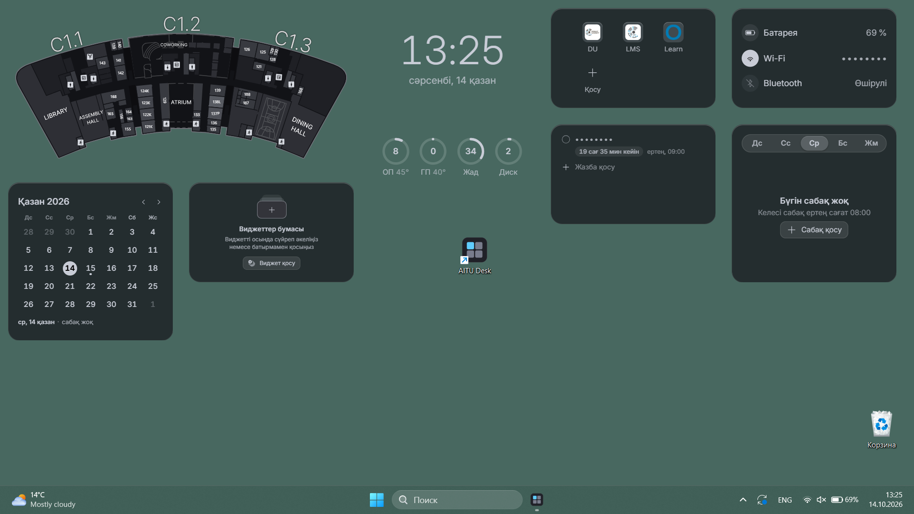
</p>

<p align="center">
<picture>
  <source media="(prefers-color-scheme: dark)" srcset="docs/screenshots/kk/map-dark.webp">
  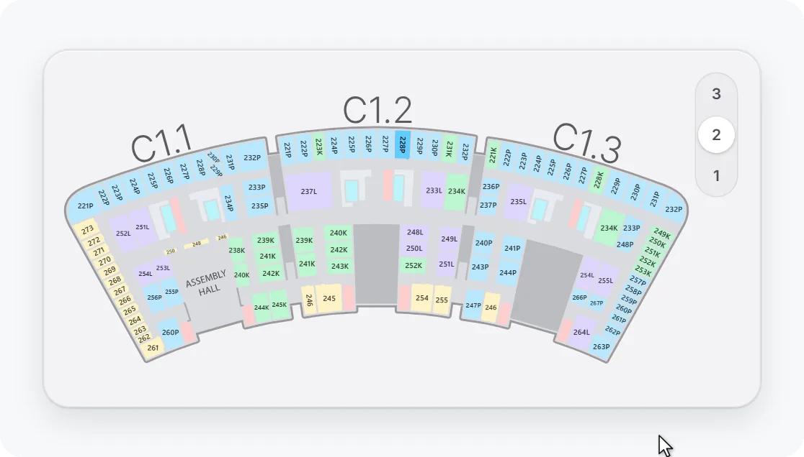
</picture>
  <br><sub>Карта дөңгелекпен меңзер тұрған жерде жақындайды, екі рет басқанда бүкіл қабат көрінеді</sub>
</p>

<p align="center">
<picture>
  <source media="(prefers-color-scheme: dark)" srcset="docs/screenshots/kk/calendar-dark.webp">
  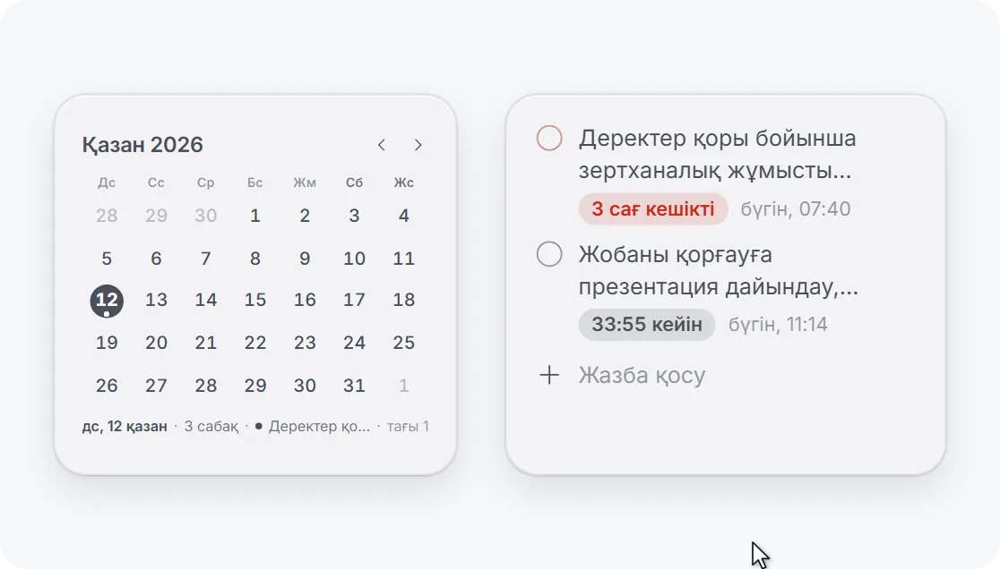
</picture>
  <br><sub>Күнтізбедегі күнді оң жақ батырмамен бассаңыз, сол күнге жазба немесе еске салғыш жасалады</sub>
</p>

<p align="center">
<picture>
  <source media="(prefers-color-scheme: dark)" srcset="docs/screenshots/kk/stack-dark.webp">
  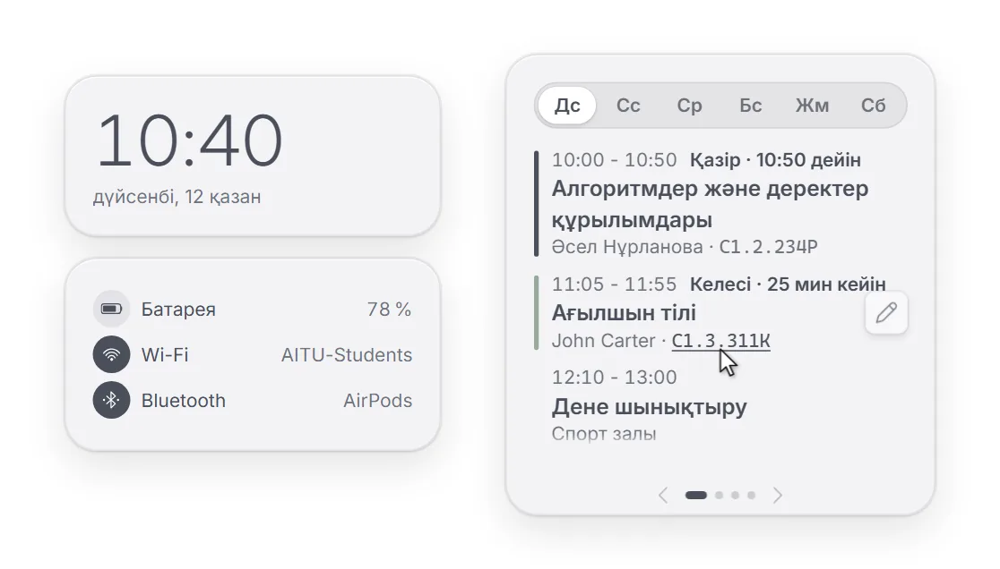
</picture>
  <br><sub>Бума тінтуірмен, дөңгелекпен, сенсорлық тақтадағы екі саусақпен және көрсеткілермен парақталады</sub>
</p>

<p align="center">
<picture>
  <source media="(prefers-color-scheme: dark)" srcset="docs/screenshots/kk/stack-in-dark.webp">
  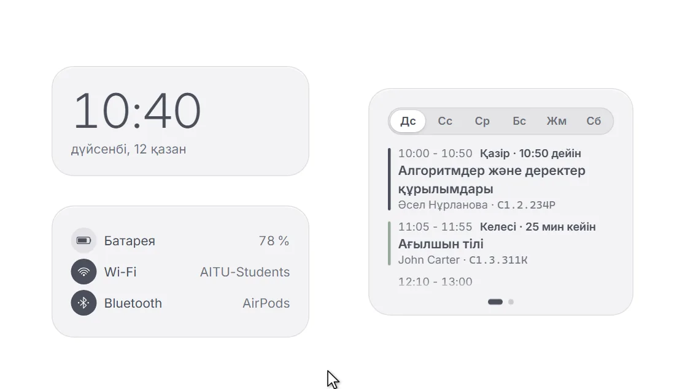
</picture>
  <br><sub>Кез келген виджет бумаға сүйреледі, ал бумалар бірнешеу болуы мүмкін</sub>
</p>

<p align="center">
<picture>
  <source media="(prefers-color-scheme: dark)" srcset="docs/screenshots/kk/fold-dark.webp">
  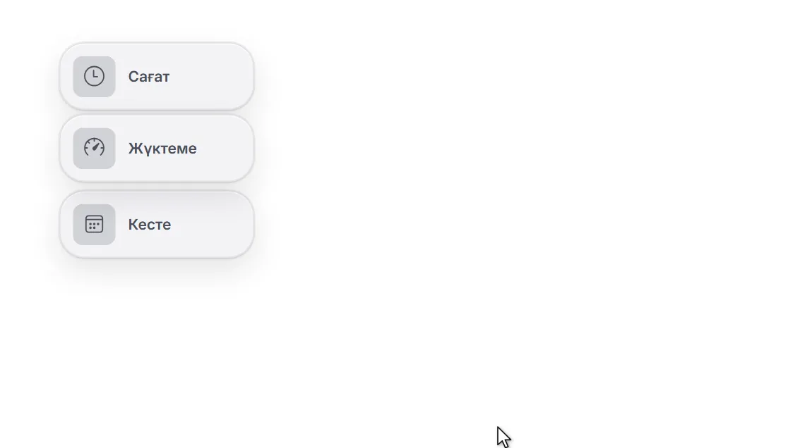
</picture>
  <br><sub>Кез келген виджет белгішеге жиылып, басқанда ашылады</sub>
</p>

<p align="center">
<picture>
  <source media="(prefers-color-scheme: dark)" srcset="docs/screenshots/kk/move-dark.webp">
  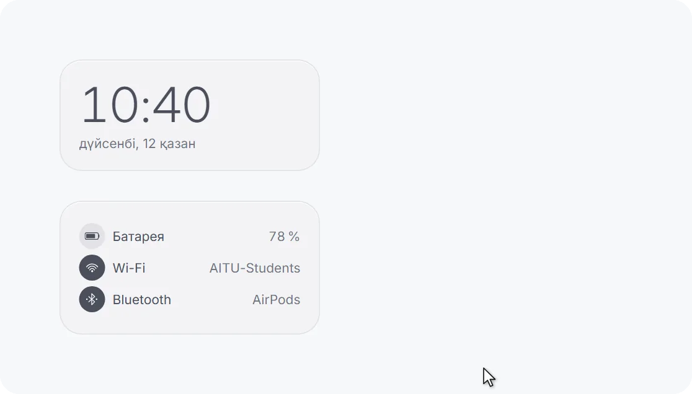
</picture>
  <br><sub>Виджет тінтуірмен жылжиды, торға тұрады және бұрышынан үлкейеді, ішіндегінің бәрі онымен бірге өседі</sub>
</p>

<p align="center">
<picture>
  <source media="(prefers-color-scheme: dark)" srcset="docs/screenshots/kk/scale-dark.webp">
  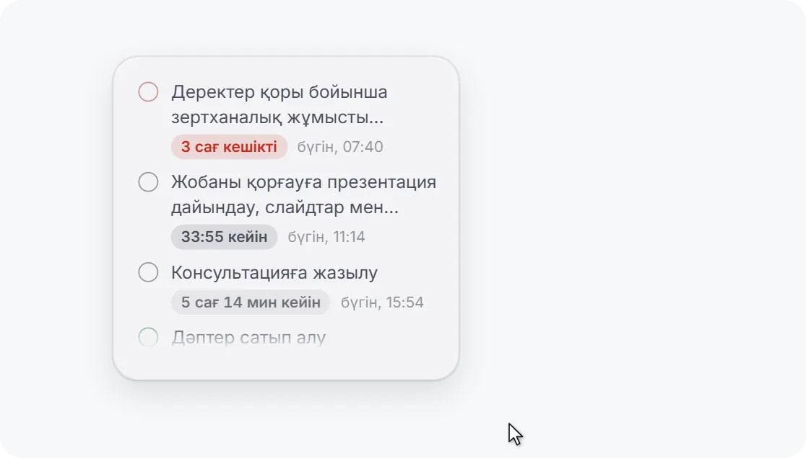
</picture>
  <br><sub>Мәтін өлшемі: виджеттің кез келген өлшемінде мәтін мен белгішелер кішірек не үлкенірек</sub>
</p>

<p align="center">
<picture>
  <source media="(prefers-color-scheme: dark)" srcset="docs/screenshots/kk/fade-dark.webp">
  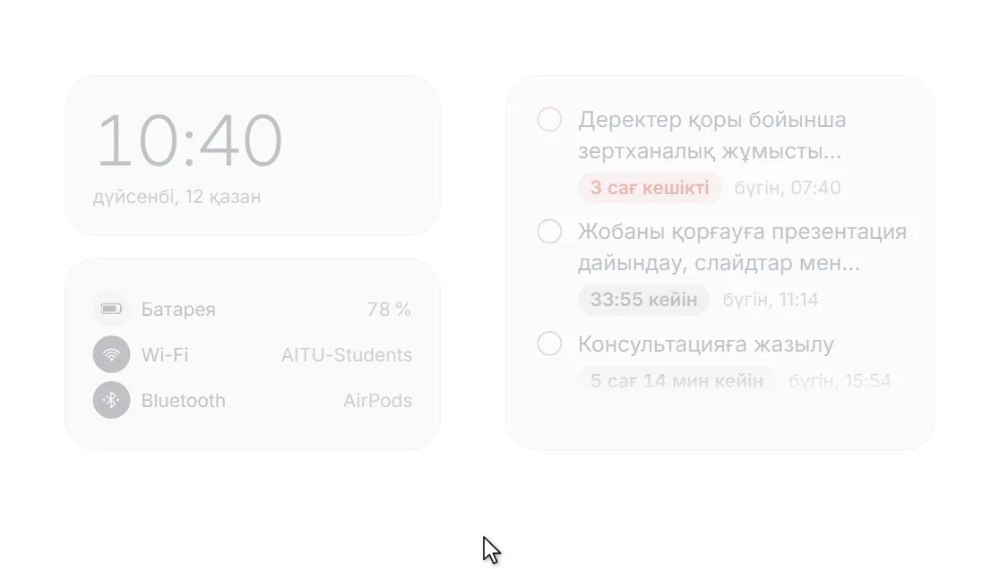
</picture>
  <br><sub>Меңзерді апарғанда айқындау: жартылай мөлдір виджет меңзердің астында айқындалады</sub>
</p>

## Не істей алады

<table>
<tr>
<td width="33%" valign="top"><br><b>Кесте</b><br>Қазіргі және келесі сабақ, қанша уақыт қалғаны</td>
<td width="33%" valign="top"><br><b>Жазбалар</b><br>Тірі кері санағы бар мерзімдер</td>
<td width="33%" valign="top"><br><b>Еске салғыштар</b><br>Сабақ пен мерзім алдында, тыныш сағаттар</td>
</tr>
<tr>
<td width="33%" valign="top"><br><b>Күнтізбе</b><br>Ай, жазбалардың мерзімдері және күннің сабақтары</td>
<td width="33%" valign="top"><br><b>AITU картасы</b><br>Барлық қабат және іздеу: 223 немесе C1.2.223</td>
<td width="33%" valign="top"><br><b>Сағат</b><br>Стильдер, қаріп, өлшем, секундтар мен күн</td>
</tr>
<tr>
<td width="33%" valign="top"><br><b>Жүйе</b><br>Заряд, Wi-Fi және Bluetooth, атаулары жасырылады</td>
<td width="33%" valign="top"><br><b>Жүктеме</b><br>Процессор, бейнекарта, жад және диск</td>
<td width="33%" valign="top"><br><b>Жарлықтар</b><br>DU, LMS, Learn және кез келген сайт</td>
</tr>
<tr>
<td width="33%" valign="top"><br><b>Өз виджеттеріңіз</b><br>Тұсқағаздағы сурет немесе GIF, 20-ға дейін</td>
<td width="33%" valign="top"><br><b>Виджеттер бумалары</b><br>Бірнеше бума, кез келген виджеттер</td>
<td width="33%" valign="top"><br><b>Орналасу</b><br>Белгішелер торы, терезе мен мәтін өлшемі</td>
</tr>
<tr>
<td width="33%" valign="top"><br><b>Өз фоныңыз</b><br>Бүкіл экранға түс немесе градиент</td>
<td width="33%" valign="top"><br><b>Айқындалу</b><br>Виджет меңзердің астында айқындалады</td>
<td width="33%" valign="top"><br><b>Құпиялылық</b><br>Мәтін нүктелердің артында, ештеңе жібермейді</td>
</tr>
<tr>
<td width="33%" valign="top"><br><b>Конфигтер</b><br>Барлық баптау бір файлда</td>
<td width="33%" valign="top"><br><b>Қателер журналы</b><br>Бір басумен ақау туралы есеп, жеке ештеңесіз</td>
<td width="33%" valign="top"><br><b>Үш тіл</b><br>Қазақша, орысша және ағылшынша</td>
</tr>
</table>

<p align="center">
<picture>
  <source media="(prefers-color-scheme: dark)" srcset="docs/screenshots/widgets-dark.webp">
  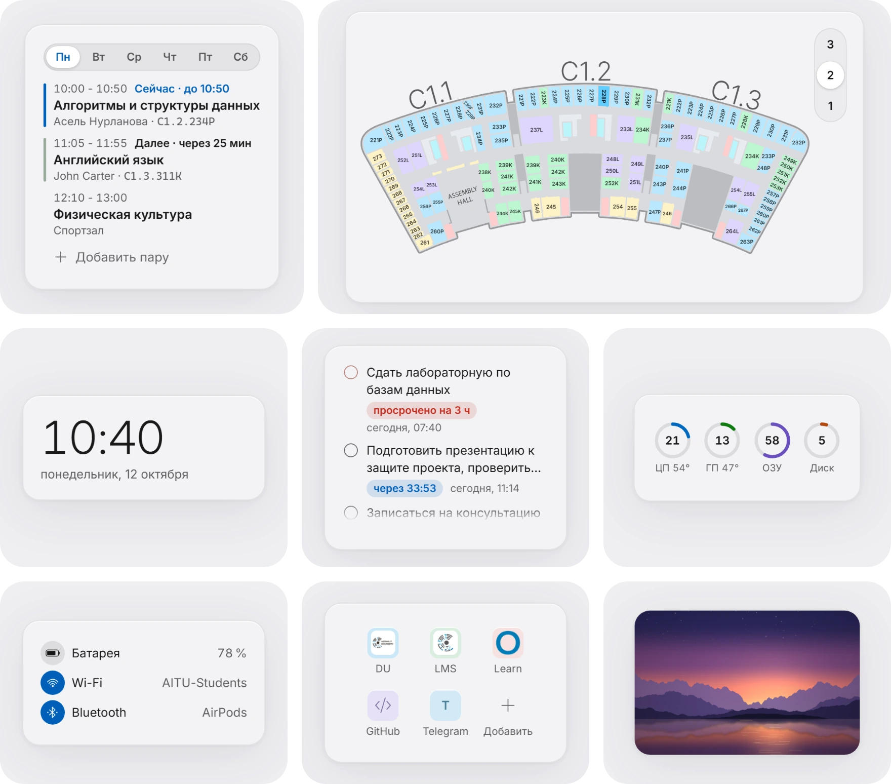
</picture>
</p>

## Өзіңізге қарай

<p align="center">
<picture>
  <source media="(prefers-color-scheme: dark)" srcset="docs/screenshots/looks-dark.webp">
  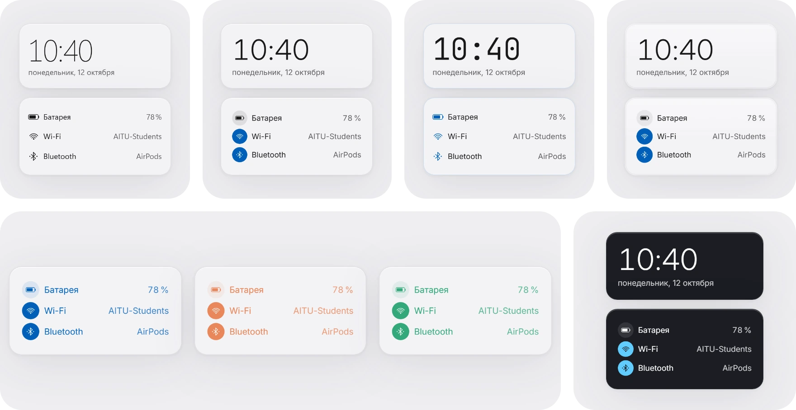
</picture>
  <br><sub>Windows 11, Aqua, Rice және Pearl · өз екпін түсіңіз, белгішелер мен мәтіннің кез келген түсі · өз фоныңыз: бүкіл экранға түс немесе градиент · ашықтан қараға дейінгі тақырыптар</sub>
</p>

## Орнату

1. [Соңғы релиз](https://github.com/cyberbara01/aitudesk/releases/latest) бетінен `AITU-Desk_<нұсқа>_x64-setup.exe` файлын жүктеп алып, іске қосыңыз.
2. Windows SmartScreen ескертуін көрсетсе, «Қосымша ақпарат» (More info), содан кейін «Бәрібір іске қосу» (Run anyway)
   батырмасын басыңыз. Ескерту қолданбаға ақылы сертификатпен қол қойылмағандықтан шығады.
3. Қысқа нұсқаулығы бар баптаулар терезесі ашылады, ал жұмыс үстелінде виджеттер пайда болады. Бұдан әрі олар
   Windows-пен бірге іске қосылады; мұны «Жалпы» бөлімінде өшіруге болады.

Windows 11, 64 бит керек. Интерфейс Windows-тағыдай қазақ, орыс немесе ағылшын тілінде болады; тіл «Жалпы» бөлімінде
немесе баптаулар терезесінің төменгі жағындағы «RU | KZ | EN» батырмасымен ауыстырылады.

<details>
<summary><b>Орнатқыштың түпнұсқа екенін тексеру</b></summary>
<br>

Релизде орнатқыштың жанында `SHA256SUMS.txt` файлы жатыр. Оны жүктелген файлдың хешімен PowerShell-де салыстырыңыз:

```powershell
Get-FileHash ".\AITU-Desk_1.0.0_x64-setup.exe" -Algorithm SHA256
```

GitHub файлды осы репозиторийден өзі жинағанын да растайды: дәл сол хеш
[жинақ растауларының](https://github.com/cyberbara01/aitudesk/attestations) бетінде бар. Бұл жазуды жинақ кезінде
GitHub Actions жасап, оған қол қояды, қолмен жүктелген файлда ол болмайды. [GitHub CLI](https://cli.github.com)
арқылы бұл бір ғана команда:

```powershell
gh attestation verify ".\AITU-Desk_1.0.0_x64-setup.exe" --repo cyberbara01/aitudesk
```

Жинақты осы репозиторийдің бастапқы кодынан [`.github/workflows/release.yml`](.github/workflows/release.yml) жасайды.
</details>

<details>
<summary><b>Орнатқыш не істейді және деректер қайда сақталады</b></summary>
<br>

| Не | Қайда |
| --- | --- |
| `aitudesk.exe` бағдарламасы және `uninstall.exe` жою бағдарламасы | `%LOCALAPPDATA%\AITU Desk\` |
| «Бастау» мәзіріндегі және, белгіні қалдырсаңыз, жұмыс үстеліндегі жарлық | «Бастау» мәзірі, жұмыс үстелі |
| «Орнатылған қолданбалардағы» жою жазуы | `HKCU\Software\Microsoft\Windows\CurrentVersion\Uninstall\AITU Desk` |
| Баптаулар, сабақтар, жазбалар, жарлықтар, виджеттердің орны (кәдімгі JSON) | `%APPDATA%\kz.edu.astanait.aitudesk\settings.json` |
| Өз виджеттеріңіздің суреттерінің көшірмелері | `%APPDATA%\kz.edu.astanait.aitudesk\widgets\` |
| WebView2 қызметтік кеші | `%LOCALAPPDATA%\kz.edu.astanait.aitudesk\EBWebView\` |
| Автоіске қосу (алғашқы іске қосудан бастап қосулы, ауыстырғышы «Жалпы» бөлімінде) | `HKCU\Software\Microsoft\Windows\CurrentVersion\Run` ішіндегі `AITU Desk` мәні |

Орнатқыш бұдан басқа ештеңе істемейді: ешқандай қызмет, драйвер, жоспарлағыш тапсырмасы, браузер кеңейтімі немесе
қосымша бағдарлама жоқ. WebView2 Windows 11-де бар; ол болмаған жағдайда ғана орнатқыш оны Microsoft сайтынан
жүктейді.

Баптаулар файлы Блокнотта ашылады. Өңдегеннен кейін ол оқылмай қалса, қолданба оны өшірмей,
`settings.broken-<уақыт>.json` деп қайта атайды.
</details>

<details>
<summary><b>Желі және құпиялылық</b></summary>
<br>

- Желі тек сіздің әрекетіңіз бойынша керек: жарлықты браузерде ашу немесе жарлықты қосқанда не өзгерткенде сайт
  белгішесін бір рет жүктеу (сайттың өзіне сұрау, ал онда белгіше болмаса, жергілікті атаулар сұралмайтын Google
  белгішелер қызметіне сұрау). DU, LMS және Learn белгішелері ішінде бар. Сайт бұл сұрауларды үй желіңіздегі
  құрылғыларға бағыттай алмайды.
- Жұмыс үстеліндегі кестені, жазбаларды, Wi-Fi желісінің атын және Bluetooth құрылғыларының аттарын нүктелермен
  жасыруға болады.
- Процессор температурасын Windows білетін жерде береді (негізінен ноутбуктерде). Көптеген үстел компьютерлерінде
  ол жоқ, ал қолданба бұл үшін драйвер орнатпайды: ол температураны сіз онсыз да іске қосатын бақылау
  бағдарламасынан (LibreHardwareMonitor, HWiNFO, Core Temp, MSI Afterburner немесе AIDA64) тек осы компьютерде алады.
- Конфигке тек сіз таңдаған бөліктер кіреді, ал жазбалар мен өз виджеттеріңіз әдепкі бойынша кірмейді. Біреудің
  конфигіндегі жарлықтар тек `http://` және `https://` мекенжайларымен, ал суреттер тек шынымен сурет болса ғана
  қабылданады.
</details>

<details>
<summary><b>Жою</b></summary>
<br>

Параметрлер → Қолданбалар → Орнатылған қолданбалар → AITU Desk → Жою. «Қолданба деректерін жою» белгісі баптауларды
да өшіреді; онсыз олар қайта орнату үшін сақталады. Жоймас бұрын бәрін «Конфигтер» бөлімінде конфигке сақтауға
болады. Жоймай-ақ қайта бастау үшін «Жалпы» бөлімінің төменгі жағындағы «Барлығын бастапқы күйге қайтару»
батырмасы қолданбаны орнатылған кездегідей етеді.
</details>

## Оған неге сенуге болады

- **Ашық код**, MIT лицензиясы: қолданбаның істейтін бәрі осы репозиторийде.
- **Ештеңе жібермейді**: телеметрия, жарнама, тіркелгі және автожаңарту жоқ.
- **Әкімші құқықтары керек емес**, тек сіздің тіркелгіңіз үшін орнатылады.
- **GitHub-та жиналады**: әр релиздің орнатқышын бастапқы кодтан GitHub Actions жинайды, жанында бақылау сомалары
  жатыр, ал GitHub жинақ растауына қол қояды.
- **Жеңіл**: орнатқыш шамамен 3 МБ, ал тыныш күйде қолданба процессорды дерлік жүктемейді.

**Құпиялылық.** AITU Desk желіге тек өзіңіз сұрағанда шығады: жарлықты ашу немесе сайт белгішесін жүктеу.
Сабақтар, жазбалар мен баптаулар компьютеріңізде қалады. Толығырақ [«Орнату»](#орнату) бөліміндегі «Желі және
құпиялылық» тармағында.

## Сұрақтар

<details>
<summary><b>Windows SmartScreen ескерту көрсетеді. Бұл қауіпті ме?</b></summary>
<br>

Жоқ. Windows ақылы цифрлық қолтаңбасы жоқ кез келген бағдарламаны осылай қарсы алады. «Қосымша ақпарат», содан кейін
«Бәрібір іске қосу» батырмасын басыңыз. Орнатқышты GitHub осы репозиторийдің ашық кодынан жинайды, ал файлды жоғарыдағы
«Орнатқыштың түпнұсқа екенін тексеру» бөлімі бойынша тексеруге болады.
</details>

<details>
<summary><b>Мен AITU-да оқымаймын. Маған пайдасы бар ма?</b></summary>
<br>

Иә. Сағат, жүктеме, жазбалар, кесте, жарлықтар мен өз суреттеріңіз кез келген адамға керек. Картаны және
университет жарлықтарын баптаулардан өшіруге болады.
</details>

<details>
<summary><b>Компьютер баяуламай ма, батарея тез отырмай ма?</b></summary>
<br>

Жоқ. Тыныш күйде AITU Desk процессорды дерлік жүктемейді. Ойын немесе фильм толық экранда ашық тұрғанда жүктеме
оқылмайды және GIF тоқтайды, ал батареяны үнемдеу режимінде бәрі сирек жаңарады.
</details>

<details>
<summary><b>Windows 10-да жұмыс істей ме?</b></summary>
<br>

Жоқ, Windows 11, 64 бит керек. Виджеттердің дөңгеленген бұрыштары, шынысы мен мөлдірлігі тек Windows 11-де бар.
</details>

<details>
<summary><b>Бағдарлама қатып қалды немесе өздігінен жабылды. Не істеу керек?</b></summary>
<br>

AITU Desk-ті қайта ашыңыз. «Бағдарлама туралы» бөлімінде «Журнал жүргізу» параметрін қосыңыз, ал ақау қайталанғанда
«Есепті сақтау» батырмасын басып, файлды Telegram-да [@capybara205](https://t.me/capybara205)-ке жіберіңіз. Журналда
тек қолданбада болған нәрсе бар: не қосулы, не басылды және қателер. Жазбалар мен сабақтардың мәтіні, жарлықтардың
мекенжайлары, желілер мен құрылғылардың атаулары оған кірмейді, ал файл ешқайда өздігінен жіберілмейді.
</details>

<details>
<summary><b>Баптауларды қалай ашуға немесе виджеттерді қалай қайтаруға болады?</b></summary>
<br>

Трейдегі AITU Desk белгішесін басыңыз немесе бағдарламаны «Бастау» мәзірінен қайта іске қосыңыз: баптаулар терезесі
ашылады. «Виджеттер» бөлімінде әр виджет бөлек қосылып, өшіріледі.
</details>

## Сілтемелер

| Не | Қайда |
| --- | --- |
| Жүктеу | [Соңғы релиз](https://github.com/cyberbara01/aitudesk/releases/latest) |
| Қате немесе идея | [Issues](https://github.com/cyberbara01/aitudesk/issues), Telegram [@capybara205](https://t.me/capybara205) немесе [анонимді пішін](https://forms.gle/LV7BYCqeveRyRm9YA) |
| Қолданбаны бағалау | [Сол пішін](https://forms.gle/LV7BYCqeveRyRm9YA): деректеріңіз қажет емес, ал пікіріңізсіз бағдарлама дамымайды |
| Автор | [@cyberbara01](https://github.com/cyberbara01) |
| AITU картасы | [aitumap](https://github.com/Yuujiso/aitumap), авторы [Yuujiso](https://github.com/Yuujiso) |
| Үшінші тарап құрамдастары | [THIRD-PARTY-NOTICES.md](THIRD-PARTY-NOTICES.md) |

<details>
<summary><b>Бастапқы кодтан жинау</b></summary>
<br>

Node.js 22+, Rust (stable) және [Tauri нұсқаулығы](https://tauri.app/start/prerequisites/) бойынша Microsoft C++
Build Tools (немесе `x86_64-pc-windows-gnu` мақсаты үшін mingw-w64) керек.

```bash
npm install
npm run tauri dev      # әзірлеу режимінде іске қосу
npm run tauri build    # орнатқыш src-tauri/target/release/bundle/nsis/ ішінде пайда болады
```

Ноутбуксыз тексеру үшін орта айнымалылары бар: `AITUDESK_MOCK_POWER` (`none` | `78` | `15,charging` |
`40,saver`), `AITUDESK_MOCK_WIFI` (`off` | `SSID,bars` | `hidden,bars`), `AITUDESK_MOCK_BT` (`off` | `none` |
`A;B;C`).

Ішінде: Tauri 2, Rust, React 18, TypeScript және Vite. Барлық виджет бір WebView2 процесінде жұмыс істейді, секундтар
көрсетілмесе сағат минутына бір рет оянады, ал жасырулы және белгішеге жиылған виджеттер таймер ұстамайды.
Бағдарлама толық экранда ашық тұрғанда жүктеме оқылмайды және GIF тоқтайды. Windows-тың үнемдеу режимінде сағат
секундтарды жасырады, заряд, желі мен жүктеме сирек тексеріледі, ал GIF тоқтайды. «Мөлдірліксіз» мөлдірлік
таңдалғанда виджеттер акрилді алып тастайды, бейнекартаға жеңілірек.

[](https://tauri.app)
[](https://www.rust-lang.org)
[](https://react.dev)
</details>

## Лицензия

[MIT](LICENSE): авторының атын сақтай отырып, пайдаланыңыз, өзгертіңіз және бөлісіңіз. Үшінші тарап құрамдастары
(карта, белгішелер, қаріптер) [THIRD-PARTY-NOTICES.md](THIRD-PARTY-NOTICES.md) файлында көрсетілген.
