<div align="center">


# AITU Desk

**Widgets for the Windows 11 desktop, made for students of Astana IT University.**

A clock, battery and network, computer load, shortcuts, notes with deadlines, the class schedule, the AITU map<br>and your own pictures lie right on the wallpaper.

[](https://github.com/cyberbara01/aitudesk/releases/latest)
[](#installation)
[](README.ru.md)
[](LICENSE)
[](#why-you-can-trust-it)
[](#installation)

<a href="https://github.com/cyberbara01/aitudesk/releases/latest"></a>

**English** · [Русский](README.ru.md)

</div>

<p align="center">
  
  <br><sub>The map, the clock and the load at the top, the schedule, notes, system and shortcuts around them.</sub>
</p>

## What's on the desktop

<table>
<tr>
<td width="50%" valign="top"><br><b>Clock</b><br>Ready-made looks and fine-tuning: font, weight, size, seconds, the date and its place, any color</td>
<td width="50%" valign="top"><br><b>System</b><br>Battery charge, Wi-Fi and Bluetooth; network and device names can hide behind dots</td>
</tr>
<tr>
<td width="50%" valign="top"><br><b>Performance</b><br>Processor, graphics, memory and disk with their temperatures: rings, bars, numbers or a line</td>
<td width="50%" valign="top"><br><b>Shortcuts</b><br>DU, LMS and Learn with their real icons, and any site of yours: just type youtube.com</td>
</tr>
<tr>
<td width="50%" valign="top"><br><b>Notes</b><br>Deadlines with a live countdown, added and edited right on the widget, dragged into your own order</td>
<td width="50%" valign="top"><br><b>Schedule</b><br>Classes by weekday, the current and the next one lit; a click on a room shows it on the map</td>
</tr>
<tr>
<td width="50%" valign="top"><br><b>Reminders</b><br>Windows notifications before a class and a deadline, with quiet hours</td>
<td width="50%" valign="top"><br><b>AITU map</b><br>Every floor, room search, your marked rooms, six schemes, see-through until you point at it, zoom with the wheel or two fingers</td>
</tr>
<tr>
<td width="50%" valign="top"><br><b>Your widgets</b><br>Your own picture or GIF on the desktop, up to 20 of them</td>
<td width="50%" valign="top"><br><b>Designs</b><br>Windows 11, Aqua, Rice and Pearl, five themes and glass, every part of a design chosen on its own</td>
</tr>
<tr>
<td width="50%" valign="top"><br><b>Colors</b><br>Your accent, and any color for the icons and the text: for all widgets or just one</td>
<td width="50%" valign="top"><br><b>Layout</b><br>Drag, resize, snap to the grid of the desktop icons, round the corners, fold a widget into an icon</td>
</tr>
<tr>
<td width="50%" valign="top"><br><b>Privacy</b><br>Text on the desktop can hide behind dots, like a password; the app sends nothing anywhere</td>
<td width="50%" valign="top"><br><b>Configs</b><br>All your settings in one file: for another computer or a friend</td>
</tr>
</table>

Everything is set up in one window, in English or Russian. Not at AITU? Everything but the map is useful to anyone, and the map and the university's shortcuts turn off.

## How it works

<table>
<tr>
<td width="33%" valign="top" align="center"><br><b>Right on the wallpaper</b><br><sub>The map at the top left, the clock and the load in the middle, the rest on the right. Move and resize them as you like</sub></td>
<td width="33%" valign="top" align="center">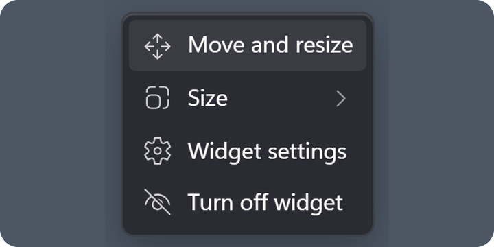<br><b>Right-click a widget</b><br><sub>Move it, resize it (everything inside grows with it), round its corners, fold it into an icon, open its settings</sub></td>
<td width="33%" valign="top" align="center">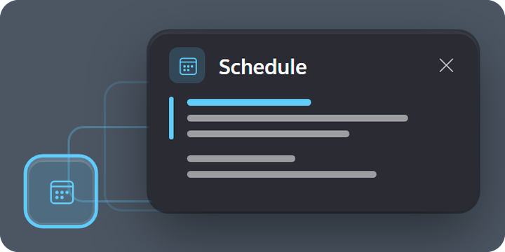<br><b>An icon that grows</b><br><sub>A small or medium widget is an icon; a click grows it into a card in the middle of the screen</sub></td>
</tr>
<tr>
<td width="33%" valign="top" align="center">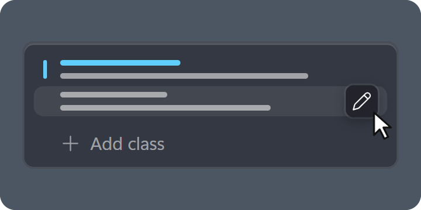<br><b>Add and edit on the spot</b><br><sub>A “+” at the end of the schedule and the notes, a pencil on the row under the pointer</sub></td>
<td width="33%" valign="top" align="center">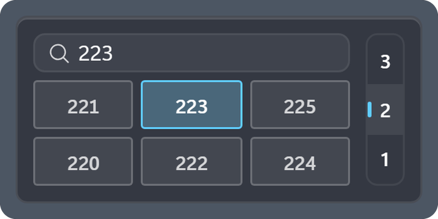<br><b>The AITU map</b><br><sub>Find a room (223 or C1.2.223), switch floors, paint your rooms; it can stay see-through until you point at it</sub></td>
<td width="33%" valign="top" align="center">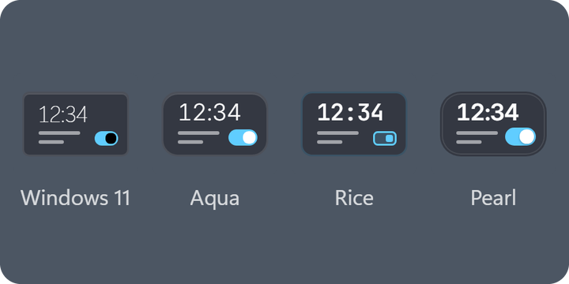<br><b>Four designs</b><br><sub>Windows 11, Aqua, Rice and Pearl, with five themes, your accent and any color for the icons and the text</sub></td>
</tr>
</table>

## The little things

<table>
<tr>
<td width="50%" valign="top"><b>A tray icon</b><br>A click on it opens the settings, and a right-click offers “Settings” and “Quit”.</td>
<td width="50%" valign="top"><b>A live countdown</b><br>In the last hour before a deadline the note counts the seconds.</td>
</tr>
<tr>
<td width="50%" valign="top"><b>From schedule to map</b><br>A click on the room of a class finds it on the map.</td>
<td width="50%" valign="top"><b>Rests when unseen</b><br>While a program fills the screen, or a widget is an icon, nothing is read or redrawn.</td>
</tr>
<tr>
<td width="50%" valign="top"><b>Easy on the battery</b><br>In Windows battery saver the clock hides its seconds and readings come less often.</td>
<td width="50%" valign="top"><b>Safe with your data</b><br>A settings file that stops being readable is set aside, never overwritten.</td>
</tr>
<tr>
<td width="50%" valign="top"><b>Touchpad ready</b><br>Pinch with two fingers to zoom the map, drag to move it.</td>
<td width="50%" valign="top"><b>Light</b><br>About 3 MB, no admin rights, installed for your account only.</td>
</tr>
</table>

## Settings

One window for everything: every option has a hint, and the widgets change the moment you change it.

<p align="center">
  <picture><source media="(prefers-color-scheme: dark)" srcset="docs/screenshots/en/board-settings-dark.webp">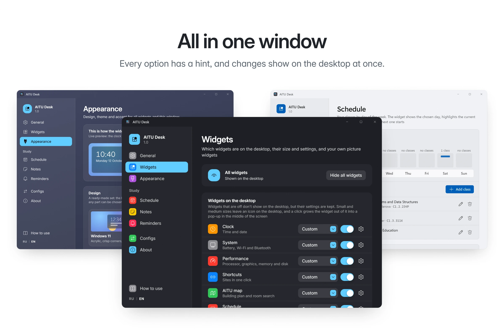</picture>
</p>

<details>
<summary><b>Every page of the settings</b></summary>
<br>

<table>
<tr>
<td width="50%" valign="top" align="center"><picture><source media="(prefers-color-scheme: dark)" srcset="docs/screenshots/en/settings-widgets-dark.webp">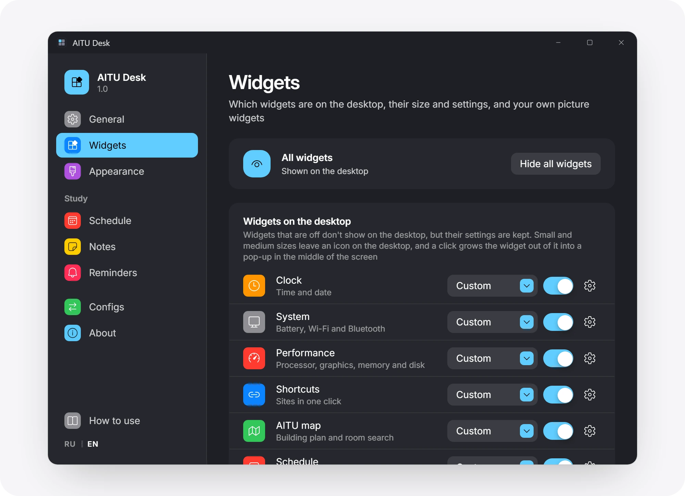</picture><br><sub>Widgets: which ones are on the desktop, their size, and your own picture widgets</sub></td>
<td width="50%" valign="top" align="center"><picture><source media="(prefers-color-scheme: dark)" srcset="docs/screenshots/en/settings-general-dark.webp">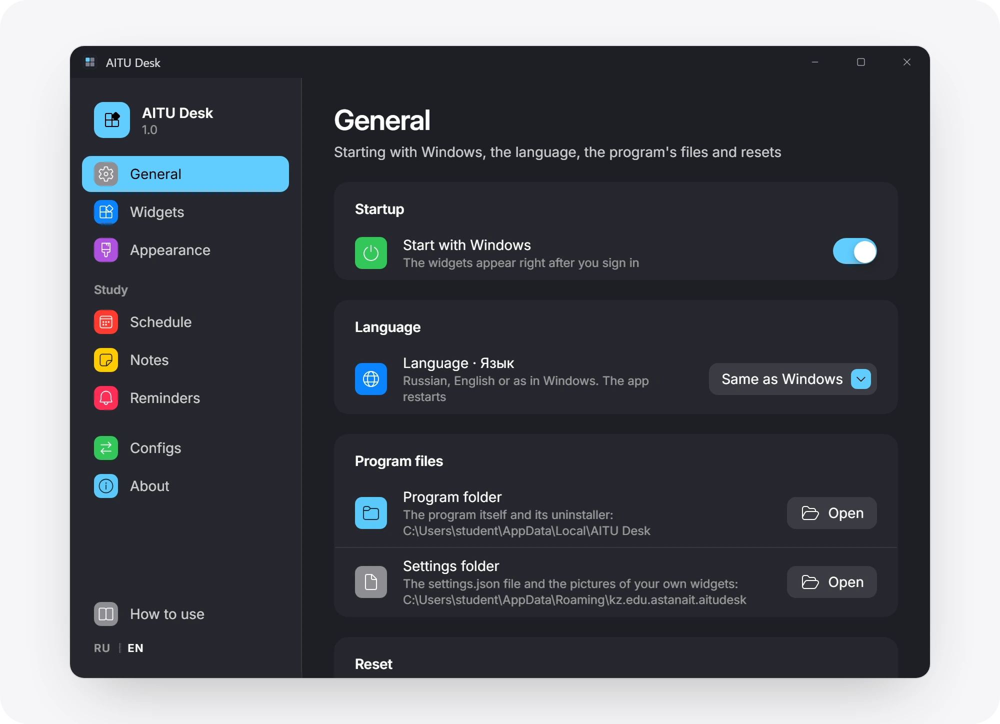</picture><br><sub>General: start with Windows, language, the program's files, resets</sub></td>
</tr>
<tr>
<td width="50%" valign="top" align="center"><picture><source media="(prefers-color-scheme: dark)" srcset="docs/screenshots/en/settings-appearance-dark.webp">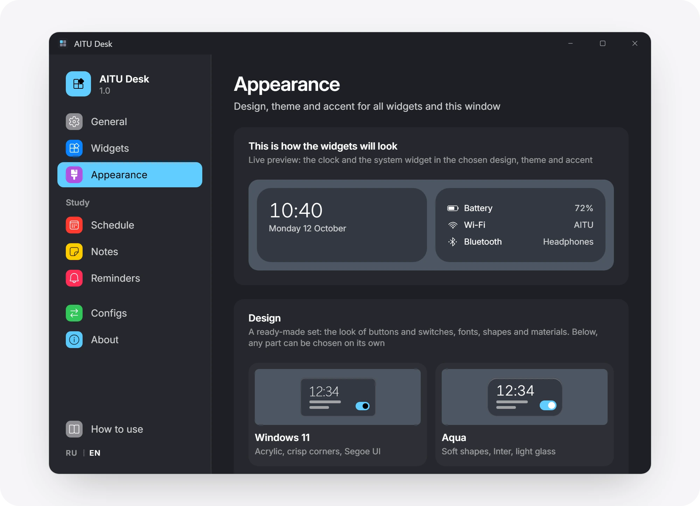</picture><br><sub>Appearance: a design, with its parts chosen separately</sub></td>
<td width="50%" valign="top" align="center"><picture><source media="(prefers-color-scheme: dark)" srcset="docs/screenshots/en/settings-perf-dark.webp">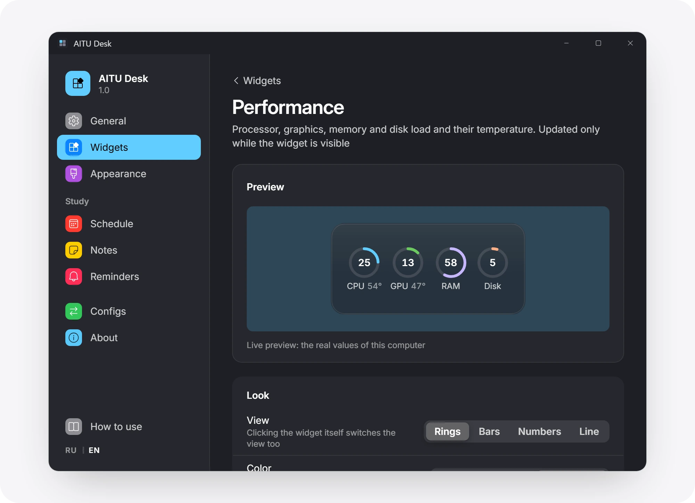</picture><br><sub>Performance: processor, graphics, memory and disk</sub></td>
</tr>
<tr>
<td width="50%" valign="top" align="center"><picture><source media="(prefers-color-scheme: dark)" srcset="docs/screenshots/en/settings-notes-dark.webp">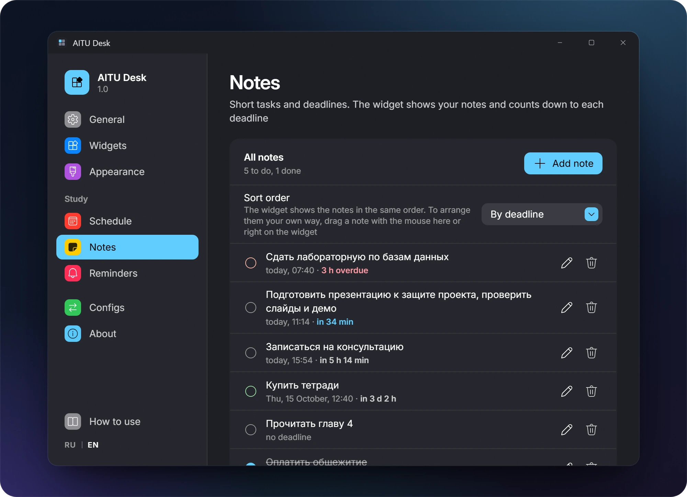</picture><br><sub>Notes with deadlines, in your own order</sub></td>
<td width="50%" valign="top" align="center"><picture><source media="(prefers-color-scheme: dark)" srcset="docs/screenshots/en/settings-own-widget-dark.webp">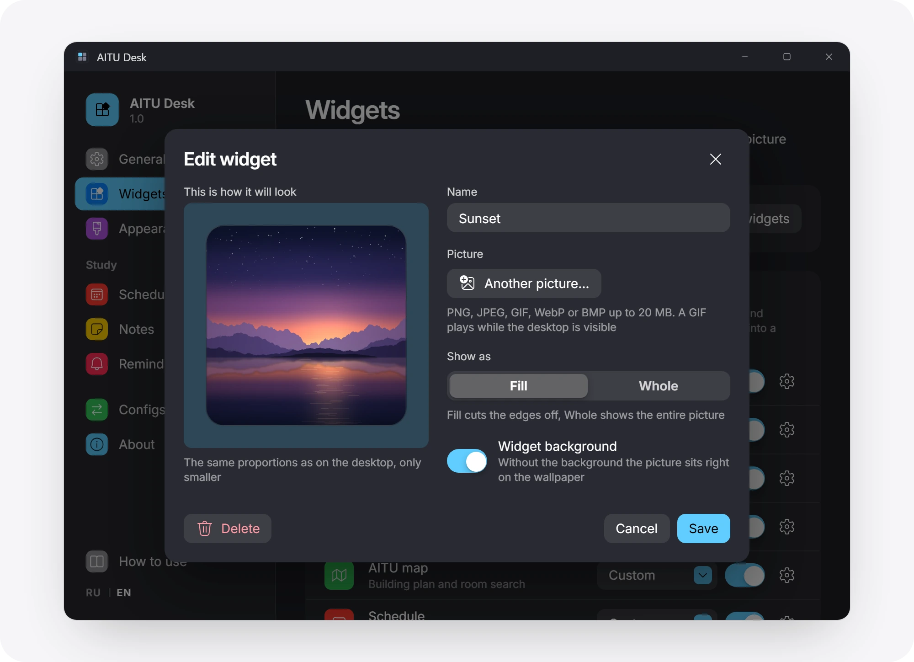</picture><br><sub>Your own widget with a live preview</sub></td>
</tr>
<tr>
<td width="50%" valign="top" align="center"><picture><source media="(prefers-color-scheme: dark)" srcset="docs/screenshots/en/settings-reminders-dark.webp">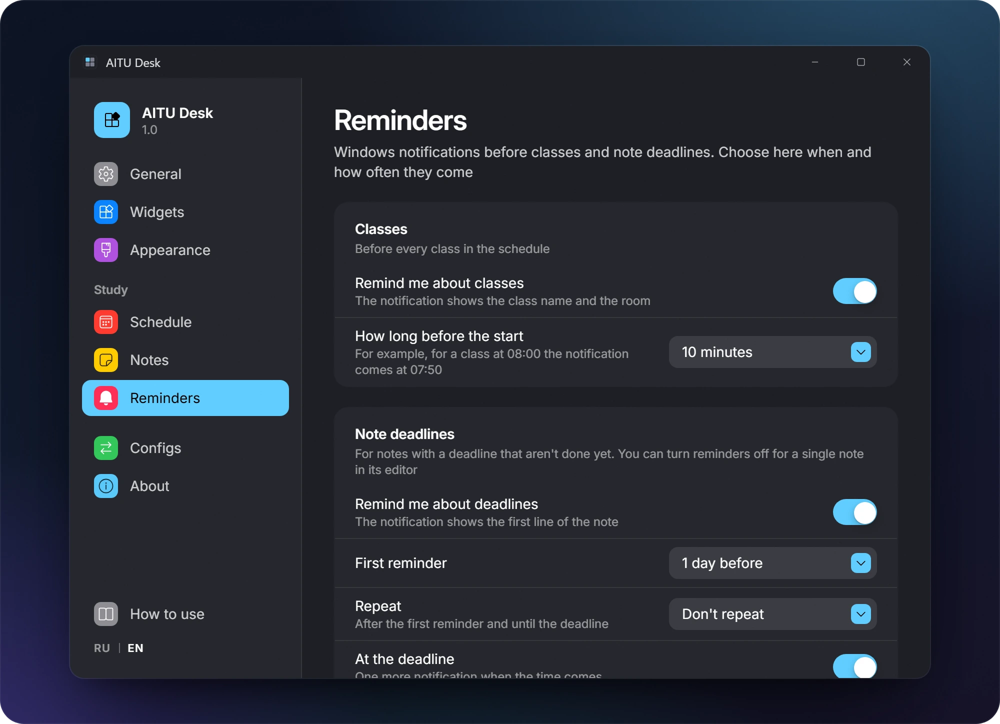</picture><br><sub>Reminders about classes and deadlines</sub></td>
<td width="50%" valign="top" align="center"><picture><source media="(prefers-color-scheme: dark)" srcset="docs/screenshots/en/settings-configs-dark.webp">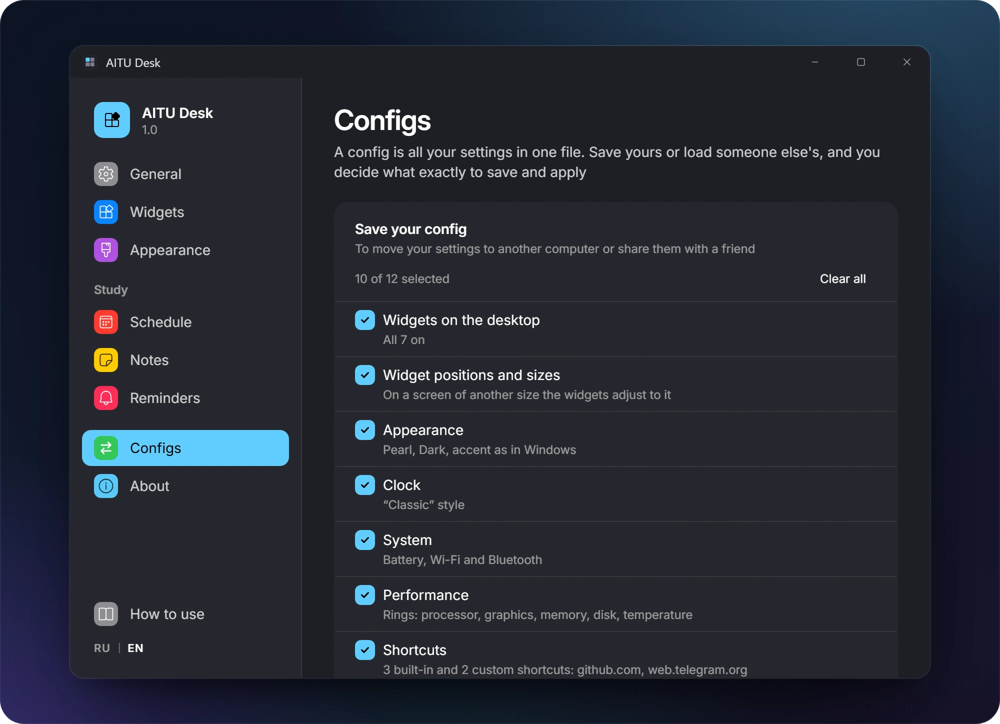</picture><br><sub>Configs: settings in a file</sub></td>
</tr>
</table>
</details>

## Installation

1. Download `AITU-Desk_<version>_x64-setup.exe` from the [latest release](https://github.com/cyberbara01/aitudesk/releases/latest) and run it.
2. If Windows shows “Windows protected your PC”, click “More info”, then “Run anyway”. The warning appears because
   the app is not signed with a paid certificate.
3. The settings window opens with a short guide, and the widgets appear on the desktop. They start with Windows from
   then on; this can be turned off in “General”.

Windows 11, 64-bit, is required. The interface is in English or Russian, following Windows; switch it in “General” or
with the “RU | EN” button at the bottom of the settings window.

<details>
<summary><b>Check that the installer is genuine</b></summary>
<br>

Next to the installer, the release has `SHA256SUMS.txt`. Compare it with the hash of the downloaded file in
PowerShell:

```powershell
Get-FileHash ".\AITU-Desk_1.0.0_x64-setup.exe" -Algorithm SHA256
```

The build is made by [`.github/workflows/release.yml`](.github/workflows/release.yml) from the source of this
repository.
</details>

<details>
<summary><b>What the installer does and where your data lives</b></summary>
<br>

| What | Where |
| --- | --- |
| The program `aitudesk.exe` and the uninstaller `uninstall.exe` | `%LOCALAPPDATA%\AITU Desk\` |
| A Start menu shortcut and, if you leave the box checked, a desktop shortcut | Start menu, desktop |
| The entry for uninstalling in “Installed apps” | `HKCU\Software\Microsoft\Windows\CurrentVersion\Uninstall\AITU Desk` |
| Settings, classes, notes, shortcuts, widget layout (plain JSON) | `%APPDATA%\kz.edu.astanait.aitudesk\settings.json` |
| Copies of the pictures of your widgets | `%APPDATA%\kz.edu.astanait.aitudesk\widgets\` |
| The WebView2 service cache | `%LOCALAPPDATA%\kz.edu.astanait.aitudesk\EBWebView\` |
| Autostart (on from the first start, a switch in “General”) | the `AITU Desk` value in `HKCU\Software\Microsoft\Windows\CurrentVersion\Run` |

The installer does nothing else: no services, drivers, scheduled tasks, browser extensions or bundled programs.
WebView2 is already part of Windows 11; only if it is missing does the installer download it from Microsoft.

The settings file opens in Notepad. If it stops being readable after an edit, the app does not erase it but renames
it to `settings.broken-<time>.json`.
</details>

<details>
<summary><b>Network and privacy</b></summary>
<br>

- The network is used only when you act: to open a shortcut in your browser, or to download a site's icon once when
  you add or change a shortcut (a request to the site itself and, if it has no icon, to Google's icon service, which
  is never asked about local names). The DU, LMS and Learn icons are built in. A site cannot send these requests on
  to devices in your home network.
- The schedule, notes, the Wi-Fi network name and Bluetooth device names on the desktop can be hidden behind dots.
- The processor temperature comes from Windows where it gives one (laptops, mostly). On most desktop PCs Windows does
  not, and the app installs no driver for it: it reads the temperature from a monitoring program you run anyway
  (LibreHardwareMonitor, HWiNFO, Core Temp, MSI Afterburner or AIDA64), on this computer only.
- A config holds only the parts you choose, and notes and your own widgets are left out by default. Shortcuts from
  someone else's config are accepted only with `http://` and `https://` addresses, and pictures only when they really
  are pictures.
</details>

<details>
<summary><b>Uninstalling</b></summary>
<br>

Settings → Apps → Installed apps → AITU Desk → Uninstall. The “Delete the application data” box erases the settings too;
without it they stay in case you install again. Before uninstalling you can save everything to a config in
“Configs”. To start over without uninstalling, “Reset everything” at the bottom of “General” makes the app as it was
right after installing.
</details>

## Why you can trust it

- **Open source** under the MIT license: everything the app does is in this repository.
- **Sends nothing**: no telemetry, ads, accounts or auto-updates.
- **Needs no admin rights** and installs for your account only.
- **Built on GitHub**: GitHub Actions builds the installer of every release from the source, with checksums next
  to it.
- **Light**: the installer is about 3 MB, and when idle the app barely touches the processor.

**Privacy.** AITU Desk goes online only when you ask it to: to open a shortcut or to fetch a site's icon. Your
classes, notes and settings stay on your computer. The details are under “Network and privacy” in
[Installation](#installation).

## Links

| What | Where |
| --- | --- |
| Download | [The latest release](https://github.com/cyberbara01/aitudesk/releases/latest) |
| A bug or an idea | [Issues](https://github.com/cyberbara01/aitudesk/issues), Telegram [@capybara205](https://t.me/capybara205) or the [anonymous form](https://forms.gle/LV7BYCqeveRyRm9YA) |
| Rate the app | [The same form](https://forms.gle/LV7BYCqeveRyRm9YA): we don't need your data, and without your feedback the app can't grow |
| Author | [@cyberbara01](https://github.com/cyberbara01) |
| The AITU map | [aitumap](https://github.com/Yuujiso/aitumap) by [Yuujiso](https://github.com/Yuujiso) |
| Third-party components | [THIRD-PARTY-NOTICES.md](THIRD-PARTY-NOTICES.md) |

<details>
<summary><b>Building from source</b></summary>
<br>

You need Node.js 22+, Rust (stable) and, following the [Tauri guide](https://tauri.app/start/prerequisites/),
Microsoft C++ Build Tools (or mingw-w64 for the `x86_64-pc-windows-gnu` target).

```bash
npm install
npm run tauri dev      # run in development mode
npm run tauri build    # the installer lands in src-tauri/target/release/bundle/nsis/
```

For testing without a laptop there are environment variables: `AITUDESK_MOCK_POWER` (`none` | `78` |
`15,charging` | `40,saver`), `AITUDESK_MOCK_WIFI` (`off` | `SSID,bars` | `hidden,bars`), `AITUDESK_MOCK_BT`
(`off` | `none` | `A;B;C`).

Inside: Tauri 2, Rust, React 18, TypeScript and Vite. All widgets run in one WebView2 process, the clock wakes up
once a minute when seconds are not shown, and hidden widgets and widgets folded into an icon keep no timers. While
a program fills the screen, the load is not read and GIFs stand still. In Windows battery saver the clock hides its
seconds, charge, network and load are checked less often, and GIFs stand still. With transparency set to none the
widgets drop their acrylic, which spares the graphics card.

[](https://tauri.app)
[](https://www.rust-lang.org)
[](https://react.dev)
</details>

## License

[MIT](LICENSE): use it, change it and share it, keeping the author's name. Third-party components (the map, icons,
fonts) are listed in [THIRD-PARTY-NOTICES.md](THIRD-PARTY-NOTICES.md).
