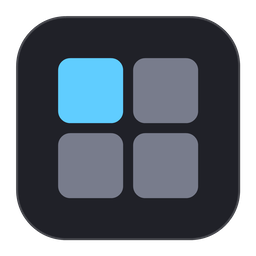
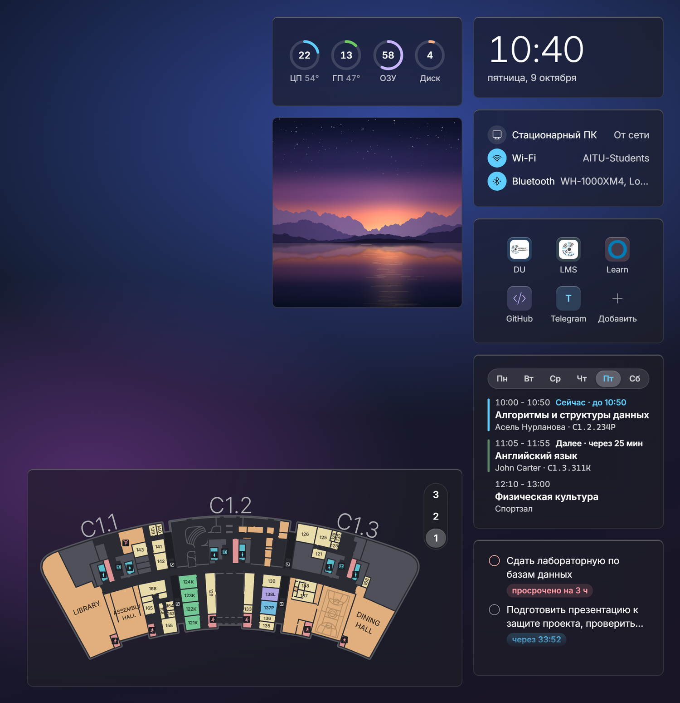
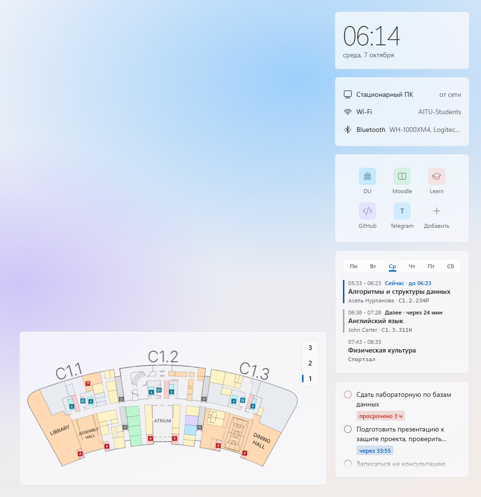
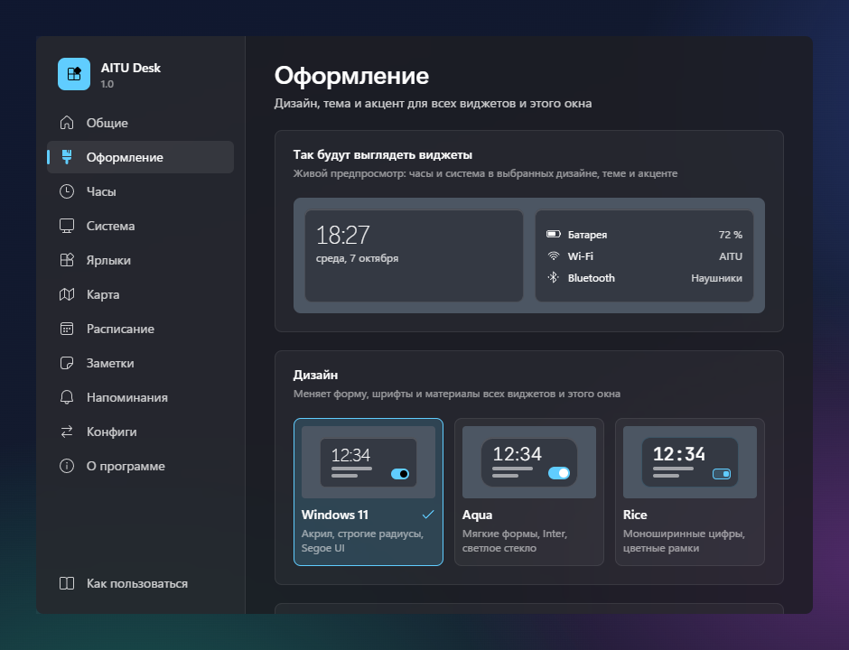
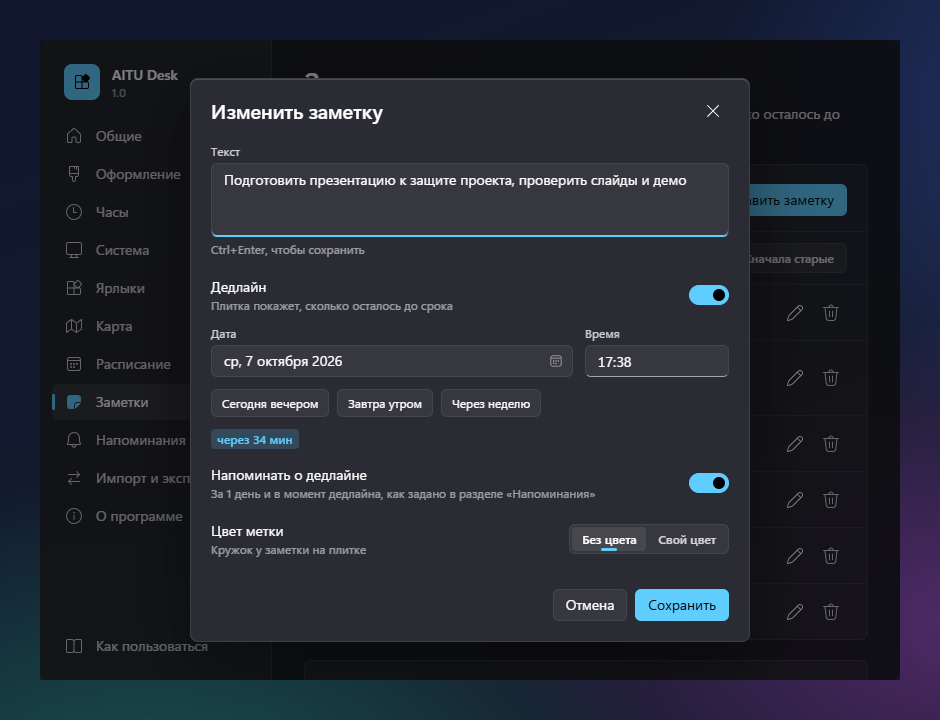
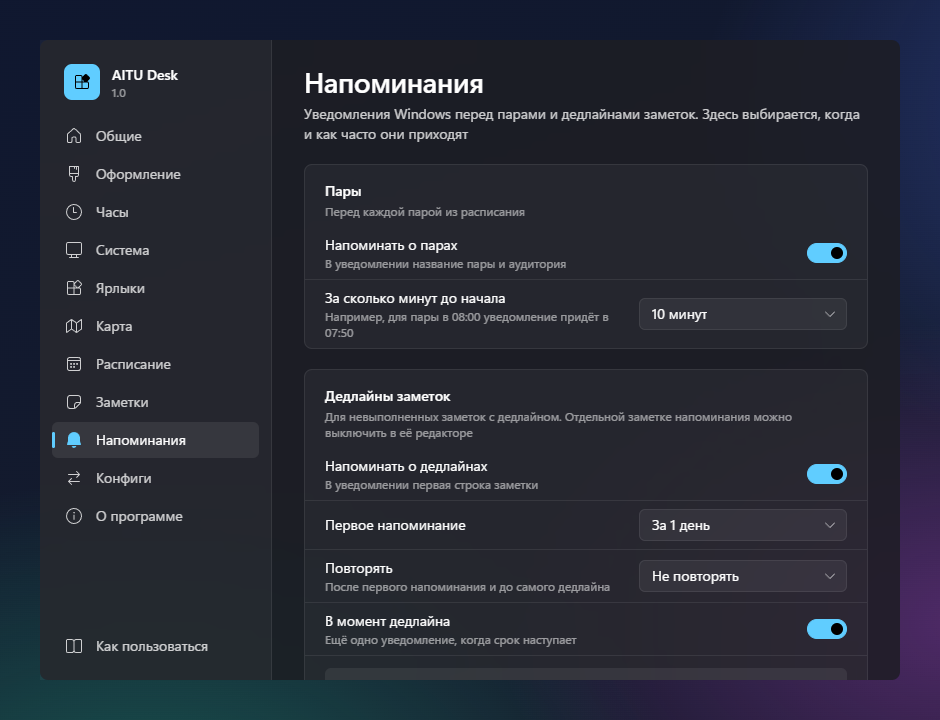
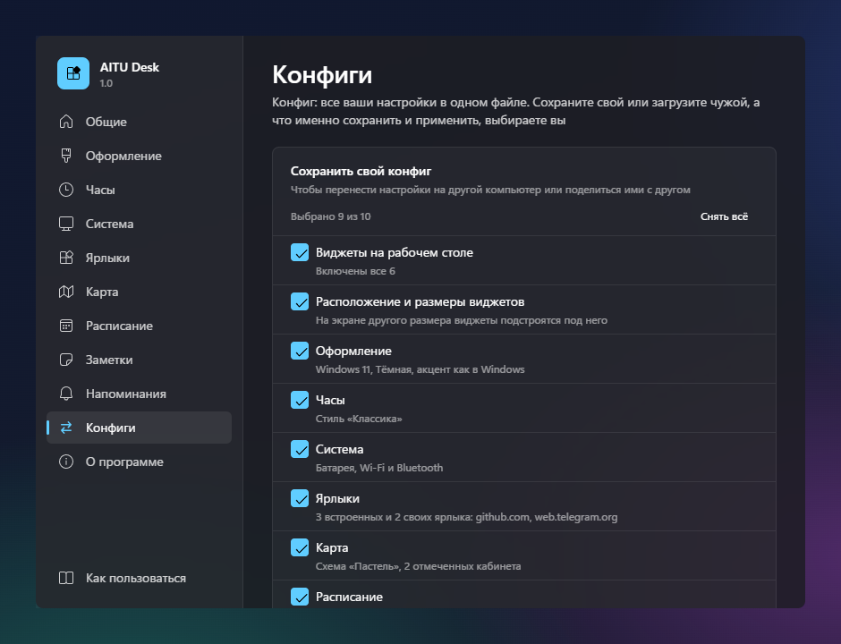

<div align="center">



# AITU Desk

**Виджеты на рабочий стол Windows 11: часы, заряд и сеть, ярлыки, заметки с дедлайнами, расписание пар и карта
Astana IT University.** Лежат прямо на обоях, под окнами, не мешают работать и не пропадают от Win+D.

[](https://github.com/cyberbara01/aitudesk/releases/latest)

[](https://github.com/cyberbara01/aitudesk/releases/latest)
[](#установка)
[](#in-english)
[](LICENSE)
[](#почему-ему-можно-доверять)
[](#установка)
<br>
[](https://tauri.app)
[](https://www.rust-lang.org)
[](https://react.dev)



</div>

## Что умеет

<table>
<tr>
<td width="50%" valign="top"><br><b>Часы</b><br>Готовые стили и тонкая настройка: шрифт, размер, секунды, формат даты, фон</td>
<td width="50%" valign="top"><br><b>Система</b><br>Заряд батареи, Wi-Fi и Bluetooth. Имена сети и устройств можно скрыть</td>
</tr>
<tr>
<td width="50%" valign="top"><br><b>Ярлыки</b><br>Любимые сайты в один клик: иконка сайта, из набора или буква, свой цвет</td>
<td width="50%" valign="top"><br><b>Заметки</b><br>Задачи с дедлайном и обратным отсчётом, просроченные сразу видно</td>
</tr>
<tr>
<td width="50%" valign="top"><br><b>Расписание</b><br>Пары по дням недели, текущая и следующая подсвечены</td>
<td width="50%" valign="top"><br><b>Напоминания</b><br>Уведомления Windows перед парой и дедлайном, тихие часы</td>
</tr>
<tr>
<td width="50%" valign="top"><br><b>Карта AITU</b><br>Этажи университета, поиск кабинета, свои цветные метки</td>
<td width="50%" valign="top"><br><b>Оформление</b><br>Три дизайна, темы от светлой до чёрной, стекло, свой акцент, размер под экран</td>
</tr>
<tr>
<td width="50%" valign="top"><br><b>Приватность</b><br>Текст на рабочем столе можно скрыть точками, как пароль</td>
<td width="50%" valign="top"><br><b>Конфиги</b><br>Все настройки в одном файле: на другой компьютер или другу</td>
</tr>
</table>

Не учитесь в AITU? Всё, кроме карты, пригодится и вам, а карту и ярлыки сайтов университета можно выключить.

## Почему ему можно доверять

- **Открытый код** под лицензией MIT: всё, что делает приложение, видно в этом репозитории.
- **Ничего не отправляет**: нет телеметрии, рекламы, учётных записей и автообновлений.
- **Не просит прав администратора** и ставится только для вашей учётной записи.
- **Собирается на GitHub**: установщик для каждого релиза собирает GitHub Actions из исходников, рядом лежат
  контрольные суммы.
- **Лёгкое**: установщик около 3 МБ, в простое приложение почти не нагружает процессор.

## Скриншоты

<p align="center">
  
</p>
<p align="center">
  
  
</p>
<p align="center">
  
  
</p>

## Установка

1. Скачайте `AITU Desk_<версия>_x64-setup.exe` из [последнего релиза](https://github.com/cyberbara01/aitudesk/releases/latest) и запустите.
2. Если Windows покажет «Система Windows защитила ваш компьютер», нажмите «Подробнее», затем «Выполнить в любом
   случае». Предупреждение появляется потому, что приложение не подписано платным сертификатом.
3. Откроется окно настроек с короткой подсказкой, а виджеты появятся на рабочем столе. Чтобы они запускались вместе
   с Windows, включите это в разделе «Общие».

Нужна Windows 11, 64 бита. Чтобы переставить виджет или изменить его размер, нажмите на него правой кнопкой мыши.
Интерфейс на русском или английском, как в Windows; сменить язык можно кнопкой внизу окна настроек, рядом
с «Как пользоваться».

<details>
<summary><b>Проверить, что установщик тот самый</b></summary>
<br>

Рядом с установщиком в релизе лежит `SHA256SUMS.txt`. Сравните с ним хеш скачанного файла в PowerShell:

```powershell
Get-FileHash ".\AITU Desk_1.0.0_x64-setup.exe" -Algorithm SHA256
```

Сборку делает [`.github/workflows/release.yml`](.github/workflows/release.yml) из исходников этого репозитория.
</details>

<details>
<summary><b>Что делает установщик и где лежат данные</b></summary>
<br>

| Что | Где |
| --- | --- |
| Программа `aitudesk.exe` и деинсталлятор `uninstall.exe` | `%LOCALAPPDATA%\AITU Desk\` |
| Ярлык в меню «Пуск» и, если оставить галочку, на рабочем столе | меню «Пуск», рабочий стол |
| Запись для удаления в «Установленных приложениях» | `HKCU\Software\Microsoft\Windows\CurrentVersion\Uninstall\AITU Desk` |
| Настройки, пары, заметки, ярлыки, расположение виджетов (обычный JSON) | `%APPDATA%\kz.edu.astanait.aitudesk\settings.json` |
| Служебный кэш WebView2 | `%LOCALAPPDATA%\kz.edu.astanait.aitudesk\EBWebView\` |
| Автозапуск, только если вы его включили | значение `AITU Desk` в `HKCU\Software\Microsoft\Windows\CurrentVersion\Run` |

Больше установщик ничего не делает: нет служб, драйверов, задач планировщика, расширений браузера и программ
в комплекте. WebView2 уже есть в Windows 11; только если его нет, установщик скачает его с сайта Microsoft.

Файл настроек можно открыть в Блокноте. Если после правки он перестанет читаться, приложение его не сотрёт, а
переименует в `settings.broken-<время>.json`.
</details>

<details>
<summary><b>Сеть и приватность</b></summary>
<br>

- Сеть нужна только по вашему действию: открыть ярлык в браузере или один раз загрузить иконку сайта, когда вы
  добавляете ярлык (запрос к самому сайту, а если иконки там нет, к сервису иконок Google).
- Расписание, заметки, имя сети Wi-Fi и названия Bluetooth-устройств на рабочем столе можно скрыть точками.
- Конфиг содержит только выбранные вами разделы, заметки по умолчанию в него не попадают. Ярлыки из чужого конфига
  принимаются только с адресами `http://` и `https://`.
</details>

<details>
<summary><b>Удаление</b></summary>
<br>

Параметры → Приложения → Установленные приложения → AITU Desk → Удалить. Галочка «Удалить данные приложения»
стирает и настройки; без неё они останутся на случай повторной установки. Перед удалением всё можно сохранить
в конфиг в разделе «Конфиги».
</details>

<details>
<summary><b>Сборка из исходников</b></summary>
<br>

Понадобятся Node.js 22+, Rust (stable) и, по [инструкции Tauri](https://tauri.app/start/prerequisites/), Microsoft
C++ Build Tools (или mingw-w64 для цели `x86_64-pc-windows-gnu`).

```bash
npm install
npm run tauri dev      # запуск в режиме разработки
npm run tauri build    # установщик в src-tauri/target/release/bundle/nsis/
```

Для проверки без ноутбука есть переменные окружения: `AITUDESK_MOCK_POWER` (`none` | `78` | `15,charging` | `40,saver`),
`AITUDESK_MOCK_WIFI` (`off` | `SSID,bars` | `hidden,bars`), `AITUDESK_MOCK_BT` (`off` | `none` | `A;B;C`).

Внутри: Tauri 2, Rust, React 18, TypeScript и Vite. Все виджеты работают в одном процессе WebView2, часы
просыпаются раз в минуту, если секунды не показаны, а скрытые виджеты не держат таймеров. В режиме экономии заряда
Windows часы прячут секунды, а заряд и сеть проверяются реже.
</details>

## Обратная связь

- Оцените приложение от 0 до 10 и предложите идею в [форме отзыва](https://forms.gle/LV7BYCqeveRyRm9YA), это пара минут.
- Нашли ошибку? Напишите в [Issues](https://github.com/cyberbara01/aitudesk/issues) или в Telegram [@capybara205](https://t.me/capybara205).

Автор: [@cyberbara01](https://github.com/cyberbara01). Карта: проект [aitumap](https://github.com/Yuujiso/aitumap)
от [Yuujiso](https://github.com/Yuujiso).

## In English

AITU Desk is a set of desktop widgets for Windows 11: a clock, battery and network, shortcuts, notes with deadlines,
the class schedule and the Astana IT University map. The interface is in Russian and English: it follows the
Windows display language, and you can switch it with the language button at the bottom of the settings window,
next to “How to use”. Get the installer from the
[latest release](https://github.com/cyberbara01/aitudesk/releases/latest).

## Лицензия

[MIT](LICENSE): пользуйтесь, меняйте и делитесь, сохраняя имя автора. Сторонние компоненты (карта, иконки, шрифты)
перечислены в [THIRD-PARTY-NOTICES.md](THIRD-PARTY-NOTICES.md).
