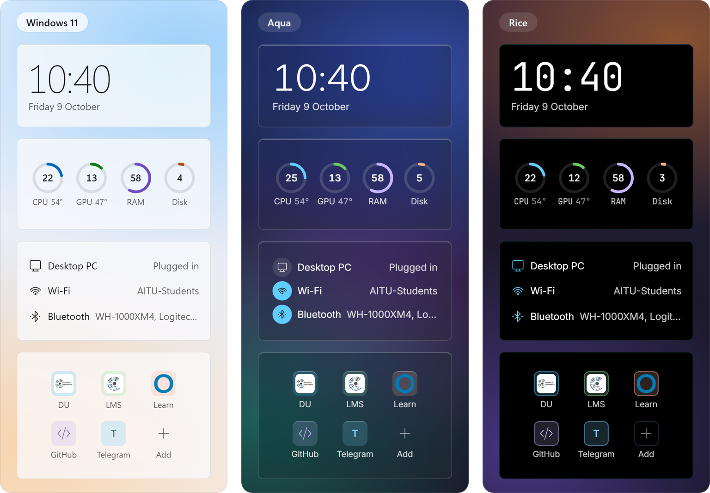
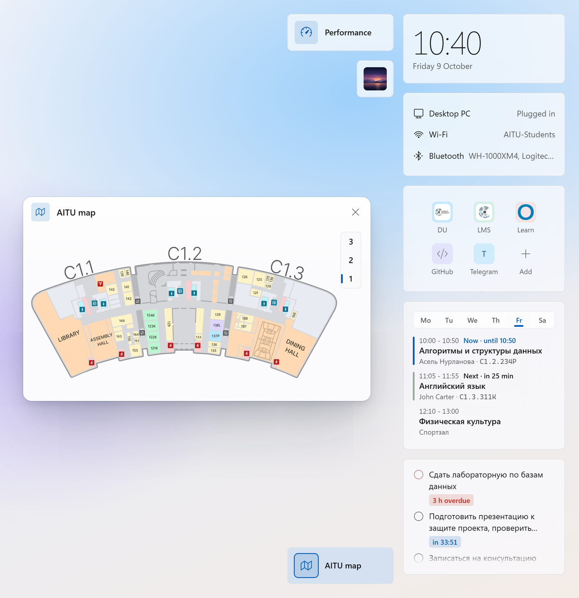
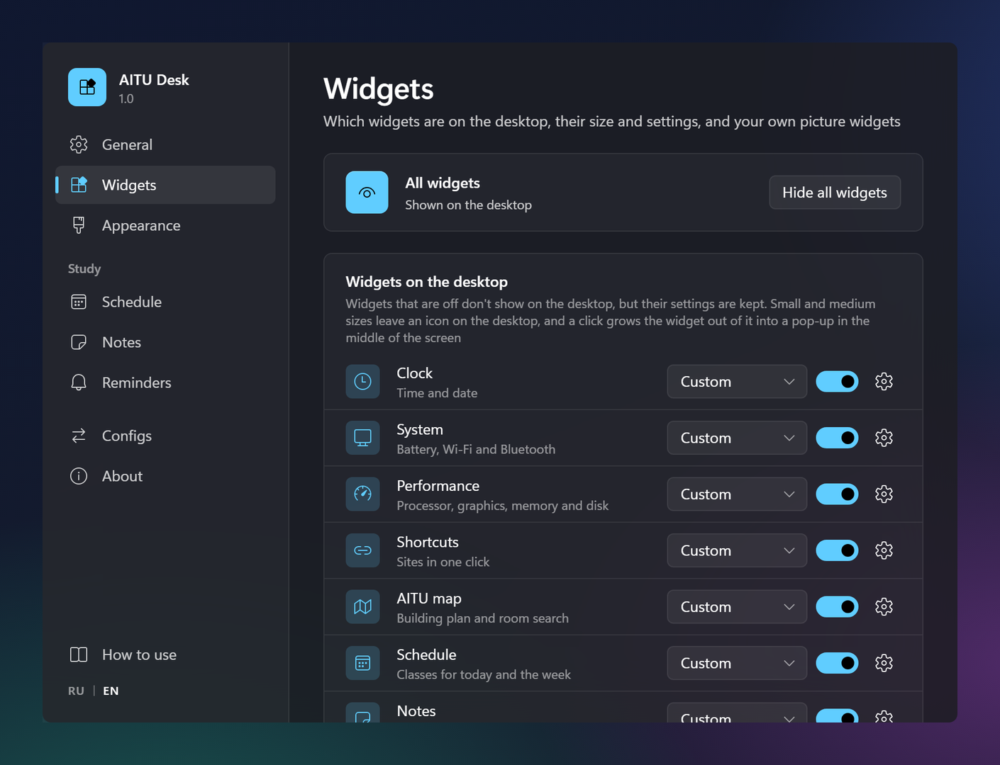
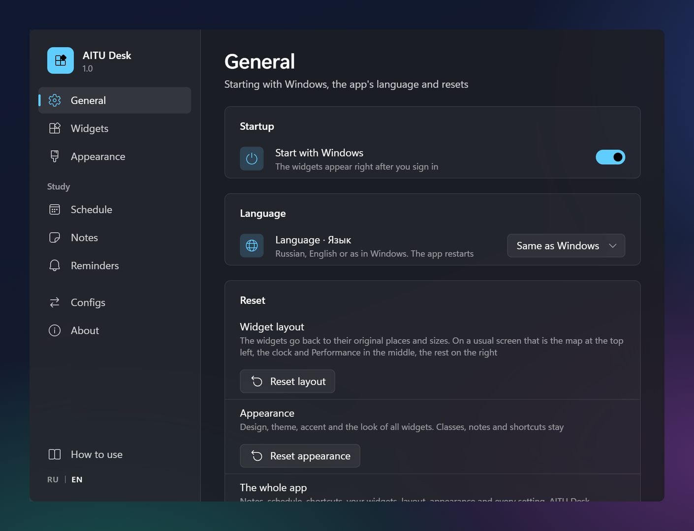
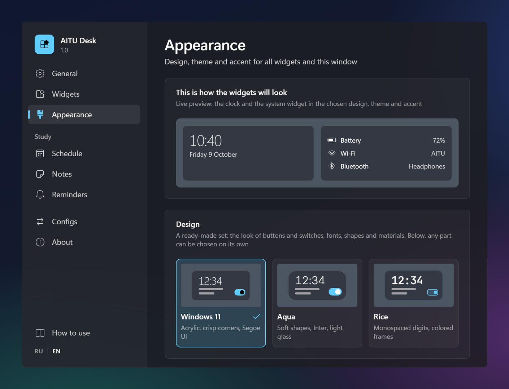
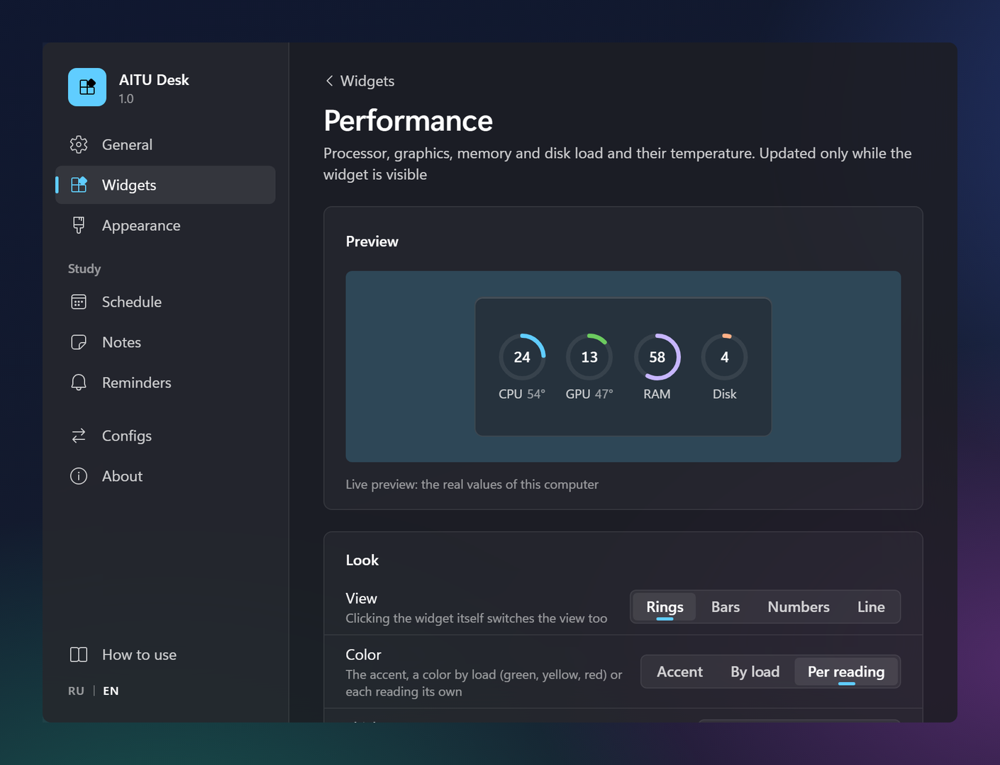
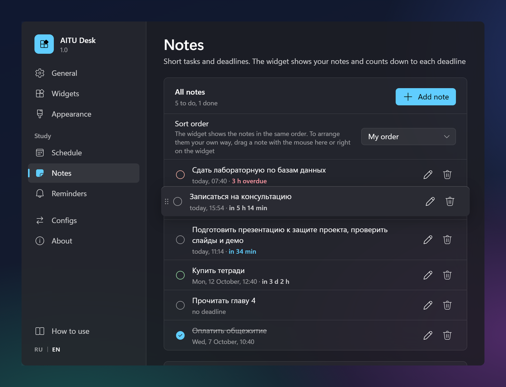
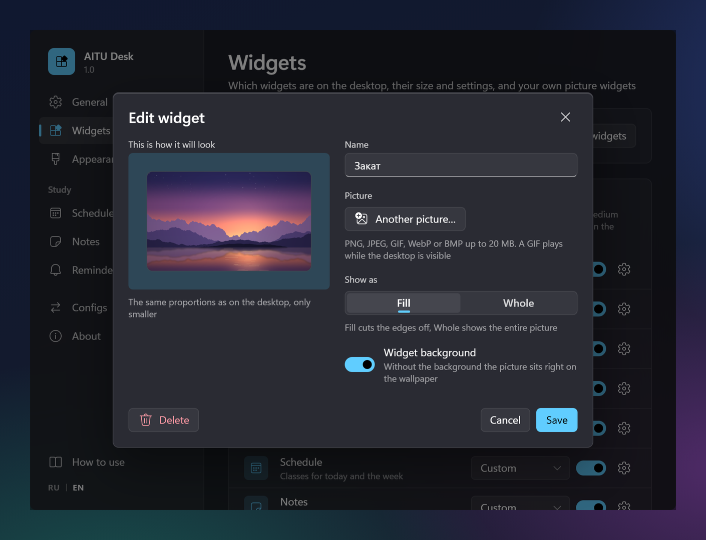
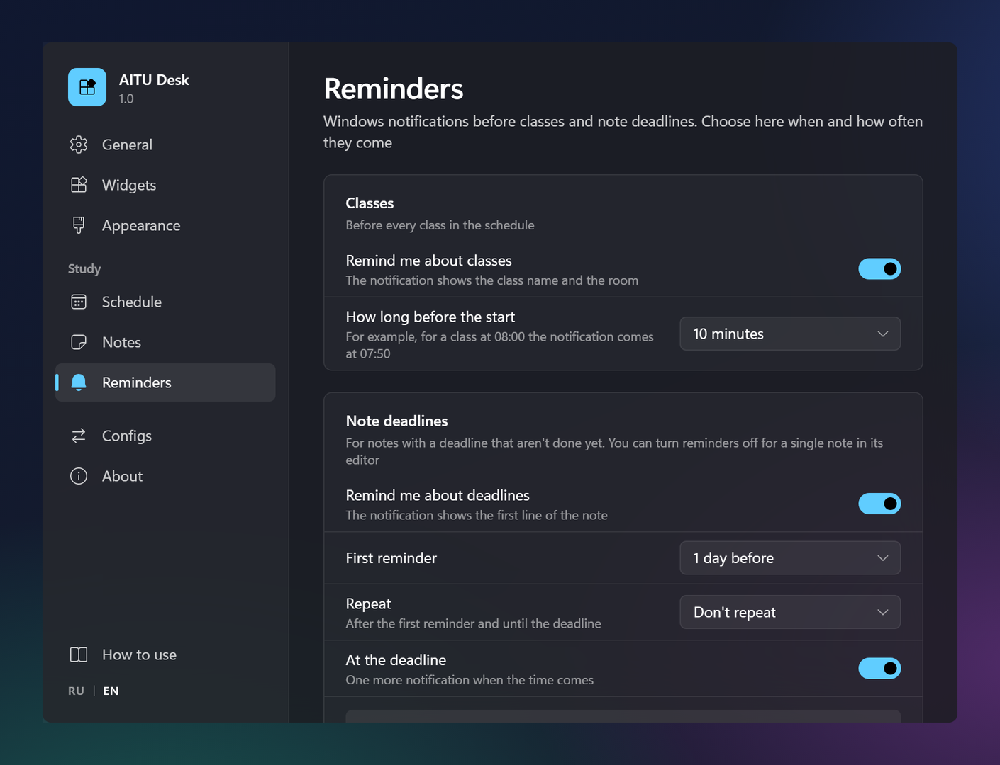
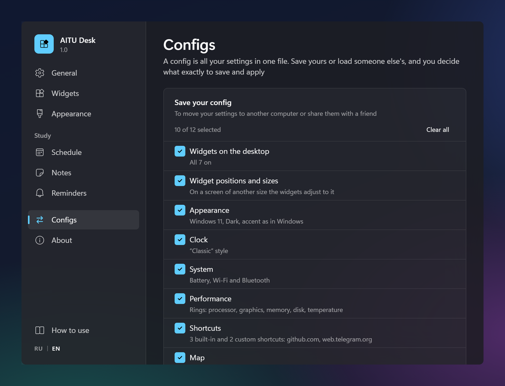

<div align="center">


# AITU Desk

**English** · [Русский](README.ru.md)

**Desktop widgets for Windows 11: a clock, battery and network, computer load, shortcuts, notes with deadlines, the
class schedule, the map of Astana IT University and your own pictures.** They sit right on the wallpaper, under your
windows, stay out of the way and don't vanish with Win+D.

[](https://github.com/cyberbara01/aitudesk/releases/latest)

[](https://github.com/cyberbara01/aitudesk/releases/latest)
[](#installation)
[](README.ru.md)
[](LICENSE)
[](#why-you-can-trust-it)
[](#installation)
<br>
[](https://tauri.app)
[](https://www.rust-lang.org)
[](https://react.dev)


</div>

## What it does

<table>
<tr>
<td width="50%" valign="top"><br><b>Clock</b><br>Ready-made styles and fine tuning: font, size, seconds, date format, background</td>
<td width="50%" valign="top"><br><b>System</b><br>Battery charge, Wi-Fi and Bluetooth. Network and device names can be hidden</td>
</tr>
<tr>
<td width="50%" valign="top"><br><b>Performance</b><br>Processor, graphics, memory and disk with their temperature; four views and your own colors</td>
<td width="50%" valign="top"><br><b>Shortcuts</b><br>AITU sites with their real icons, plus your own: the site's icon, one from the set or a letter, your own color</td>
</tr>
<tr>
<td width="50%" valign="top"><br><b>Notes</b><br>Tasks with a deadline and a countdown, put in your own order with the mouse</td>
<td width="50%" valign="top"><br><b>Schedule</b><br>Classes by day of the week, the current and the next one highlighted</td>
</tr>
<tr>
<td width="50%" valign="top"><br><b>Reminders</b><br>Windows notifications before a class and a deadline, quiet hours</td>
<td width="50%" valign="top"><br><b>AITU map</b><br>The university's floors, room search, six color schemes or your own color, marks, zoom with the wheel or two fingers</td>
</tr>
<tr>
<td width="50%" valign="top"><br><b>Your widgets</b><br>Your own picture or GIF on the desktop, up to 20 of them</td>
<td width="50%" valign="top"><br><b>Appearance</b><br>Three designs and fine-tuning: font, shapes, borders, transparency. Themes, your accent, scale</td>
</tr>
<tr>
<td width="50%" valign="top"><br><b>Privacy</b><br>Text on the desktop can be hidden behind dots, like a password</td>
<td width="50%" valign="top"><br><b>Configs</b><br>All your settings in one file: for another computer or a friend</td>
</tr>
</table>

Not at AITU? Everything except the map is useful to you too, and the map and the university's shortcuts can be
turned off.

## Why you can trust it

- **Open source** under the MIT license: everything the app does is in this repository.
- **Sends nothing**: no telemetry, ads, accounts or auto-updates.
- **Needs no admin rights** and installs for your account only.
- **Built on GitHub**: GitHub Actions builds the installer of every release from the source, with checksums next
  to it.
- **Light**: the installer is about 3 MB, and when idle the app barely touches the processor.

## Screenshots

Three designs, the same widgets in each: Windows 11 (light theme), Aqua (glass) and Rice (black). Any design
goes with any theme and accent color.

<p align="center">
  
</p>

A widget can be folded into a small icon; a click grows it into a pop-up in the middle of the screen.

<p align="center">
  
</p>

The settings window:

<p align="center">
  
  
</p>
<p align="center">
  
  
</p>
<p align="center">
  
  
</p>
<p align="center">
  
  
</p>

## Installation

1. Download `AITU Desk_<version>_x64-setup.exe` from the [latest release](https://github.com/cyberbara01/aitudesk/releases/latest) and run it.
2. If Windows shows “Windows protected your PC”, click “More info”, then “Run anyway”. The warning appears because
   the app is not signed with a paid certificate.
3. The settings window opens with a short guide, and the widgets appear on the desktop. They start with Windows from
   then on; this can be turned off in “General”.

Windows 11, 64-bit, is required. To move a widget or change its size, right-click it: the clock, system, performance
and shortcuts grow along with it. In “Size” a widget can also fold into an icon that grows into a pop-up in the middle
of the screen. Which widgets are shown, their sizes and your own picture widgets are in “Widgets”. The interface is
in English or Russian, following Windows; switch the language in “General” or with the “RU | EN” button at the bottom
of the settings window.

<details>
<summary><b>Check that the installer is genuine</b></summary>
<br>

Next to the installer, the release has `SHA256SUMS.txt`. Compare it with the hash of the downloaded file in
PowerShell:

```powershell
Get-FileHash ".\AITU Desk_1.0.0_x64-setup.exe" -Algorithm SHA256
```

The build is made by [`.github/workflows/release.yml`](.github/workflows/release.yml) from the source of this
repository.
</details>

<details>
<summary><b>What the installer does and where your data lives</b></summary>
<br>

| What | Where |
| --- | --- |
| The program `aitudesk.exe` and the uninstaller `uninstall.exe` | `%LOCALAPPDATA%\AITU Desk\` |
| A Start menu shortcut and, if you leave the box checked, a desktop shortcut | Start menu, desktop |
| The entry for uninstalling in “Installed apps” | `HKCU\Software\Microsoft\Windows\CurrentVersion\Uninstall\AITU Desk` |
| Settings, classes, notes, shortcuts, widget layout (plain JSON) | `%APPDATA%\kz.edu.astanait.aitudesk\settings.json` |
| Copies of the pictures of your widgets | `%APPDATA%\kz.edu.astanait.aitudesk\widgets\` |
| The WebView2 service cache | `%LOCALAPPDATA%\kz.edu.astanait.aitudesk\EBWebView\` |
| Autostart (on from the first start, a switch in “General”) | the `AITU Desk` value in `HKCU\Software\Microsoft\Windows\CurrentVersion\Run` |

The installer does nothing else: no services, drivers, scheduled tasks, browser extensions or bundled programs.
WebView2 is already part of Windows 11; only if it is missing does the installer download it from Microsoft.

The settings file opens in Notepad. If it stops being readable after an edit, the app does not erase it but renames
it to `settings.broken-<time>.json`.
</details>

<details>
<summary><b>Network and privacy</b></summary>
<br>

- The network is used only when you act: to open a shortcut in your browser, or to download a site's icon once when
  you add or change a shortcut (a request to the site itself and, if it has no icon, to Google's icon service, which
  is never asked about local names). The DU, LMS and Learn icons are built in. A site cannot send these requests on
  to devices in your home network.
- The schedule, notes, the Wi-Fi network name and Bluetooth device names on the desktop can be hidden behind dots.
- The processor temperature comes from Windows where it gives one (laptops, mostly). On most desktop PCs Windows does
  not, and the app installs no driver for it: it reads the temperature from a monitoring program you run anyway
  (LibreHardwareMonitor, HWiNFO, Core Temp, MSI Afterburner or AIDA64), on this computer only.
- A config holds only the parts you choose, and notes and your own widgets are left out by default. Shortcuts from
  someone else's config are accepted only with `http://` and `https://` addresses, and pictures only when they really
  are pictures.
</details>

<details>
<summary><b>Uninstalling</b></summary>
<br>

Settings → Apps → Installed apps → AITU Desk → Uninstall. The “Delete the application data” box erases the settings too;
without it they stay in case you install again. Before uninstalling you can save everything to a config in
“Configs”. To start over without uninstalling, “Reset everything” at the bottom of “General” makes the app as it was
right after installing.
</details>

<details>
<summary><b>Building from source</b></summary>
<br>

You need Node.js 22+, Rust (stable) and, following the [Tauri guide](https://tauri.app/start/prerequisites/),
Microsoft C++ Build Tools (or mingw-w64 for the `x86_64-pc-windows-gnu` target).

```bash
npm install
npm run tauri dev      # run in development mode
npm run tauri build    # the installer lands in src-tauri/target/release/bundle/nsis/
```

For testing without a laptop there are environment variables: `AITUDESK_MOCK_POWER` (`none` | `78` |
`15,charging` | `40,saver`), `AITUDESK_MOCK_WIFI` (`off` | `SSID,bars` | `hidden,bars`), `AITUDESK_MOCK_BT`
(`off` | `none` | `A;B;C`).

Inside: Tauri 2, Rust, React 18, TypeScript and Vite. All widgets run in one WebView2 process, the clock wakes up
once a minute when seconds are not shown, and hidden widgets and widgets folded into an icon keep no timers. While
a program fills the screen, the load is not read and GIFs stand still. In Windows battery saver the clock hides its
seconds, charge, network and load are checked less often, and GIFs stand still. With transparency set to none the
widgets drop their acrylic, which spares the graphics card.
</details>

## Feedback

- Rate the app from 0 to 10 in the [anonymous form](https://forms.gle/LV7BYCqeveRyRm9YA): a single rating is enough, ideas are optional.
- Found a bug? Write in [Issues](https://github.com/cyberbara01/aitudesk/issues) or on Telegram [@capybara205](https://t.me/capybara205).

Author: [@cyberbara01](https://github.com/cyberbara01). Map: the [aitumap](https://github.com/Yuujiso/aitumap)
project by [Yuujiso](https://github.com/Yuujiso).

## License

[MIT](LICENSE): use it, change it and share it, keeping the author's name. Third-party components (the map, icons,
fonts) are listed in [THIRD-PARTY-NOTICES.md](THIRD-PARTY-NOTICES.md).
