<div align="center">


# AITU Desk

**Widgets for the Windows 11 desktop, made for students of Astana IT University.**

A clock, battery and network, computer load, shortcuts, notes with deadlines, the class schedule, a calendar,<br>the AITU map and your own pictures lie right on the wallpaper.

[](https://github.com/cyberbara01/aitudesk/releases/latest)
[](#installation)
[](README.ru.md)
[](LICENSE)
[](#why-you-can-trust-it)
[](#installation)

<a href="https://github.com/cyberbara01/aitudesk/releases/latest"></a>

**English** · [Русский](README.ru.md) · [Қазақша](README.kk.md)

<sub>An unofficial student project, not affiliated with Astana IT University.</sub>

</div>

<p align="center">
  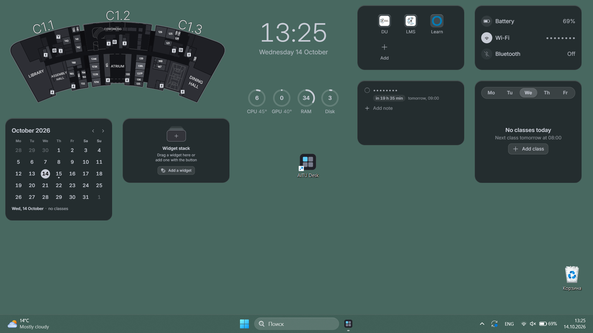
</p>

<p align="center">
<picture>
  <source media="(prefers-color-scheme: dark)" srcset="docs/screenshots/en/map-dark.webp">
  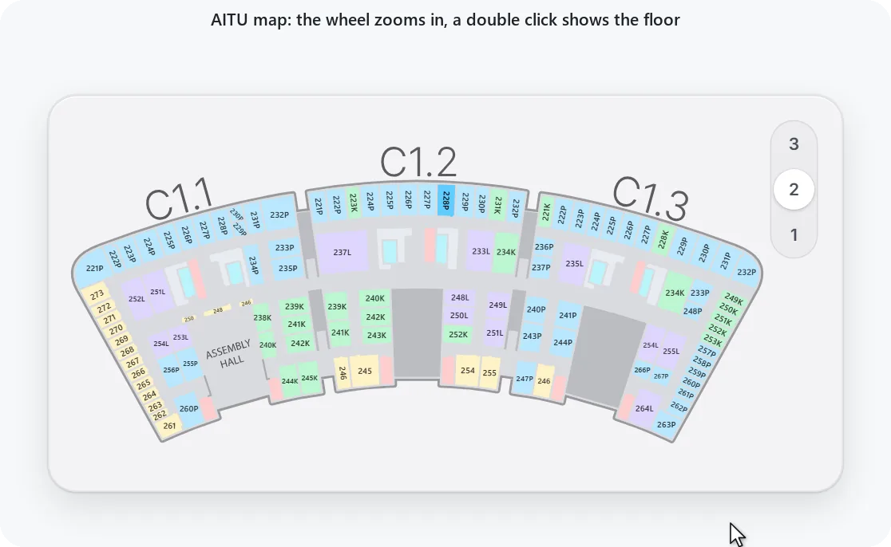
</picture>
  <br><sub>The map zooms in with the wheel where the pointer is, a double click shows the whole floor</sub>
</p>

<p align="center">
<picture>
  <source media="(prefers-color-scheme: dark)" srcset="docs/screenshots/en/widgets-dark.webp">
  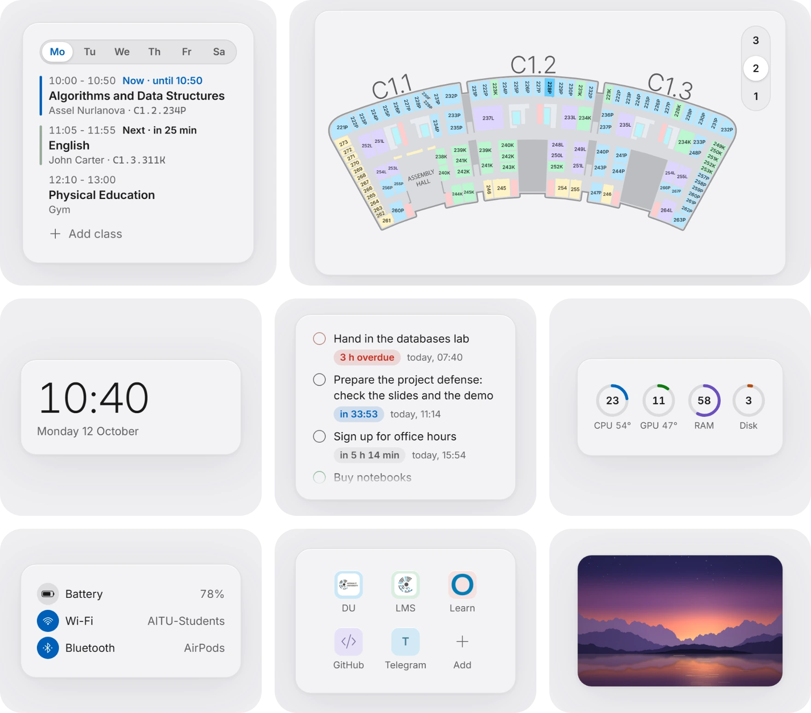
</picture>
</p>

## What it does

<table>
<tr>
<td width="33%" valign="top"><br><b>Schedule</b><br>The current and next class, and time left</td>
<td width="33%" valign="top"><br><b>Notes</b><br>Deadlines with a live countdown</td>
<td width="33%" valign="top"><br><b>Reminders</b><br>Before a class and a deadline, quiet hours</td>
</tr>
<tr>
<td width="33%" valign="top"><br><b>Calendar</b><br>The month, note deadlines and the day’s classes</td>
<td width="33%" valign="top"><br><b>AITU map</b><br>Every floor, room search: 223 or C1.2.223</td>
<td width="33%" valign="top"><br><b>Clock</b><br>Styles, font, size, seconds and date</td>
</tr>
<tr>
<td width="33%" valign="top"><br><b>System</b><br>Battery, Wi-Fi and Bluetooth, names hidden</td>
<td width="33%" valign="top"><br><b>Performance</b><br>CPU, GPU, memory and disk</td>
<td width="33%" valign="top"><br><b>Shortcuts</b><br>DU, LMS, Learn and any site</td>
</tr>
<tr>
<td width="33%" valign="top"><br><b>Your widgets</b><br>A picture or GIF on the wallpaper, up to 20</td>
<td width="33%" valign="top"><br><b>Widget stacks</b><br>Several stacks of any widgets</td>
<td width="33%" valign="top"><br><b>Layout</b><br>Icon grid, window and text size</td>
</tr>
<tr>
<td width="33%" valign="top"><br><b>Your background</b><br>A color or a gradient across the screen</td>
<td width="33%" valign="top"><br><b>Fade in</b><br>A widget comes forward under the pointer</td>
<td width="33%" valign="top"><br><b>Privacy</b><br>Text behind dots, the app sends nothing</td>
</tr>
<tr>
<td width="33%" valign="top"><br><b>Configs</b><br>All settings in one file</td>
<td width="33%" valign="top"><br><b>Crash log</b><br>A bug report in one click, nothing personal</td>
<td width="33%" valign="top"><br><b>Three languages</b><br>English, Russian and Kazakh</td>
</tr>
</table>

<p align="center">
<picture>
  <source media="(prefers-color-scheme: dark)" srcset="docs/screenshots/en/calendar-dark.webp">
  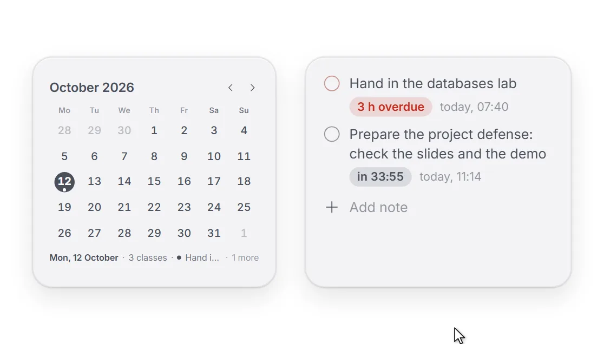
</picture>
  <br><sub>A right click on a day of the calendar makes a note or a reminder for that day</sub>
</p>

<p align="center">
<picture>
  <source media="(prefers-color-scheme: dark)" srcset="docs/screenshots/en/stack-dark.webp">
  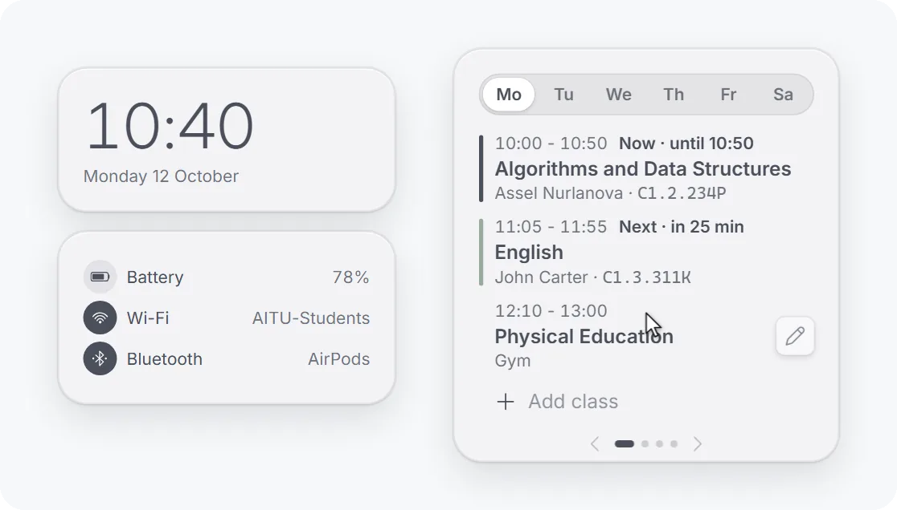
</picture>
  <br><sub>A stack pages by a mouse drag, the wheel, two fingers on the touchpad and the arrows</sub>
</p>

<p align="center">
<picture>
  <source media="(prefers-color-scheme: dark)" srcset="docs/screenshots/en/stack-in-dark.webp">
  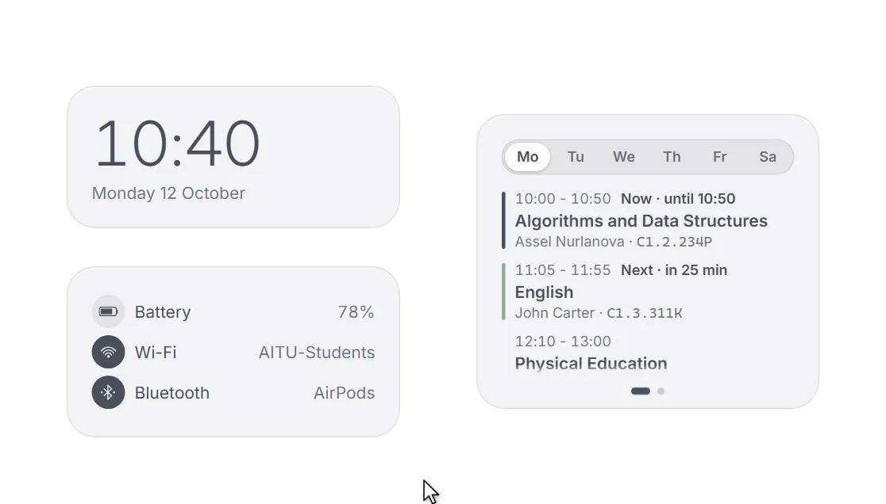
</picture>
  <br><sub>Any widget drags into a stack, and you can have several stacks</sub>
</p>

<p align="center">
<picture>
  <source media="(prefers-color-scheme: dark)" srcset="docs/screenshots/en/fold-dark.webp">
  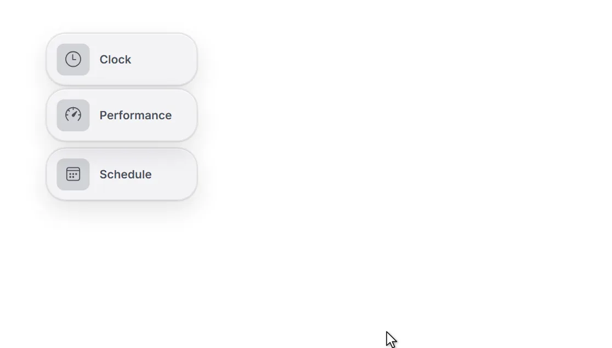
</picture>
  <br><sub>Any widget folds into an icon and opens with a click</sub>
</p>

<p align="center">
<picture>
  <source media="(prefers-color-scheme: dark)" srcset="docs/screenshots/en/move-dark.webp">
  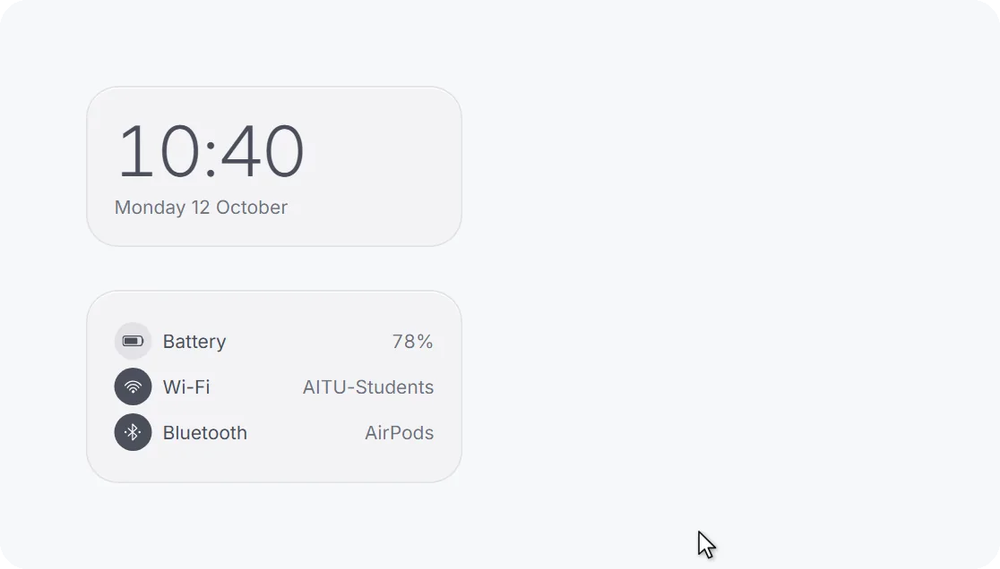
</picture>
  <br><sub>A widget moves with the mouse, lands on the grid and resizes by its corner, its content grows with it</sub>
</p>

## Make it yours

<p align="center">
<picture>
  <source media="(prefers-color-scheme: dark)" srcset="docs/screenshots/en/looks-dark.webp">
  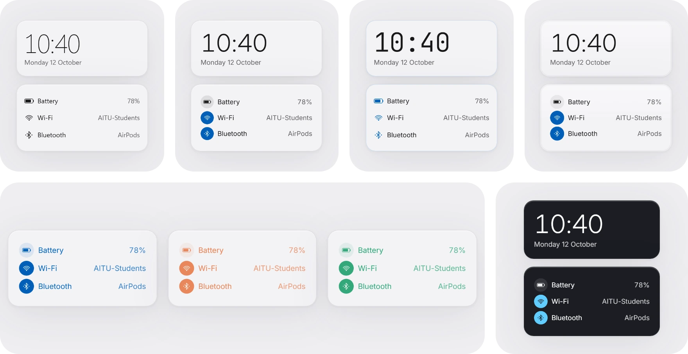
</picture>
  <br><sub>Windows 11, Aqua, Rice and Pearl · your accent and any color for icons and text · your own background: a color or a gradient across the screen · themes from light to black</sub>
</p>

<p align="center">
<picture>
  <source media="(prefers-color-scheme: dark)" srcset="docs/screenshots/en/scale-dark.webp">
  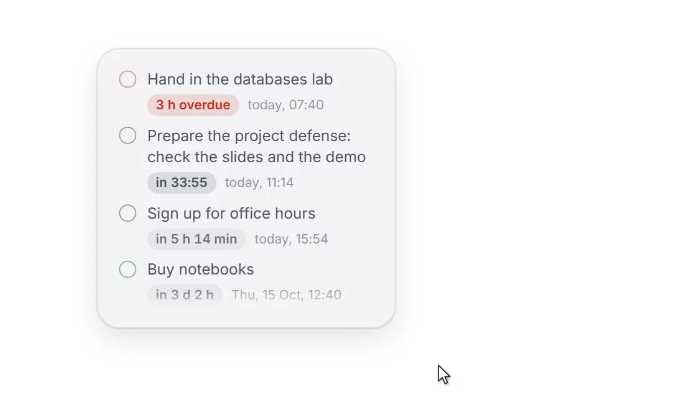
</picture>
  <br><sub>Text size: text and icons smaller or bigger at any widget size</sub>
</p>

<p align="center">
<picture>
  <source media="(prefers-color-scheme: dark)" srcset="docs/screenshots/en/fade-dark.webp">
  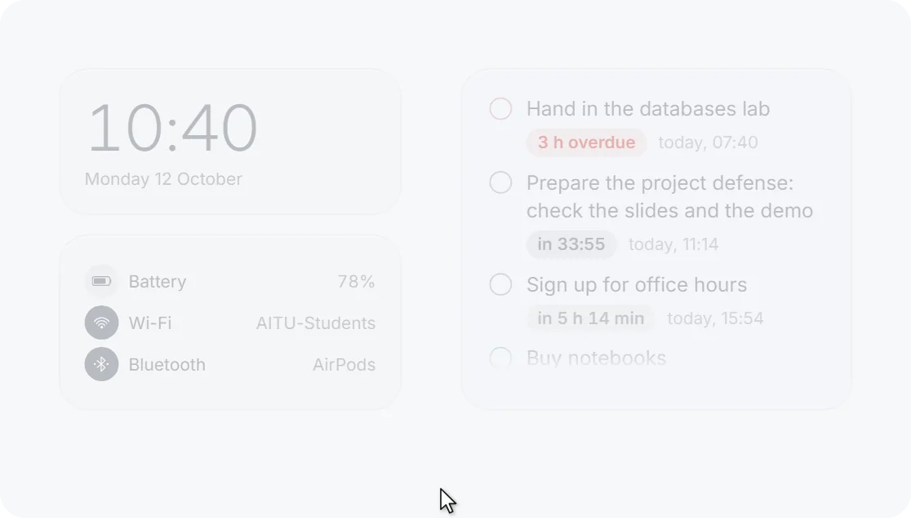
</picture>
  <br><sub>Fade in on hover: a see-through widget comes forward under the pointer</sub>
</p>

## Installation

1. Download `AITU-Desk_<version>_x64-setup.exe` from the [latest release](https://github.com/cyberbara01/aitudesk/releases/latest) and run it.
2. If Windows shows “Windows protected your PC”, click “More info”, then “Run anyway”. The warning appears because
   the app is not signed with a paid certificate.
3. The settings window opens with a short guide, and the widgets appear on the desktop. They start with Windows from
   then on; this can be turned off in “General”.

Windows 11, 64-bit, is required. The interface is in English, Russian or Kazakh, following Windows; switch it in
“General” or with the “RU | KZ | EN” button at the bottom of the settings window.

<details>
<summary><b>Check that the installer is genuine</b></summary>
<br>

Next to the installer, the release has `SHA256SUMS.txt`. Compare it with the hash of the downloaded file in
PowerShell:

```powershell
Get-FileHash ".\AITU-Desk_1.0.0_x64-setup.exe" -Algorithm SHA256
```

GitHub also confirms that it built the file itself from this repository: the same hash is on the
[build attestations](https://github.com/cyberbara01/aitudesk/attestations) page. GitHub Actions makes that record
during the build and signs it, so a file uploaded by hand has none. With [GitHub CLI](https://cli.github.com) it is
one command:

```powershell
gh attestation verify ".\AITU-Desk_1.0.0_x64-setup.exe" --repo cyberbara01/aitudesk
```

The build is made by [`.github/workflows/release.yml`](.github/workflows/release.yml) from the source of this
repository.
</details>

<details>
<summary><b>What the installer does and where your data lives</b></summary>
<br>

| What | Where |
| --- | --- |
| The program `aitudesk.exe` and the uninstaller `uninstall.exe` | `%LOCALAPPDATA%\AITU Desk\` |
| A Start menu shortcut and, if you leave the box checked, a desktop shortcut | Start menu, desktop |
| The entry for uninstalling in “Installed apps” | `HKCU\Software\Microsoft\Windows\CurrentVersion\Uninstall\AITU Desk` |
| Settings, classes, notes, shortcuts, widget layout (plain JSON) | `%APPDATA%\kz.edu.astanait.aitudesk\settings.json` |
| Copies of the pictures of your widgets | `%APPDATA%\kz.edu.astanait.aitudesk\widgets\` |
| The WebView2 service cache | `%LOCALAPPDATA%\kz.edu.astanait.aitudesk\EBWebView\` |
| Autostart (on from the first start, a switch in “General”) | the `AITU Desk` value in `HKCU\Software\Microsoft\Windows\CurrentVersion\Run` |

The installer does nothing else: no services, drivers, scheduled tasks, browser extensions or bundled programs.
WebView2 is already part of Windows 11; only if it is missing does the installer download it from Microsoft.

The settings file opens in Notepad. If it stops being readable after an edit, the app does not erase it but renames
it to `settings.broken-<time>.json`.
</details>

<details>
<summary><b>Network and privacy</b></summary>
<br>

- The network is used only when you act: to open a shortcut in your browser, or to download a site's icon once when
  you add or change a shortcut (a request to the site itself and, if it has no icon, to Google's icon service, which
  is never asked about local names). The DU, LMS and Learn icons are built in. A site cannot send these requests on
  to devices in your home network.
- The schedule, notes, the Wi-Fi network name and Bluetooth device names on the desktop can be hidden behind dots.
- The processor temperature comes from Windows where it gives one (laptops, mostly). On most desktop PCs Windows does
  not, and the app installs no driver for it: it reads the temperature from a monitoring program you run anyway
  (LibreHardwareMonitor, HWiNFO, Core Temp, MSI Afterburner or AIDA64), on this computer only.
- A config holds only the parts you choose, and notes and your own widgets are left out by default. Shortcuts from
  someone else's config are accepted only with `http://` and `https://` addresses, and pictures only when they really
  are pictures.
</details>

<details>
<summary><b>Uninstalling</b></summary>
<br>

Settings → Apps → Installed apps → AITU Desk → Uninstall. The “Delete the application data” box erases the settings too;
without it they stay in case you install again. Before uninstalling you can save everything to a config in
“Configs”. To start over without uninstalling, “Reset everything” at the bottom of “General” makes the app as it was
right after installing.
</details>

## Why you can trust it

- **Open source** under the MIT license: everything the app does is in this repository.
- **Sends nothing**: no telemetry, ads, accounts or auto-updates.
- **Needs no admin rights** and installs for your account only.
- **Built on GitHub**: GitHub Actions builds the installer of every release from the source, with checksums next
  to it and GitHub's signed build attestation.
- **Light**: the installer is about 3 MB, and when idle the app barely touches the processor.

**Privacy.** AITU Desk goes online only when you ask it to: to open a shortcut or to fetch a site's icon. Your
classes, notes and settings stay on your computer. The details are under “Network and privacy” in
[Installation](#installation).

## FAQ

<details>
<summary><b>Windows says “Windows protected your PC”. Is it dangerous?</b></summary>
<br>

No. Windows says this about any program without a paid code signing certificate. Click “More info”, then “Run
anyway”. GitHub builds the installer from the open source of this repository, and you can check the file with
“Check that the installer is genuine” above.
</details>

<details>
<summary><b>I don’t study at AITU. Is it for me?</b></summary>
<br>

Yes. The clock, performance, notes, schedule, shortcuts and your own pictures are useful to anyone. The map and the
university shortcuts can be turned off in the settings.
</details>

<details>
<summary><b>Will it slow down my computer or drain the battery?</b></summary>
<br>

No. When idle, AITU Desk barely touches the processor. While a game or a video is full screen, the load is not read
and GIFs pause, and in battery saver everything updates less often.
</details>

<details>
<summary><b>Does it work on Windows 10?</b></summary>
<br>

No, it needs Windows 11, 64-bit. The rounded corners, glass and transparency of the widgets exist only in Windows 11.
</details>

<details>
<summary><b>The app froze or closed by itself. What do I do?</b></summary>
<br>

Open AITU Desk again. On “About”, turn on “Keep a log”, and when it happens again, click “Save a report” and send the
file on Telegram to [@capybara205](https://t.me/capybara205). The log holds only what happened in the app: what is on,
what was clicked and the errors. The text of notes and classes, shortcut addresses and the names of networks and
devices never go in, and the file is never sent anywhere by itself.
</details>

<details>
<summary><b>How do I open the settings or bring the widgets back?</b></summary>
<br>

Click the AITU Desk icon in the tray or start the app again from the Start menu: the settings window opens. Its
“Widgets” page turns each widget on and off.
</details>

## Links

| What | Where |
| --- | --- |
| Download | [The latest release](https://github.com/cyberbara01/aitudesk/releases/latest) |
| A bug or an idea | [Issues](https://github.com/cyberbara01/aitudesk/issues), Telegram [@capybara205](https://t.me/capybara205) or the [anonymous form](https://forms.gle/LV7BYCqeveRyRm9YA) |
| Rate the app | [The same form](https://forms.gle/LV7BYCqeveRyRm9YA): we don't need your data, and without your feedback the app can't grow |
| Author | [@cyberbara01](https://github.com/cyberbara01) |
| The AITU map | [aitumap](https://github.com/Yuujiso/aitumap) by [Yuujiso](https://github.com/Yuujiso) |
| Third-party components | [THIRD-PARTY-NOTICES.md](THIRD-PARTY-NOTICES.md) |

<details>
<summary><b>Building from source</b></summary>
<br>

You need Node.js 22+, Rust (stable) and, following the [Tauri guide](https://tauri.app/start/prerequisites/),
Microsoft C++ Build Tools (or mingw-w64 for the `x86_64-pc-windows-gnu` target).

```bash
npm install
npm run tauri dev      # run in development mode
npm run tauri build    # the installer lands in src-tauri/target/release/bundle/nsis/
```

For testing without a laptop there are environment variables: `AITUDESK_MOCK_POWER` (`none` | `78` |
`15,charging` | `40,saver`), `AITUDESK_MOCK_WIFI` (`off` | `SSID,bars` | `hidden,bars`), `AITUDESK_MOCK_BT`
(`off` | `none` | `A;B;C`).

Inside: Tauri 2, Rust, React 18, TypeScript and Vite. All widgets run in one WebView2 process, the clock wakes up
once a minute when seconds are not shown, and hidden widgets and widgets folded into an icon keep no timers. While
a program fills the screen, the load is not read and GIFs stand still. In Windows battery saver the clock hides its
seconds, charge, network and load are checked less often, and GIFs stand still. With transparency set to none the
widgets drop their acrylic, which spares the graphics card.

[](https://tauri.app)
[](https://www.rust-lang.org)
[](https://react.dev)
</details>

## License

[MIT](LICENSE): use it, change it and share it, keeping the author's name. Third-party components (the map, icons,
fonts) are listed in [THIRD-PARTY-NOTICES.md](THIRD-PARTY-NOTICES.md).
