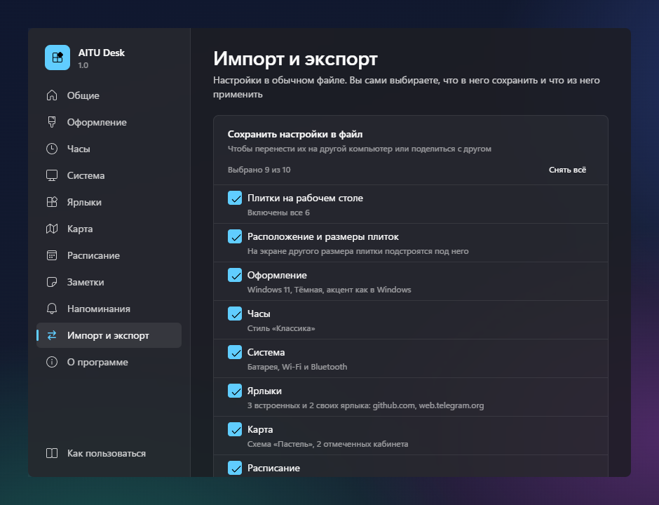

# AITU Desk

Виджеты рабочего стола для студентов AITU (Astana IT University) под Windows 11: карта корпуса C1, часы, расписание пар,
заметки с дедлайнами и напоминаниями, состояние системы и ярлыки университетских сервисов. Плитки лежат прямо на обоях
под всеми окнами, не мешают работе и переживают Win+D.

Код полностью открыт, приложение ничего не отправляет в интернет само и ставится без прав администратора. Ниже
подробно написано, что именно делает установщик и где лежат ваши данные.

<p align="center">
  
</p>

## Возможности

- **Карта AITU**: три этажа корпуса (данные проекта [aitumap](https://github.com/Yuujiso/aitumap)). Поиск кабинета
  (`223` или `C1.2.223`), зум без потери чёткости: мелкие подписи появляются по мере приближения. Кисть на плитке
  включает режим покраски: клик по кабинету красит его своим цветом. Карта отмечает аудиторию текущей или ближайшей
  пары, четыре цветовые схемы, может лежать прямо на обоях совсем без фона.
- **Часы**: галерея готовых стилей и тонкая настройка: шрифт, насыщенность, ширина, размер, секунды, формат даты,
  компоновка, цвета, фон.
- **Расписание**: свои пары по дням недели: время, название, преподаватель, аудитория. Текущая и следующая пара
  подсвечены, дни без пар можно скрыть. Клик по аудитории показывает её на карте.
- **Заметки**: короткие задачи с дедлайном и обратным отсчётом, просроченные выделены, выполненные отмечаются кружком.
  Сортировка по дедлайну или по дате добавления, сначала новые или старые.
- **Напоминания**: уведомления Windows перед парой и перед дедлайном. Своё время и частота: за сколько минут до пары,
  когда начинать напоминать о дедлайне и как часто повторять, тихие часы, звук. Для отдельной заметки напоминания
  можно выключить.
- **Приватность на рабочем столе**: текст расписания и заметок, имя сети Wi-Fi и названия Bluetooth-устройств можно
  скрыть точками, как пароль. При наведении рядом со строкой появляется глаз, клик показывает её.
- **Система**: батарея, Wi-Fi, Bluetooth.
- **Ярлыки**: Digital University, Moodle, Learn и любые свои ссылки. У любого ярлыка, в том числе встроенного, можно
  поменять название, адрес, иконку (иконка сайта, из набора Fluent или первая буква) и цвет.
- **Оформление**: три дизайн-языка (Windows 11, Aqua, Rice), палитры от светлой до чёрной и прозрачное «Стекло»,
  акцент из готовых или свой. Все плитки перетаскиваются и меняют размер, расположение запоминается. Оформление можно
  сбросить целиком или по разделам, ваши пары, заметки и ярлыки при этом остаются.
- **Импорт и экспорт**: все настройки сохраняются в обычный файл JSON, по разделам на выбор, и загружаются на другом
  компьютере или у друга. Заметки помечены как личные и по умолчанию в файл не попадают.
- **Просто начать**: при первом запуске окно настроек показывает короткую подсказку; ярлык приложения всегда открывает
  настройки, а все плитки можно скрыть и вернуть одной кнопкой в разделе «Общие».

<p align="center">
  
  
</p>
<p align="center">
  
  
</p>
<p align="center">
  
</p>

## Установка

1. Скачайте `AITU Desk_<версия>_x64-setup.exe` со страницы [Releases](../../releases).
2. Запустите его. Права администратора не нужны: приложение ставится только для вашей учётной записи.
3. Windows SmartScreen может показать «Система Windows защитила ваш компьютер», потому что сборка не подписана платным
   сертификатом. Нажмите «Подробнее», затем «Выполнить в любом случае». Если сомневаетесь, сверьте контрольную сумму
   (ниже) или соберите приложение сами из исходников.
4. После установки откроется окно настроек с короткой подсказкой, а плитки появятся на рабочем столе. Чтобы они
   появлялись после перезагрузки, включите «Запускать вместе с Windows» в разделе «Общие».

Требования: Windows 11, 64 бита.

### Проверка установщика

Установщик для каждого релиза собирает GitHub Actions из исходников этого репозитория (файл
[`.github/workflows/release.yml`](.github/workflows/release.yml)), рядом с ним лежит `SHA256SUMS.txt`. Проверить
скачанный файл можно в PowerShell:

```powershell
Get-FileHash ".\AITU Desk_1.0.0_x64-setup.exe" -Algorithm SHA256
```

Значение должно совпасть со строкой в `SHA256SUMS.txt`.

## Что делает установщик

| Что | Где |
| --- | --- |
| Программа: `aitudesk.exe`, `WebView2Loader.dll`, `uninstall.exe` | `%LOCALAPPDATA%\AITU Desk\` |
| Ярлык в меню «Пуск» и, если оставить галочку, на рабочем столе | меню «Пуск», рабочий стол |
| Запись для удаления в «Установленных приложениях» | `HKCU\Software\Microsoft\Windows\CurrentVersion\Uninstall\AITU Desk` |

Больше установщик ничего не делает: нет служб, драйверов, фоновых обновлений, задач планировщика, расширений браузера
и сторонних программ в комплекте. WebView2 уже входит в Windows 11; только если его нет, установщик скачает его
с сайта Microsoft.

## Что хранит приложение

| Что | Где |
| --- | --- |
| Настройки, пары, заметки, ярлыки, расположение плиток (обычный JSON) | `%APPDATA%\kz.edu.astanait.aitudesk\settings.json` |
| Служебный кэш WebView2 | `%LOCALAPPDATA%\kz.edu.astanait.aitudesk\EBWebView\` |
| Автозапуск, только если вы его включили в «Общих» | значение `AITU Desk` в `HKCU\Software\Microsoft\Windows\CurrentVersion\Run` |

Напоминания приходят как обычные уведомления Windows от имени AITU Desk, пока приложение запущено. Выключить их можно
в разделе «Напоминания» или в параметрах уведомлений Windows.

Файл настроек можно открыть и поправить в Блокноте, пока приложение закрыто. Если после правки он перестанет читаться,
AITU Desk не сотрёт его: файл будет переименован в `settings.broken-<время>.json` в той же папке, и данные из него
можно будет вернуть.

## Сеть и приватность

- Нет телеметрии, аналитики, рекламы, учётных записей и автообновлений.
- Сеть нужна только по вашему действию: открыть ярлык в браузере или один раз загрузить иконку сайта, когда вы
  добавляете или меняете ярлык (запрос к самому сайту, а если иконки там нет, к сервису иконок Google). Картинка
  сохраняется в настройках, плитки в интернет не ходят.
- Файл настроек при экспорте содержит только выбранные вами разделы, его можно открыть в Блокноте и посмотреть, что
  внутри. Ярлыки из чужого файла принимаются только с адресами `http://` и `https://`.

## Удаление

Параметры, Приложения, Установленные приложения, AITU Desk, Удалить. Удаляются программа, ярлыки и запись автозапуска.
Галочка «Удалить данные приложения» в окне удаления стирает и настройки с кэшем; без неё они останутся на случай
повторной установки. Перед удалением можно сохранить всё в файл в разделе «Импорт и экспорт».

## Лёгкость

Все плитки работают в одном процессе WebView2, часы просыпаются раз в минуту, если секунды не показаны, состояние
системы опрашивается раз в 10 и 30 секунд, напоминания проверяются раз в минуту. Скрытые и выключенные плитки ничего
не рисуют и не держат таймеров. В простое приложение почти не тратит процессор.

## Сборка из исходников

Понадобятся Node.js 22+, Rust (stable) и, по инструкции Tauri, Microsoft C++ Build Tools (или mingw-w64 для цели
`x86_64-pc-windows-gnu`).

```bash
npm install
npm run tauri dev      # запуск в режиме разработки
npm run tauri build    # NSIS-установщик в src-tauri/target/release/bundle/nsis/
```

Полезные переменные окружения для проверки без ноутбука: `AITUDESK_MOCK_POWER` (`none` | `78` | `15,charging`),
`AITUDESK_MOCK_WIFI` (`off` | `SSID,bars` | `hidden,bars`), `AITUDESK_MOCK_BT` (`off` | `none` | `A;B;C`).

## Технологии

Tauri 2, Rust, React 18, TypeScript, Vite. Акрил и Mica через `window-vibrancy`, системные данные, уведомления и окна
выбора файла через WinRT и Win32 (`windows` crate). Иконки Fluent UI System Icons, шрифты Segoe UI Variable, Inter
и JetBrains Mono.

## Автор и обратная связь

- **cyberbara01**: идея, дизайн, разработка. GitHub: [@cyberbara01](https://github.com/cyberbara01).
- Идеи и баги пишите в Telegram: [@capybara205](https://t.me/capybara205) или в [Issues](../../issues).

## Лицензия

MIT, см. [LICENSE](LICENSE). Карта: aitumap (Yuujiso, MIT). Иконки: Fluent UI System Icons (Microsoft, MIT).
Шрифты Inter и JetBrains Mono: SIL OFL 1.1.
