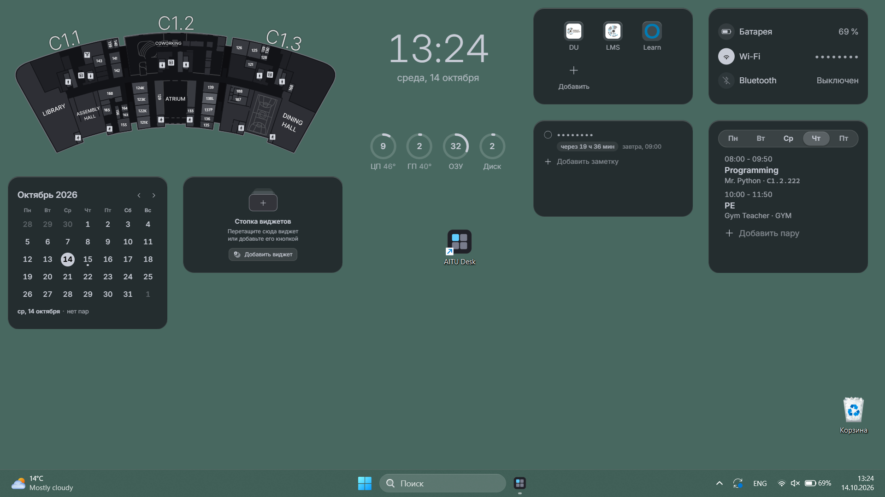
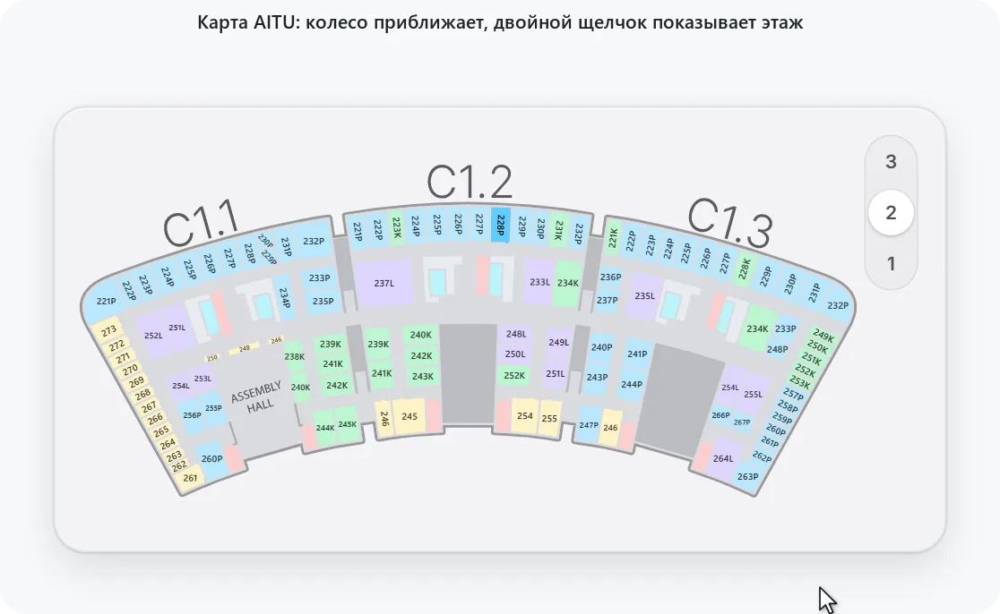
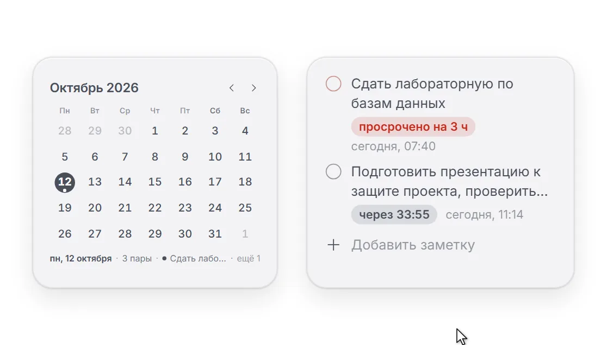
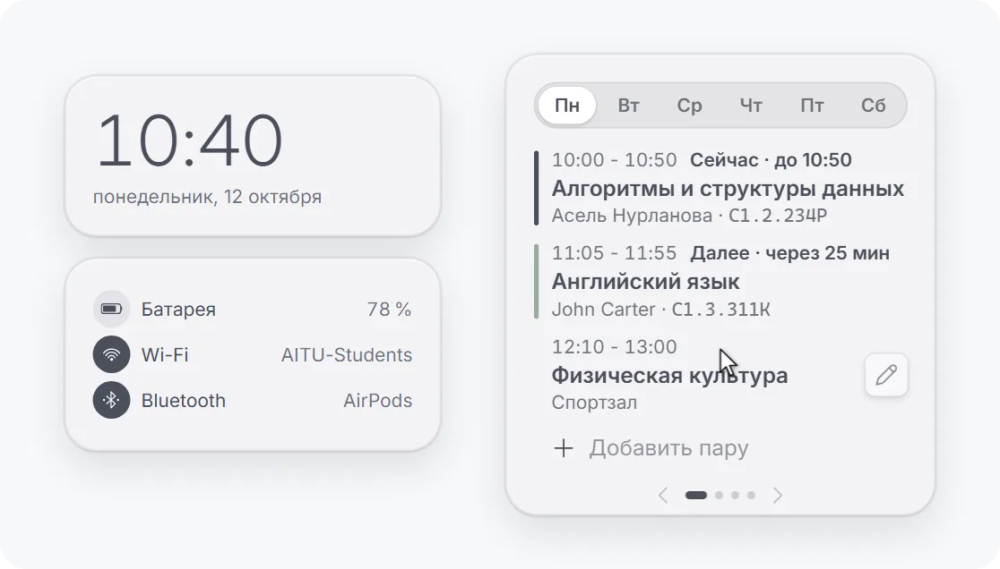
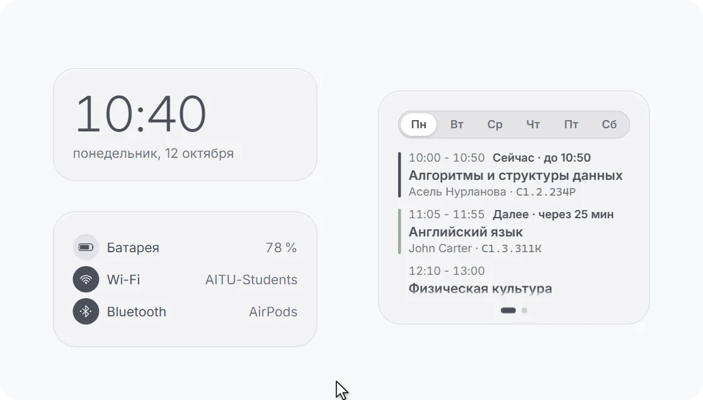
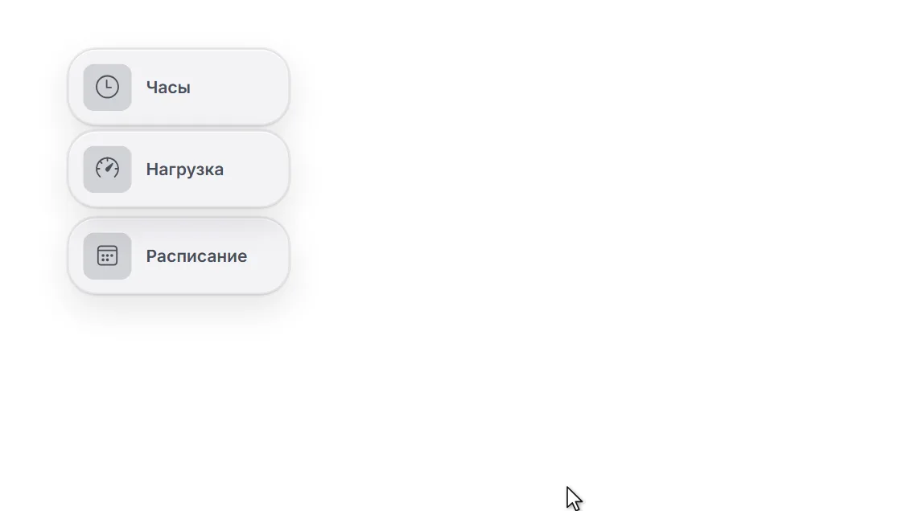
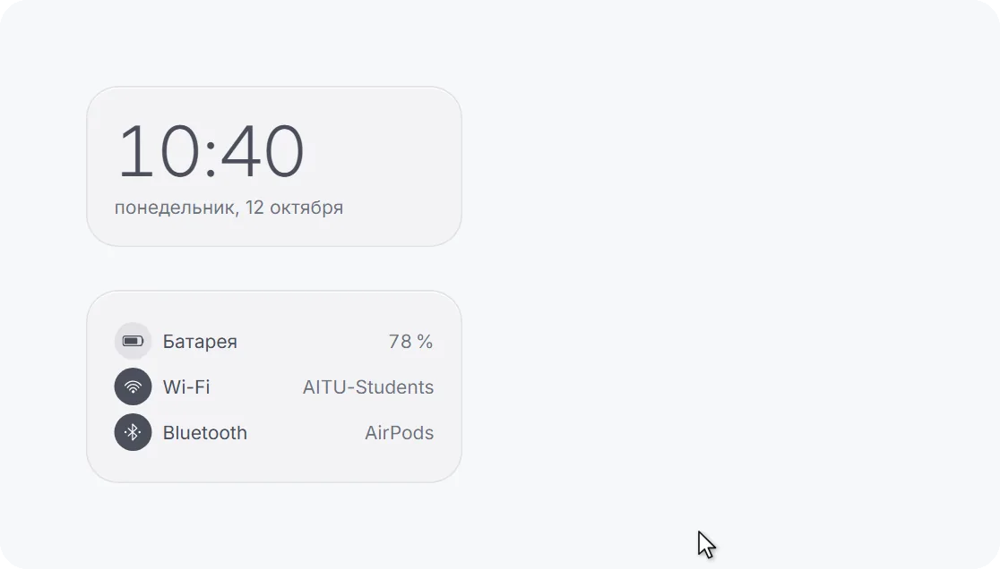
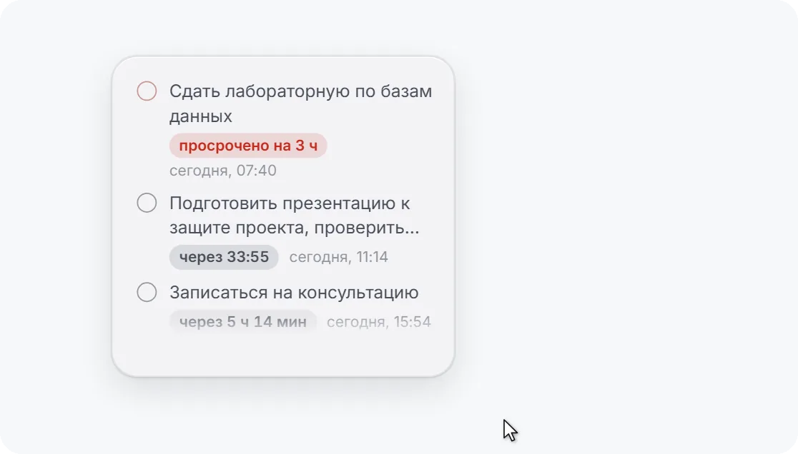
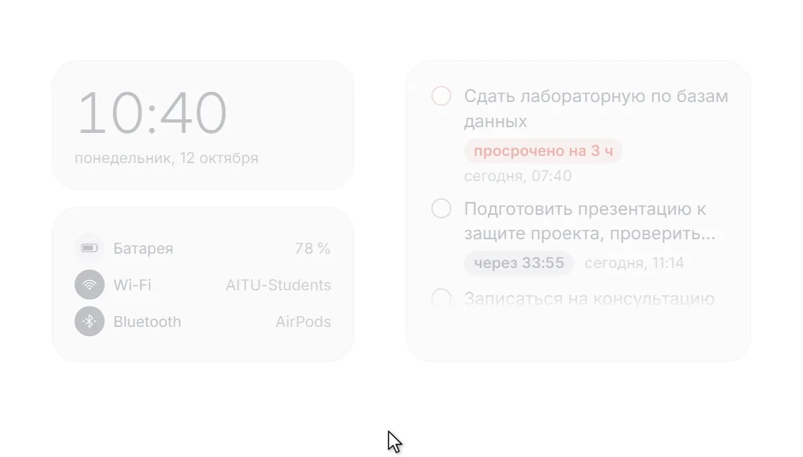

<div align="center">


# AITU Desk

**Виджеты на рабочий стол Windows 11 для студентов Astana IT University.**

Часы, заряд и сеть, нагрузка компьютера, ярлыки, заметки с дедлайнами, расписание пар, календарь,<br>карта AITU и ваши картинки лежат прямо на обоях.

[](https://github.com/cyberbara01/aitudesk/releases/latest)
[](#установка)
[](README.md)
[](LICENSE)
[](#почему-ему-можно-доверять)
[](#установка)

<a href="https://github.com/cyberbara01/aitudesk/releases/latest"></a>

**Русский** · [Қазақша](README.kk.md) · [English](README.md)

<sub>Неофициальный студенческий проект, не связан с Astana IT University.</sub>

</div>

<p align="center">
  
</p>

<p align="center">
<picture>
  <source media="(max-width: 700px) and (prefers-color-scheme:dark)" srcset="docs/screenshots/m/map-dark.webp">
  <source media="(max-width: 700px)" srcset="docs/screenshots/m/map.webp">
  <source media="(prefers-color-scheme: dark)" srcset="docs/screenshots/map-dark.webp">
  
</picture>
  <br><sub>Карта приближается колесом там, где курсор, а двойной щелчок показывает весь этаж</sub>
</p>

<p align="center">
<picture>
  <source media="(max-width: 700px) and (prefers-color-scheme:dark)" srcset="docs/screenshots/m/calendar-dark.webp">
  <source media="(max-width: 700px)" srcset="docs/screenshots/m/calendar.webp">
  <source media="(prefers-color-scheme: dark)" srcset="docs/screenshots/calendar-dark.webp">
  
</picture>
  <br><sub>Правый щелчок по дню календаря делает заметку или напоминание на этот день</sub>
</p>

<p align="center">
<picture>
  <source media="(max-width: 700px) and (prefers-color-scheme:dark)" srcset="docs/screenshots/m/stack-dark.webp">
  <source media="(max-width: 700px)" srcset="docs/screenshots/m/stack.webp">
  <source media="(prefers-color-scheme: dark)" srcset="docs/screenshots/stack-dark.webp">
  
</picture>
  <br><sub>Стопка листается мышью, колесом, двумя пальцами по тачпаду и стрелками</sub>
</p>

<p align="center">
<picture>
  <source media="(max-width: 700px) and (prefers-color-scheme:dark)" srcset="docs/screenshots/m/stack-in-dark.webp">
  <source media="(max-width: 700px)" srcset="docs/screenshots/m/stack-in.webp">
  <source media="(prefers-color-scheme: dark)" srcset="docs/screenshots/stack-in-dark.webp">
  
</picture>
  <br><sub>Любой виджет перетаскивается в стопку, а стопок можно сделать несколько</sub>
</p>

<p align="center">
<picture>
  <source media="(max-width: 700px) and (prefers-color-scheme:dark)" srcset="docs/screenshots/m/fold-dark.webp">
  <source media="(max-width: 700px)" srcset="docs/screenshots/m/fold.webp">
  <source media="(prefers-color-scheme: dark)" srcset="docs/screenshots/fold-dark.webp">
  
</picture>
  <br><sub>Любой виджет сворачивается в значок и раскрывается по щелчку</sub>
</p>

<p align="center">
<picture>
  <source media="(max-width: 700px) and (prefers-color-scheme:dark)" srcset="docs/screenshots/m/move-dark.webp">
  <source media="(max-width: 700px)" srcset="docs/screenshots/m/move.webp">
  <source media="(prefers-color-scheme: dark)" srcset="docs/screenshots/move-dark.webp">
  
</picture>
  <br><sub>Виджет двигается мышью, встаёт по сетке и растягивается за угол, а всё внутри растёт вместе с ним</sub>
</p>

<p align="center">
<picture>
  <source media="(max-width: 700px) and (prefers-color-scheme:dark)" srcset="docs/screenshots/m/scale-dark.webp">
  <source media="(max-width: 700px)" srcset="docs/screenshots/m/scale.webp">
  <source media="(prefers-color-scheme: dark)" srcset="docs/screenshots/scale-dark.webp">
  
</picture>
  <br><sub>Размер текста: текст и значки мельче или крупнее при любом размере виджета</sub>
</p>

<p align="center">
<picture>
  <source media="(max-width: 700px) and (prefers-color-scheme:dark)" srcset="docs/screenshots/m/fade-dark.webp">
  <source media="(max-width: 700px)" srcset="docs/screenshots/m/fade.webp">
  <source media="(prefers-color-scheme: dark)" srcset="docs/screenshots/fade-dark.webp">
  
</picture>
  <br><sub>Проявление при наведении: полупрозрачный виджет проявляется под курсором</sub>
</p>

## Что умеет

<table>
<tr>
<td width="33%" valign="top"><br><b>Расписание</b><br>Текущая пара, следующая и сколько осталось</td>
<td width="33%" valign="top"><br><b>Заметки</b><br>Дедлайны с живым отсчётом</td>
<td width="33%" valign="top"><br><b>Напоминания</b><br>Перед парой и дедлайном, тихие часы</td>
</tr>
<tr>
<td width="33%" valign="top"><br><b>Календарь</b><br>Месяц, дедлайны заметок и пары дня</td>
<td width="33%" valign="top"><br><b>Карта AITU</b><br>Все этажи и поиск: 223 или C1.2.223</td>
<td width="33%" valign="top"><br><b>Часы</b><br>Стили, шрифт, размер, секунды и дата</td>
</tr>
<tr>
<td width="33%" valign="top"><br><b>Система</b><br>Заряд, Wi-Fi и Bluetooth, имена скрываются</td>
<td width="33%" valign="top"><br><b>Нагрузка</b><br>Процессор, видеокарта, память и диск</td>
<td width="33%" valign="top"><br><b>Ярлыки</b><br>DU, LMS, Learn и любой сайт</td>
</tr>
<tr>
<td width="33%" valign="top"><br><b>Свои виджеты</b><br>Картинка или GIF на обоях, до 20 штук</td>
<td width="33%" valign="top"><br><b>Стопки виджетов</b><br>Несколько стопок, любые виджеты</td>
<td width="33%" valign="top"><br><b>Расположение</b><br>Сетка значков, размер окна и текста</td>
</tr>
<tr>
<td width="33%" valign="top"><br><b>Свой фон</b><br>Цвет или градиент на весь экран</td>
<td width="33%" valign="top"><br><b>Проявление</b><br>Виджет проявляется под курсором</td>
<td width="33%" valign="top"><br><b>Приватность</b><br>Текст за точками, ничего не отправляет</td>
</tr>
<tr>
<td width="33%" valign="top"><br><b>Конфиги</b><br>Все настройки в одном файле</td>
<td width="33%" valign="top"><br><b>Журнал ошибок</b><br>Отчёт о сбое в один клик, без личного</td>
<td width="33%" valign="top"><br><b>Три языка</b><br>Русский, казахский и английский</td>
</tr>
</table>

<p align="center">
<picture>
  <source media="(prefers-color-scheme: dark)" srcset="docs/screenshots/widgets-dark.webp">
  
</picture>
</p>

## Под себя

<p align="center">
<picture>
  <source media="(prefers-color-scheme: dark)" srcset="docs/screenshots/looks-dark.webp">
  
</picture>
  <br><sub>Windows 11, Aqua, Rice и Pearl · свой акцент и любой цвет значков и текста · свой фон: цвет или градиент на весь экран · темы от светлой до чёрной</sub>
</p>

## Установка

1. Скачайте `AITU-Desk_<версия>_x64-setup.exe` со страницы [последнего релиза](https://github.com/cyberbara01/aitudesk/releases/latest) и запустите.
2. Если Windows покажет «Система Windows защитила ваш компьютер», нажмите «Подробнее», затем «Выполнить в любом
   случае». Предупреждение появляется, потому что приложение не подписано платным сертификатом.
3. Откроется окно настроек с короткой инструкцией, а на рабочем столе появятся виджеты. Дальше они запускаются вместе
   с Windows; это можно выключить в «Общих».

Нужна Windows 11, 64-бит. Интерфейс на русском, казахском или английском, как в Windows; переключается в «Общих» или
кнопкой «RU | KZ | EN» внизу окна настроек.

<details>
<summary><b>Проверить, что установщик настоящий</b></summary>
<br>

Рядом с установщиком в релизе лежит `SHA256SUMS.txt`. Сравните его с хешем скачанного файла в PowerShell:

```powershell
Get-FileHash ".\AITU-Desk_1.0.0_x64-setup.exe" -Algorithm SHA256
```

GitHub ещё и подтверждает, что сам собрал файл из этого репозитория: тот же хеш есть на странице
[подтверждений сборки](https://github.com/cyberbara01/aitudesk/attestations). Эту запись делает GitHub Actions во
время сборки и подписывает её, у файла, загруженного вручную, её нет. Через [GitHub CLI](https://cli.github.com) это
одна команда:

```powershell
gh attestation verify ".\AITU-Desk_1.0.0_x64-setup.exe" --repo cyberbara01/aitudesk
```

Сборку делает [`.github/workflows/release.yml`](.github/workflows/release.yml) из исходников этого репозитория.
</details>

<details>
<summary><b>Что делает установщик и где хранятся данные</b></summary>
<br>

| Что | Где |
| --- | --- |
| Программа `aitudesk.exe` и деинсталлятор `uninstall.exe` | `%LOCALAPPDATA%\AITU Desk\` |
| Ярлык в меню «Пуск» и, если оставить галочку, на рабочем столе | меню «Пуск», рабочий стол |
| Запись для удаления в «Установленных приложениях» | `HKCU\Software\Microsoft\Windows\CurrentVersion\Uninstall\AITU Desk` |
| Настройки, пары, заметки, ярлыки, расположение виджетов (обычный JSON) | `%APPDATA%\kz.edu.astanait.aitudesk\settings.json` |
| Копии картинок ваших виджетов | `%APPDATA%\kz.edu.astanait.aitudesk\widgets\` |
| Служебный кеш WebView2 | `%LOCALAPPDATA%\kz.edu.astanait.aitudesk\EBWebView\` |
| Автозапуск (включён с первого запуска, переключатель в «Общих») | значение `AITU Desk` в `HKCU\Software\Microsoft\Windows\CurrentVersion\Run` |

Больше установщик ничего не делает: никаких служб, драйверов, задач планировщика, расширений браузера и программ в
нагрузку. WebView2 уже есть в Windows 11; только если его нет, установщик скачает его с сайта Microsoft.

Файл настроек открывается в Блокноте. Если после правки он перестанет читаться, приложение не сотрёт его, а
переименует в `settings.broken-<время>.json`.
</details>

<details>
<summary><b>Сеть и приватность</b></summary>
<br>

- Сеть нужна только по вашему действию: открыть ярлык в браузере или один раз скачать иконку сайта, когда вы
  добавляете или меняете ярлык (запрос к самому сайту и, если иконки там нет, к сервису иконок Google, которого не
  спрашивают про локальные имена). Иконки DU, LMS и Learn встроены. Сайт не может перенаправить эти запросы на
  устройства вашей домашней сети.
- Расписание, заметки, имя сети Wi-Fi и имена Bluetooth-устройств на рабочем столе можно скрыть за точками.
- Температуру процессора даёт Windows там, где она её знает (в основном на ноутбуках). На большинстве стационарных ПК
  её нет, и приложение не ставит для этого драйвер: оно берёт температуру из программы мониторинга, которую вы и так
  запускаете (LibreHardwareMonitor, HWiNFO, Core Temp, MSI Afterburner или AIDA64), только на этом компьютере.
- В конфиг попадают только выбранные вами части, а заметки и свои виджеты по умолчанию не попадают. Ярлыки из
  чужого конфига принимаются только с адресами `http://` и `https://`, а картинки только если это действительно
  картинки.
</details>

<details>
<summary><b>Удаление</b></summary>
<br>

Параметры → Приложения → Установленные приложения → AITU Desk → Удалить. Галочка «Удалить данные приложения» сотрёт
и настройки; без неё они останутся на случай повторной установки. Перед удалением всё можно сохранить в конфиг в
разделе «Конфиги». Чтобы начать заново без удаления, кнопка «Сбросить всё» внизу «Общих» сделает приложение таким,
как сразу после установки.
</details>

## Почему ему можно доверять

- **Открытый код** под лицензией MIT: всё, что делает приложение, есть в этом репозитории.
- **Ничего не отправляет**: ни телеметрии, ни рекламы, ни аккаунтов, ни автообновлений.
- **Не нужны права администратора**, ставится только для вашей учётной записи.
- **Собирается на GitHub**: установщик каждого релиза собирает GitHub Actions из исходников, рядом лежат контрольные
  суммы, а GitHub подписывает подтверждение сборки.
- **Лёгкое**: установщик около 3 МБ, а в покое приложение почти не нагружает процессор.

**Приватность.** AITU Desk выходит в сеть, только когда вы сами просите: открыть ярлык или загрузить иконку сайта.
Пары, заметки и настройки остаются на вашем компьютере. Подробности в «Сеть и приватность» в разделе
[«Установка»](#установка).

## Вопросы

<details>
<summary><b>Windows пишет «Система Windows защитила ваш компьютер». Это опасно?</b></summary>
<br>

Нет. Так Windows встречает любую программу без платной цифровой подписи. Нажмите «Подробнее», затем «Выполнить в
любом случае». Установщик собирает GitHub из открытого кода этого репозитория, а проверить файл можно по разделу
«Проверить, что установщик настоящий» выше.
</details>

<details>
<summary><b>Я учусь не в AITU. Мне пригодится?</b></summary>
<br>

Да. Часы, нагрузка, заметки, расписание, ярлыки и свои картинки нужны любому. Карту и ярлыки университета можно
выключить в настройках.
</details>

<details>
<summary><b>Не будет ли тормозить компьютер или садиться батарея?</b></summary>
<br>

Нет. В покое AITU Desk почти не нагружает процессор. Пока игра или фильм открыты на весь экран, нагрузка не
считывается и GIF стоят, а в режиме экономии батареи всё обновляется реже.
</details>

<details>
<summary><b>Работает ли на Windows 10?</b></summary>
<br>

Нет, нужна Windows 11, 64-бит. Закруглённые углы, стекло и прозрачность виджетов есть только в Windows 11.
</details>

<details>
<summary><b>Программа зависла или закрылась сама. Что делать?</b></summary>
<br>

Откройте AITU Desk снова. В разделе «О программе» включите «Записывать журнал», а когда сбой повторится, нажмите
«Сохранить отчёт» и пришлите файл в Telegram [@capybara205](https://t.me/capybara205). В журнале только то, что
происходило в приложении: что включено, что нажато и ошибки. Тексты заметок и пар, адреса ярлыков, названия сетей и
устройств туда не попадают, и файл никуда не отправляется сам.
</details>

<details>
<summary><b>Как открыть настройки или вернуть виджеты?</b></summary>
<br>

Щёлкните значок AITU Desk в трее или запустите программу ещё раз из меню «Пуск»: откроется окно настроек. В разделе
«Виджеты» каждый виджет включается и выключается отдельно.
</details>

## Ссылки

| Что | Где |
| --- | --- |
| Скачать | [Последний релиз](https://github.com/cyberbara01/aitudesk/releases/latest) |
| Ошибка или идея | [Issues](https://github.com/cyberbara01/aitudesk/issues), Telegram [@capybara205](https://t.me/capybara205) или [анонимная форма](https://forms.gle/LV7BYCqeveRyRm9YA) |
| Оценить приложение | [Та же форма](https://forms.gle/LV7BYCqeveRyRm9YA): ваши данные не нужны, а без вашего фидбэка софт не будет расти |
| Автор | [@cyberbara01](https://github.com/cyberbara01) |
| Карта AITU | [aitumap](https://github.com/Yuujiso/aitumap), автор [Yuujiso](https://github.com/Yuujiso) |
| Сторонние компоненты | [THIRD-PARTY-NOTICES.md](THIRD-PARTY-NOTICES.md) |

<details>
<summary><b>Сборка из исходников</b></summary>
<br>

Нужны Node.js 22+, Rust (stable) и, по [инструкции Tauri](https://tauri.app/start/prerequisites/), Microsoft C++
Build Tools (или mingw-w64 для цели `x86_64-pc-windows-gnu`).

```bash
npm install
npm run tauri dev      # запуск в режиме разработки
npm run tauri build    # установщик появится в src-tauri/target/release/bundle/nsis/
```

Для проверки без ноутбука есть переменные окружения: `AITUDESK_MOCK_POWER` (`none` | `78` | `15,charging` |
`40,saver`), `AITUDESK_MOCK_WIFI` (`off` | `SSID,bars` | `hidden,bars`), `AITUDESK_MOCK_BT` (`off` | `none` |
`A;B;C`).

Внутри: Tauri 2, Rust, React 18, TypeScript и Vite. Все виджеты работают в одном процессе WebView2, часы просыпаются
раз в минуту, если секунды не показаны, а скрытые и свёрнутые в значок виджеты не держат таймеров. Пока программа
открыта на весь экран, нагрузка не считывается и GIF стоят. В режиме экономии Windows часы прячут секунды, заряд, сеть
и нагрузка проверяются реже, а GIF стоят. При прозрачности «Без прозрачности» виджеты сбрасывают акрил, и видеокарте
легче.

[](https://tauri.app)
[](https://www.rust-lang.org)
[](https://react.dev)
</details>

## Лицензия

[MIT](LICENSE): пользуйтесь, меняйте и делитесь, сохраняя имя автора. Сторонние компоненты (карта, иконки, шрифты)
перечислены в [THIRD-PARTY-NOTICES.md](THIRD-PARTY-NOTICES.md).
