<div align="center">


# AITU Desk

**Виджеты на рабочий стол Windows 11 для студентов Astana IT University.**

Часы, заряд и сеть, нагрузка компьютера, ярлыки, заметки с дедлайнами, расписание пар, карта AITU<br>и ваши картинки лежат прямо на обоях.

[](https://github.com/cyberbara01/aitudesk/releases/latest)
[](#установка)
[](README.md)
[](LICENSE)
[](#почему-ему-можно-доверять)
[](#установка)

<a href="https://github.com/cyberbara01/aitudesk/releases/latest"></a>

**Русский** · [English](README.md)

</div>

<p align="center">
  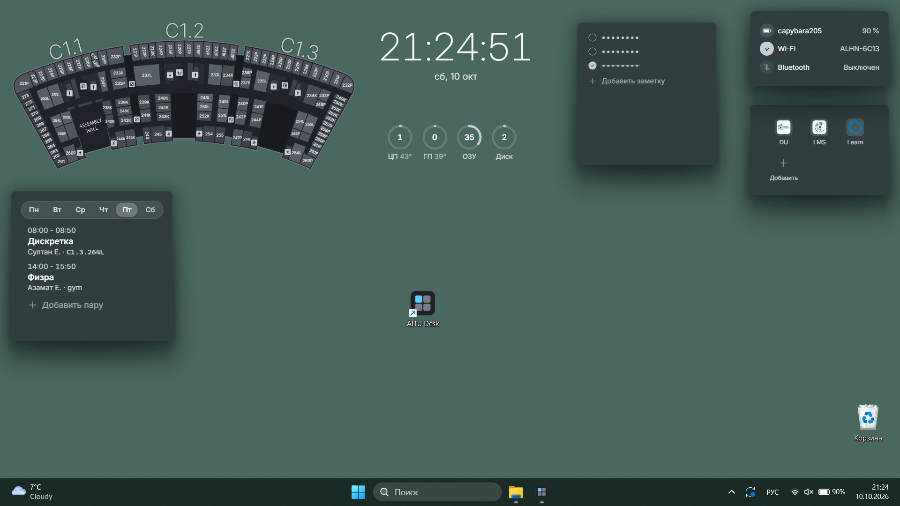
  <br><sub>Настоящий ноутбук: карта, часы и нагрузка вверху, расписание, заметки, система и ярлыки вокруг них.</sub>
</p>

## Что на рабочем столе

<table>
<tr>
<td width="50%" valign="top"><br><b>Часы</b><br>Готовые стили и тонкая настройка: шрифт, толщина, размер, секунды, дата и её место, любой цвет</td>
<td width="50%" valign="top"><br><b>Система</b><br>Заряд батареи, Wi-Fi и Bluetooth; имена сети и устройств можно скрыть за точками</td>
</tr>
<tr>
<td width="50%" valign="top"><br><b>Нагрузка</b><br>Процессор, видеокарта, память и диск с температурой: кольца, полосы, числа или строка</td>
<td width="50%" valign="top"><br><b>Ярлыки</b><br>DU, LMS и Learn с настоящими иконками и любые ваши сайты: достаточно ввести youtube.com</td>
</tr>
<tr>
<td width="50%" valign="top"><br><b>Заметки</b><br>Дедлайны с живым отсчётом, добавляются и правятся прямо на виджете, расставляются мышью</td>
<td width="50%" valign="top"><br><b>Расписание</b><br>Пары по дням недели, текущая и следующая подсвечены; щелчок по аудитории покажет её на карте</td>
</tr>
<tr>
<td width="50%" valign="top"><br><b>Напоминания</b><br>Уведомления Windows перед парой и дедлайном, тихие часы</td>
<td width="50%" valign="top"><br><b>Карта AITU</b><br>Все этажи, поиск кабинета, ваши метки, шесть схем, прозрачность до наведения, зум колесом или двумя пальцами</td>
</tr>
<tr>
<td width="50%" valign="top"><br><b>Свои виджеты</b><br>Ваша картинка или GIF на рабочем столе, до 20 штук</td>
<td width="50%" valign="top"><br><b>Дизайны</b><br>Windows 11, Aqua, Rice и Pearl, пять тем и стекло, каждая часть дизайна выбирается отдельно</td>
</tr>
<tr>
<td width="50%" valign="top"><br><b>Цвета</b><br>Свой акцент и любой цвет значков и текста: для всех виджетов или для одного</td>
<td width="50%" valign="top"><br><b>Расположение</b><br>Перетаскивание, размер, сетка значков рабочего стола, скругление углов, виджет-значок</td>
</tr>
<tr>
<td width="50%" valign="top"><br><b>Приватность</b><br>Текст на рабочем столе можно скрыть за точками, как пароль; приложение ничего не отправляет</td>
<td width="50%" valign="top"><br><b>Конфиги</b><br>Все настройки в одном файле: для другого компьютера или друга</td>
</tr>
</table>

Всё настраивается в одном окне, на русском или английском. Учитесь не в AITU? Всё, кроме карты, пригодится любому, а карту и ярлыки университета можно выключить.

## Под себя

Четыре дизайна, пять тем и стекло, свой акцентный цвет и любой цвет значков и текста. Каждую часть дизайна (шрифт, цифры, скругления, отступы, рамки, прозрачность) можно выбрать отдельно.

<p align="center">
  <picture><source media="(prefers-color-scheme: dark)" srcset="docs/screenshots/board-designs-dark.webp">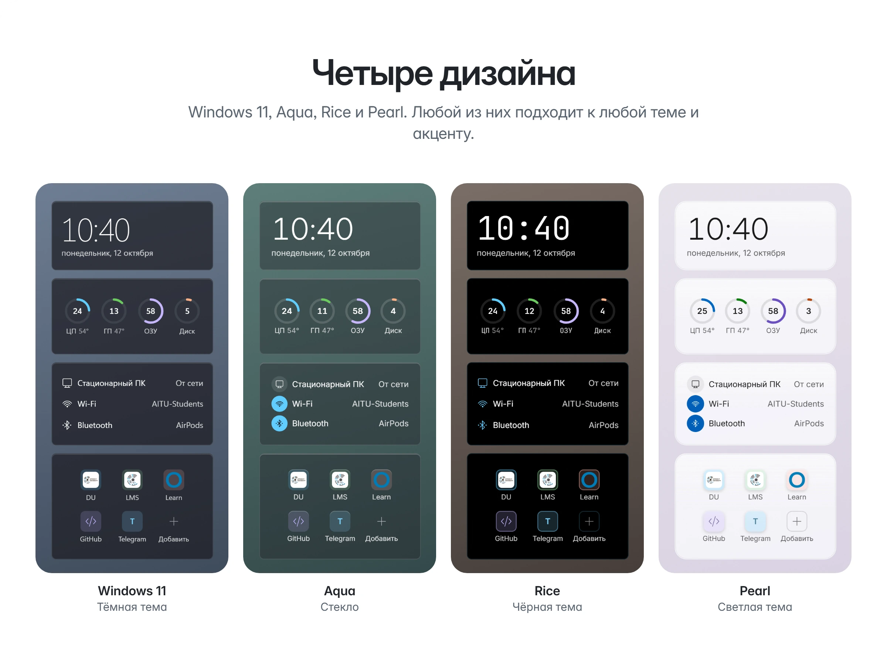</picture>
</p>

<p align="center">
  <picture><source media="(prefers-color-scheme: dark)" srcset="docs/screenshots/board-colors-dark.webp">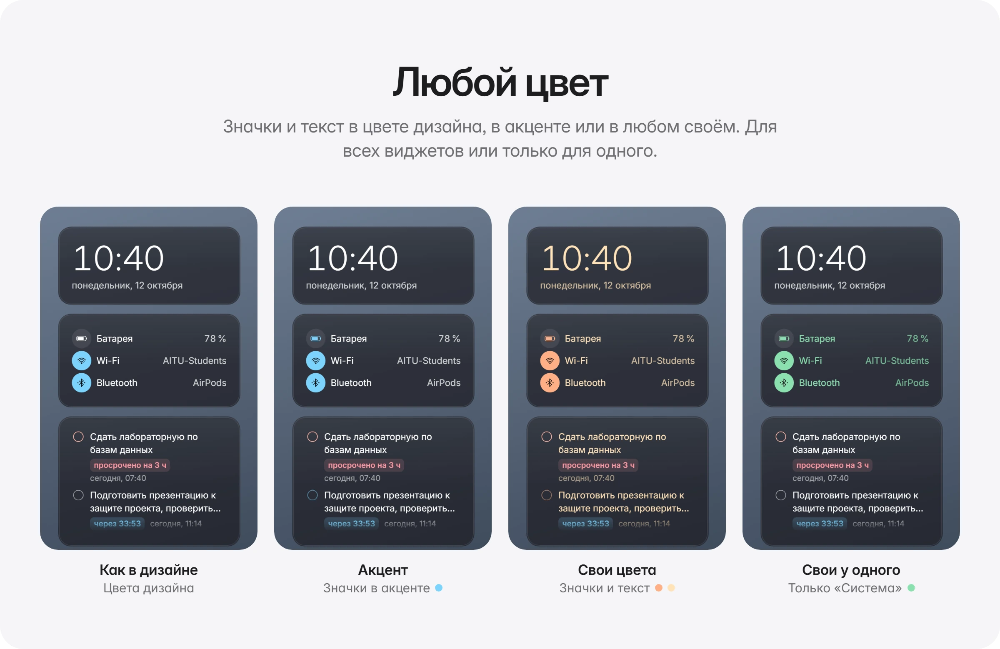</picture>
</p>

<p align="center">
  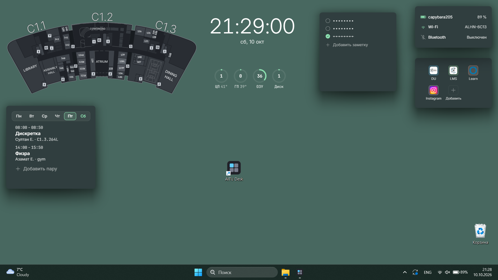
  <br><sub>Ваш акцентный цвет проходит через все виджеты: здесь розовый и зелёный.</sub>
</p>

## Ваш стол, ваше расположение

Двигайте виджеты мышью, меняйте их размер, выравнивайте по сетке значков рабочего стола и выбирайте скругление углов прямо в меню виджета. Виджет, который нужен время от времени, сворачивается в значок и по щелчку вырастает в окно.

<p align="center">
  <picture><source media="(prefers-color-scheme: dark)" srcset="docs/screenshots/board-grid-dark.webp">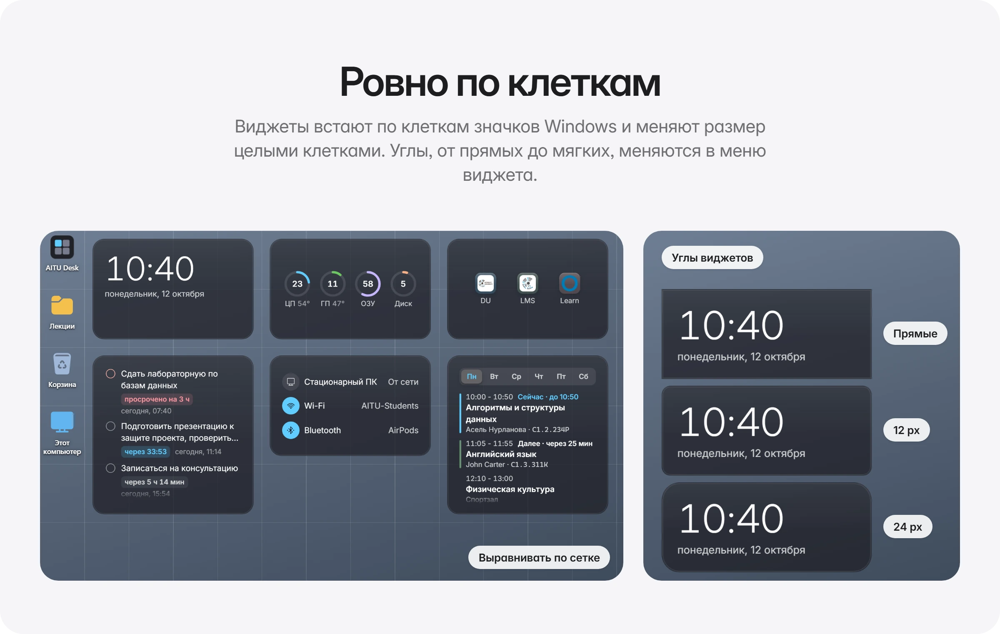</picture>
</p>

<p align="center">
  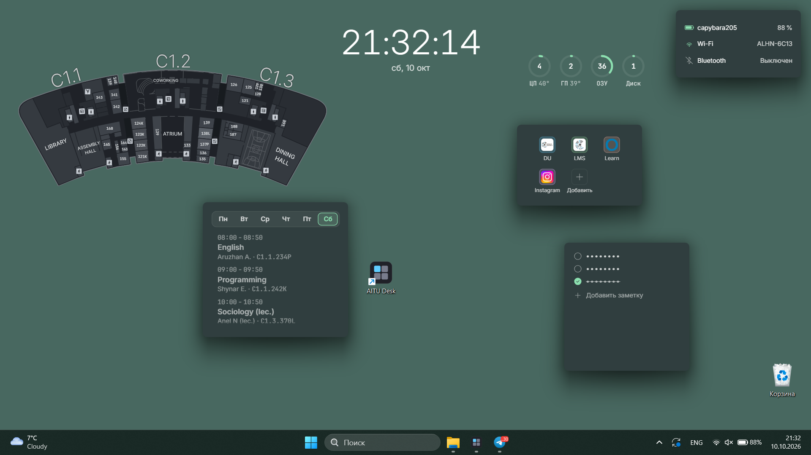
  <br><sub>Любое расположение: виджеты перетаскиваются куда угодно и меняют размер, а всё внутри растёт вместе с ними.</sub>
</p>

<p align="center">
  <picture><source media="(prefers-color-scheme: dark)" srcset="docs/screenshots/board-desktop-dark.webp">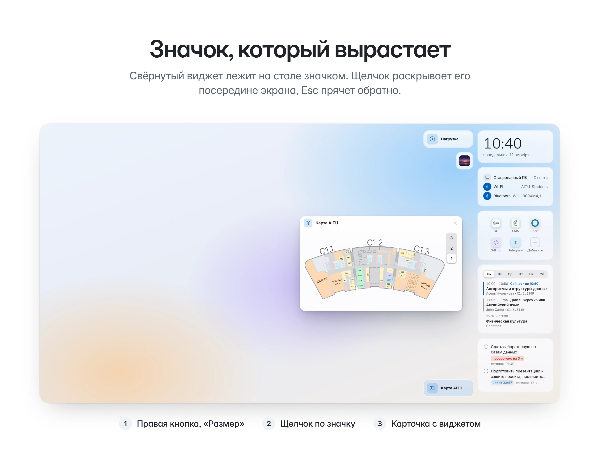</picture>
</p>

## Карта AITU

Этажи университета прямо на рабочем столе: найдите кабинет по номеру (223 или C1.2.223), переключите этаж, покрасьте свои кабинеты кистью. Аудитория следующей пары отмечена кольцом, а щелчок по аудитории в расписании ведёт сюда.

<p align="center">
  <picture><source media="(prefers-color-scheme: dark)" srcset="docs/screenshots/board-map-dark.webp">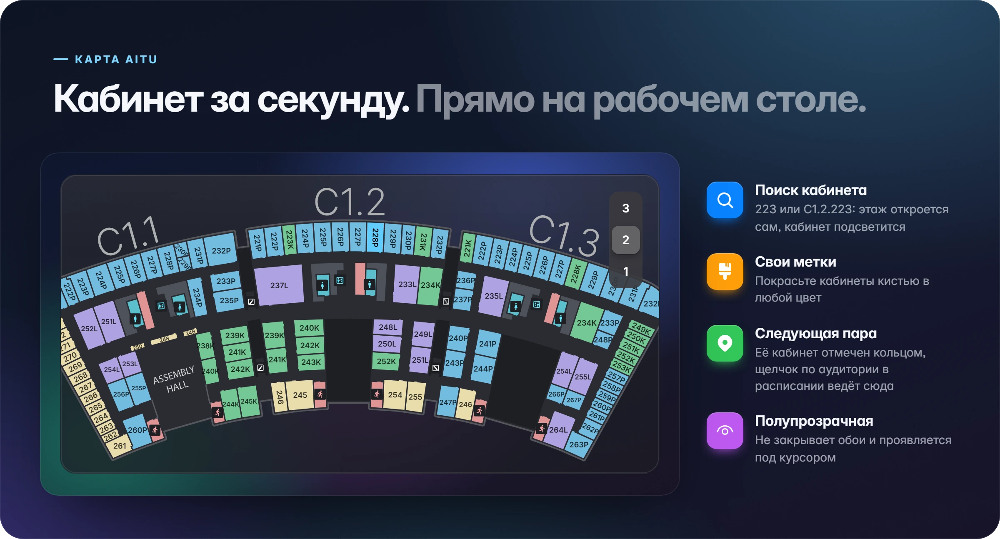</picture>
</p>

<p align="center">
  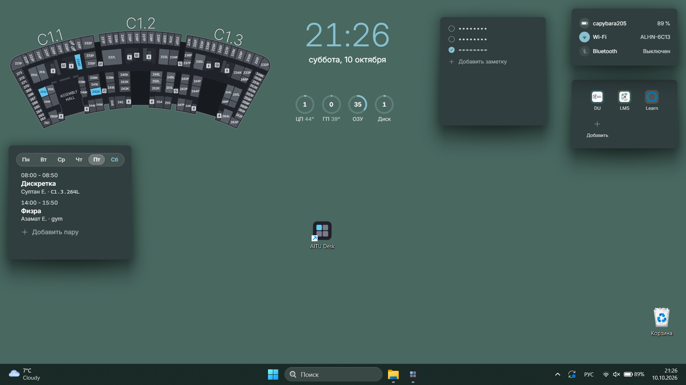
  <br><sub>Карта целым этажом или крупно, с вашими кабинетами в ваших цветах.</sub>
</p>

## Как это работает

<table>
<tr>
<td width="33%" valign="top" align="center">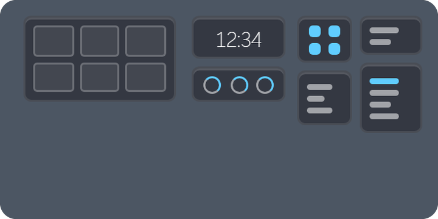<br><b>Прямо на обоях</b><br><sub>Карта слева вверху, часы и нагрузка посередине, остальное справа. Двигайте и меняйте размер как удобно</sub></td>
<td width="33%" valign="top" align="center">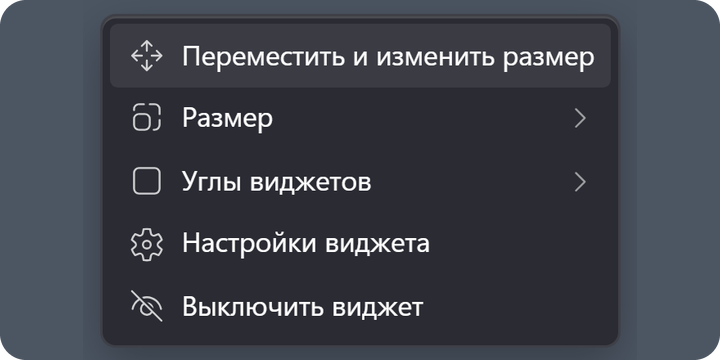<br><b>Правая кнопка мыши</b><br><sub>Переместить, изменить размер (всё внутри растёт), скруглить углы, свернуть в значок, открыть настройки</sub></td>
<td width="33%" valign="top" align="center">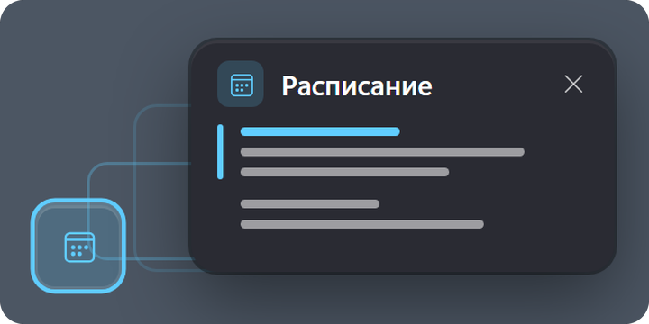<br><b>Значок, который вырастает</b><br><sub>Маленький или средний виджет становится значком, по щелчку он вырастает в окно посередине экрана</sub></td>
</tr>
<tr>
<td width="33%" valign="top" align="center">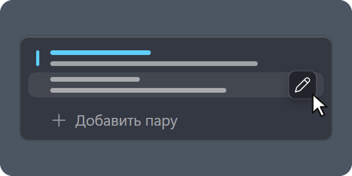<br><b>Добавить и изменить на месте</b><br><sub>«+» в конце расписания и заметок, карандаш на строке под курсором</sub></td>
<td width="33%" valign="top" align="center">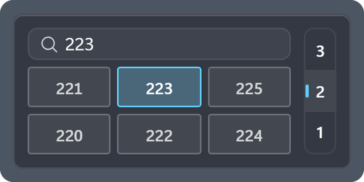<br><b>Карта AITU</b><br><sub>Найдите кабинет (223 или C1.2.223), переключите этаж, покрасьте свои кабинеты; карта может быть прозрачной, пока на неё не наведёшь</sub></td>
<td width="33%" valign="top" align="center">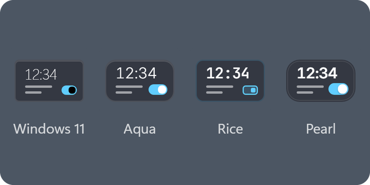<br><b>Четыре дизайна</b><br><sub>Windows 11, Aqua, Rice и Pearl, пять тем, свой акцент и любой цвет значков и текста</sub></td>
</tr>
</table>

## Мелочи, которые приятны

<table>
<tr>
<td width="50%" valign="top"><b>Не боится Win+D</b><br>«Свернуть все окна» не прячет виджеты, а сами они никогда не закрывают ваши окна.</td>
<td width="50%" valign="top"><b>Живой отсчёт</b><br>За час до дедлайна заметка считает секунды.</td>
</tr>
<tr>
<td width="50%" valign="top"><b>Из расписания на карту</b><br>Щелчок по аудитории пары находит её на карте.</td>
<td width="50%" valign="top"><b>Отдыхает, когда не видно</b><br>Пока программа на весь экран или виджет свёрнут в значок, ничего не читается и не рисуется.</td>
</tr>
<tr>
<td width="50%" valign="top"><b>Бережёт батарею</b><br>В режиме экономии Windows часы прячут секунды, а данные обновляются реже.</td>
<td width="50%" valign="top"><b>Не теряет данные</b><br>Файл настроек, который перестал читаться, откладывается в сторону, а не стирается.</td>
</tr>
<tr>
<td width="50%" valign="top"><b>Дружит с тачпадом</b><br>Щипок двумя пальцами приближает карту, перетаскивание двигает её.</td>
<td width="50%" valign="top"><b>Лёгкое</b><br>Около 3 МБ, без прав администратора, ставится только для вашей учётной записи.</td>
</tr>
</table>

<p align="center">
  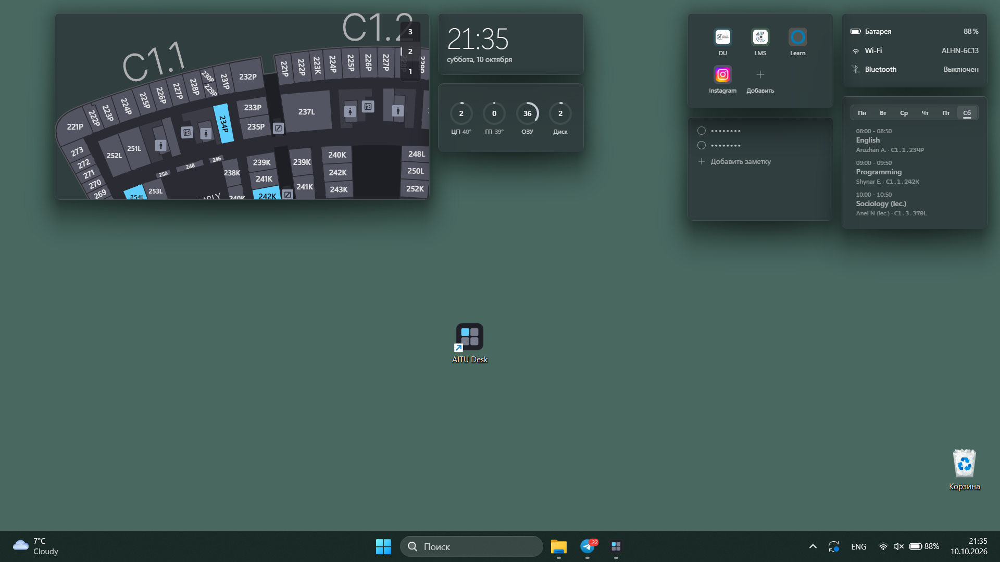
  <br><sub>Каждый рабочий стол свой: соберите виджеты вместе или разнесите и оставьте только нужные.</sub>
</p>

## Настройки

Одно окно для всего: у каждого пункта есть подсказка, а виджеты меняются в тот же миг.

<p align="center">
  <picture><source media="(prefers-color-scheme: dark)" srcset="docs/screenshots/board-settings-dark.webp">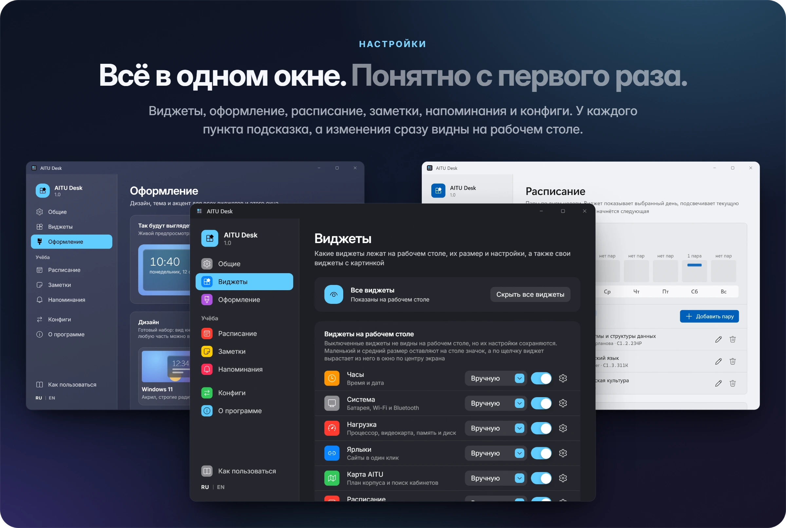</picture>
</p>

<details>
<summary><b>Все страницы настроек</b></summary>
<br>

<table>
<tr>
<td width="50%" valign="top" align="center"><picture><source media="(prefers-color-scheme: dark)" srcset="docs/screenshots/settings-widgets-dark.webp">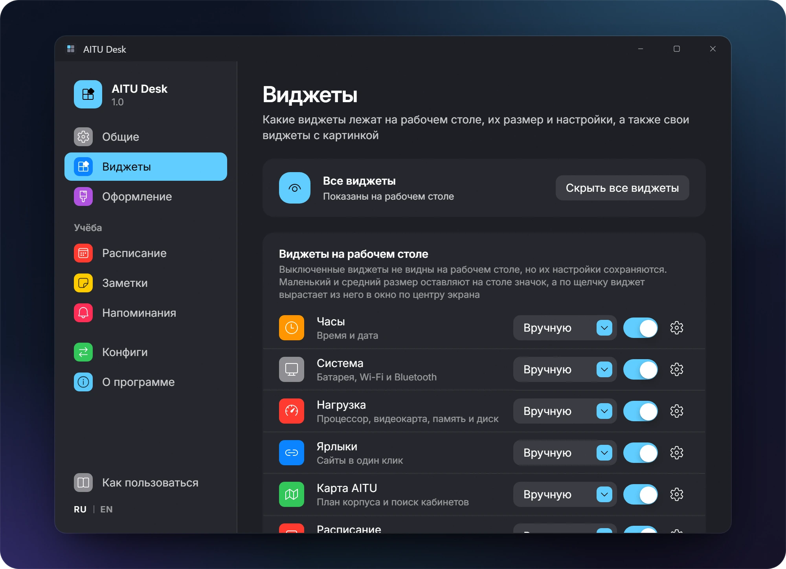</picture><br><sub>Виджеты: какие лежат на рабочем столе, их размер и свои виджеты с картинкой</sub></td>
<td width="50%" valign="top" align="center"><picture><source media="(prefers-color-scheme: dark)" srcset="docs/screenshots/settings-general-dark.webp">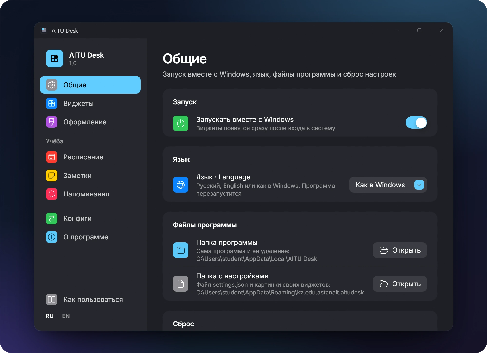</picture><br><sub>Общие: запуск с Windows, язык, файлы программы, сброс</sub></td>
</tr>
<tr>
<td width="50%" valign="top" align="center"><picture><source media="(prefers-color-scheme: dark)" srcset="docs/screenshots/settings-appearance-dark.webp">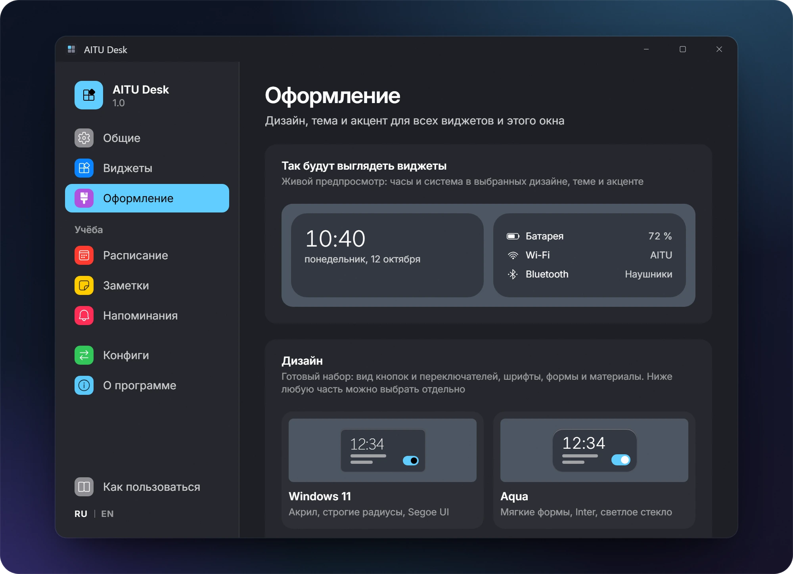</picture><br><sub>Оформление: дизайн и его части по отдельности</sub></td>
<td width="50%" valign="top" align="center"><picture><source media="(prefers-color-scheme: dark)" srcset="docs/screenshots/settings-perf-dark.webp">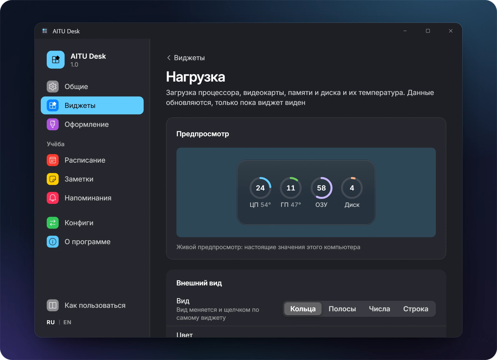</picture><br><sub>Нагрузка: процессор, видеокарта, память и диск</sub></td>
</tr>
<tr>
<td width="50%" valign="top" align="center"><picture><source media="(prefers-color-scheme: dark)" srcset="docs/screenshots/settings-notes-dark.webp">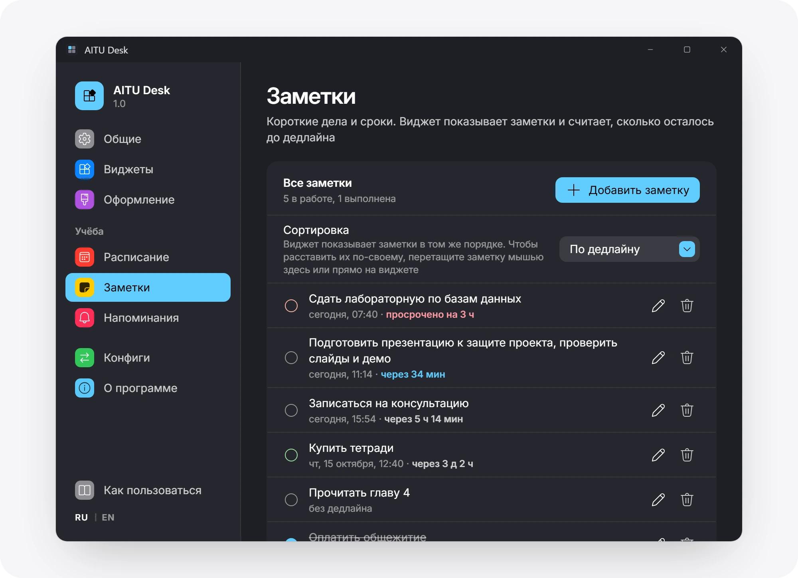</picture><br><sub>Заметки с дедлайнами в своём порядке</sub></td>
<td width="50%" valign="top" align="center"><picture><source media="(prefers-color-scheme: dark)" srcset="docs/screenshots/settings-own-widget-dark.webp">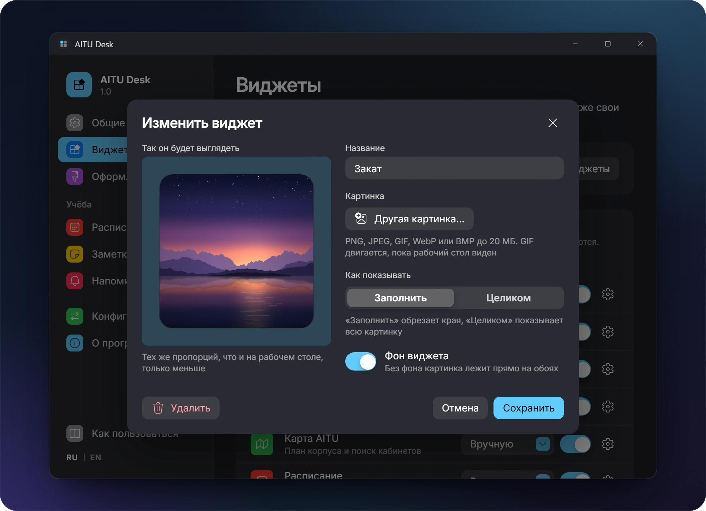</picture><br><sub>Свой виджет с живым предпросмотром</sub></td>
</tr>
<tr>
<td width="50%" valign="top" align="center"><picture><source media="(prefers-color-scheme: dark)" srcset="docs/screenshots/settings-reminders-dark.webp">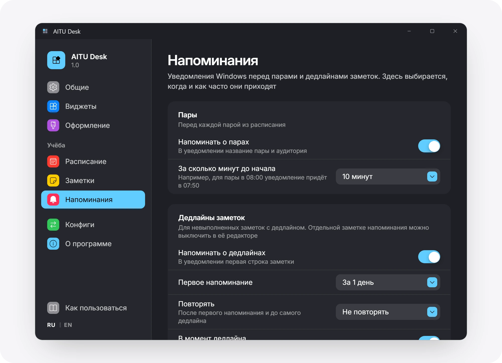</picture><br><sub>Напоминания о парах и дедлайнах</sub></td>
<td width="50%" valign="top" align="center"><picture><source media="(prefers-color-scheme: dark)" srcset="docs/screenshots/settings-configs-dark.webp">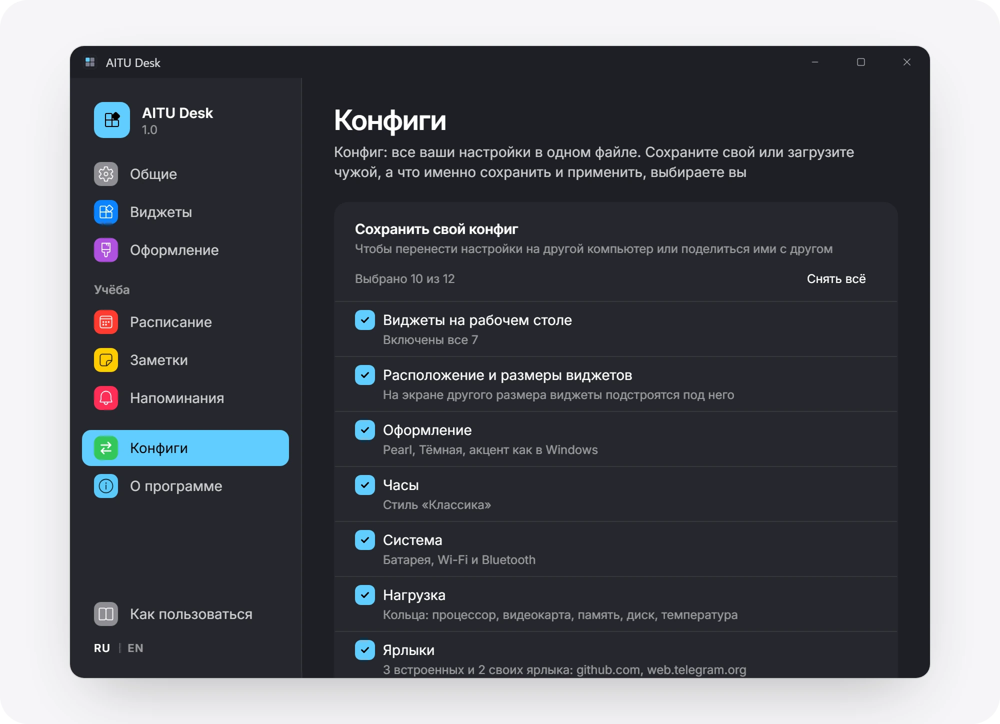</picture><br><sub>Конфиги: настройки в файле</sub></td>
</tr>
</table>
</details>

## Установка

1. Скачайте `AITU-Desk_<версия>_x64-setup.exe` со страницы [последнего релиза](https://github.com/cyberbara01/aitudesk/releases/latest) и запустите.
2. Если Windows покажет «Система Windows защитила ваш компьютер», нажмите «Подробнее», затем «Выполнить в любом
   случае». Предупреждение появляется, потому что приложение не подписано платным сертификатом.
3. Откроется окно настроек с короткой инструкцией, а на рабочем столе появятся виджеты. Дальше они запускаются вместе
   с Windows; это можно выключить в «Общих».

Нужна Windows 11, 64-бит. Интерфейс на русском или английском, как в Windows; переключается в «Общих» или кнопкой
«RU | EN» внизу окна настроек.

<details>
<summary><b>Проверить, что установщик настоящий</b></summary>
<br>

Рядом с установщиком в релизе лежит `SHA256SUMS.txt`. Сравните его с хешем скачанного файла в PowerShell:

```powershell
Get-FileHash ".\AITU-Desk_1.0.0_x64-setup.exe" -Algorithm SHA256
```

Сборку делает [`.github/workflows/release.yml`](.github/workflows/release.yml) из исходников этого репозитория.
</details>

<details>
<summary><b>Что делает установщик и где хранятся данные</b></summary>
<br>

| Что | Где |
| --- | --- |
| Программа `aitudesk.exe` и деинсталлятор `uninstall.exe` | `%LOCALAPPDATA%\AITU Desk\` |
| Ярлык в меню «Пуск» и, если оставить галочку, на рабочем столе | меню «Пуск», рабочий стол |
| Запись для удаления в «Установленных приложениях» | `HKCU\Software\Microsoft\Windows\CurrentVersion\Uninstall\AITU Desk` |
| Настройки, пары, заметки, ярлыки, расположение виджетов (обычный JSON) | `%APPDATA%\kz.edu.astanait.aitudesk\settings.json` |
| Копии картинок ваших виджетов | `%APPDATA%\kz.edu.astanait.aitudesk\widgets\` |
| Служебный кеш WebView2 | `%LOCALAPPDATA%\kz.edu.astanait.aitudesk\EBWebView\` |
| Автозапуск (включён с первого запуска, переключатель в «Общих») | значение `AITU Desk` в `HKCU\Software\Microsoft\Windows\CurrentVersion\Run` |

Больше установщик ничего не делает: никаких служб, драйверов, задач планировщика, расширений браузера и программ в
нагрузку. WebView2 уже есть в Windows 11; только если его нет, установщик скачает его с сайта Microsoft.

Файл настроек открывается в Блокноте. Если после правки он перестанет читаться, приложение не сотрёт его, а
переименует в `settings.broken-<время>.json`.
</details>

<details>
<summary><b>Сеть и приватность</b></summary>
<br>

- Сеть нужна только по вашему действию: открыть ярлык в браузере или один раз скачать иконку сайта, когда вы
  добавляете или меняете ярлык (запрос к самому сайту и, если иконки там нет, к сервису иконок Google, которого не
  спрашивают про локальные имена). Иконки DU, LMS и Learn встроены. Сайт не может перенаправить эти запросы на
  устройства вашей домашней сети.
- Расписание, заметки, имя сети Wi-Fi и имена Bluetooth-устройств на рабочем столе можно скрыть за точками.
- Температуру процессора даёт Windows там, где она её знает (в основном на ноутбуках). На большинстве стационарных ПК
  её нет, и приложение не ставит для этого драйвер: оно берёт температуру из программы мониторинга, которую вы и так
  запускаете (LibreHardwareMonitor, HWiNFO, Core Temp, MSI Afterburner или AIDA64), только на этом компьютере.
- В конфиг попадают только выбранные вами части, а заметки и свои виджеты по умолчанию не попадают. Ярлыки из
  чужого конфига принимаются только с адресами `http://` и `https://`, а картинки только если это действительно
  картинки.
</details>

<details>
<summary><b>Удаление</b></summary>
<br>

Параметры → Приложения → Установленные приложения → AITU Desk → Удалить. Галочка «Удалить данные приложения» сотрёт
и настройки; без неё они останутся на случай повторной установки. Перед удалением всё можно сохранить в конфиг в
разделе «Конфиги». Чтобы начать заново без удаления, кнопка «Сбросить всё» внизу «Общих» сделает приложение таким,
как сразу после установки.
</details>

## Почему ему можно доверять

- **Открытый код** под лицензией MIT: всё, что делает приложение, есть в этом репозитории.
- **Ничего не отправляет**: ни телеметрии, ни рекламы, ни аккаунтов, ни автообновлений.
- **Не нужны права администратора**, ставится только для вашей учётной записи.
- **Собирается на GitHub**: установщик каждого релиза собирает GitHub Actions из исходников, рядом лежат контрольные
  суммы.
- **Лёгкое**: установщик около 3 МБ, а в покое приложение почти не нагружает процессор.

**Приватность.** AITU Desk выходит в сеть, только когда вы сами просите: открыть ярлык или загрузить иконку сайта.
Пары, заметки и настройки остаются на вашем компьютере. Подробности в «Сеть и приватность» в разделе
[«Установка»](#установка).

## Ссылки

| Что | Где |
| --- | --- |
| Скачать | [Последний релиз](https://github.com/cyberbara01/aitudesk/releases/latest) |
| Ошибка или идея | [Issues](https://github.com/cyberbara01/aitudesk/issues), Telegram [@capybara205](https://t.me/capybara205) или [анонимная форма](https://forms.gle/LV7BYCqeveRyRm9YA) |
| Оценить приложение | [Та же форма](https://forms.gle/LV7BYCqeveRyRm9YA): ваши данные не нужны, а без вашего фидбэка софт не будет расти |
| Автор | [@cyberbara01](https://github.com/cyberbara01) |
| Карта AITU | [aitumap](https://github.com/Yuujiso/aitumap), автор [Yuujiso](https://github.com/Yuujiso) |
| Сторонние компоненты | [THIRD-PARTY-NOTICES.md](THIRD-PARTY-NOTICES.md) |

<details>
<summary><b>Сборка из исходников</b></summary>
<br>

Нужны Node.js 22+, Rust (stable) и, по [инструкции Tauri](https://tauri.app/start/prerequisites/), Microsoft C++
Build Tools (или mingw-w64 для цели `x86_64-pc-windows-gnu`).

```bash
npm install
npm run tauri dev      # запуск в режиме разработки
npm run tauri build    # установщик появится в src-tauri/target/release/bundle/nsis/
```

Для проверки без ноутбука есть переменные окружения: `AITUDESK_MOCK_POWER` (`none` | `78` | `15,charging` |
`40,saver`), `AITUDESK_MOCK_WIFI` (`off` | `SSID,bars` | `hidden,bars`), `AITUDESK_MOCK_BT` (`off` | `none` |
`A;B;C`).

Внутри: Tauri 2, Rust, React 18, TypeScript и Vite. Все виджеты работают в одном процессе WebView2, часы просыпаются
раз в минуту, если секунды не показаны, а скрытые и свёрнутые в значок виджеты не держат таймеров. Пока программа
открыта на весь экран, нагрузка не считывается и GIF стоят. В режиме экономии Windows часы прячут секунды, заряд, сеть
и нагрузка проверяются реже, а GIF стоят. При прозрачности «Без прозрачности» виджеты сбрасывают акрил, и видеокарте
легче.

[](https://tauri.app)
[](https://www.rust-lang.org)
[](https://react.dev)
</details>

## Лицензия

[MIT](LICENSE): пользуйтесь, меняйте и делитесь, сохраняя имя автора. Сторонние компоненты (карта, иконки, шрифты)
перечислены в [THIRD-PARTY-NOTICES.md](THIRD-PARTY-NOTICES.md).
