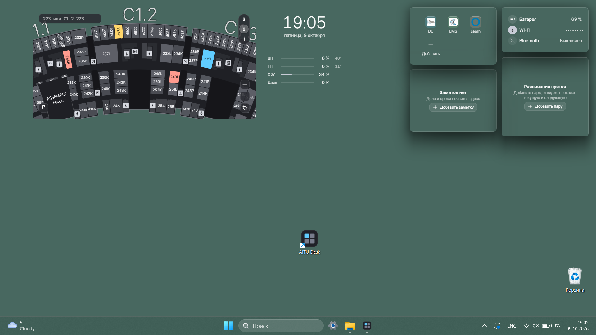
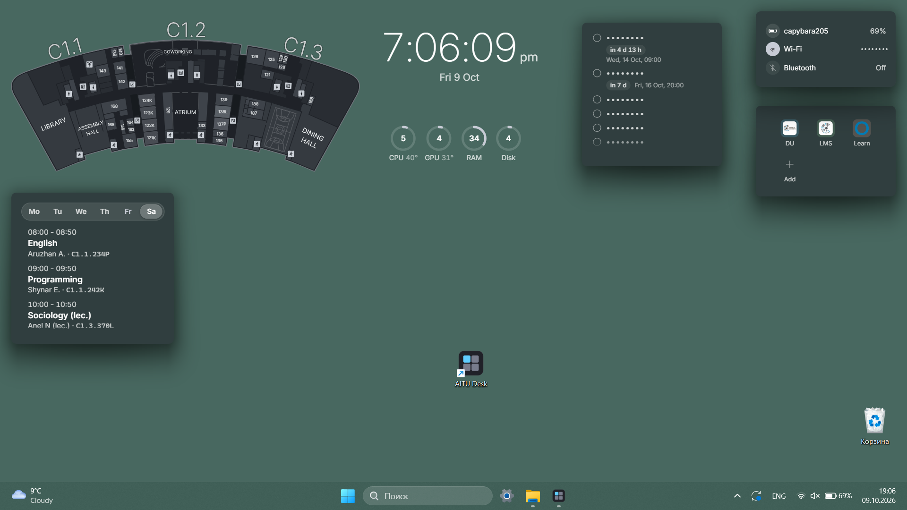
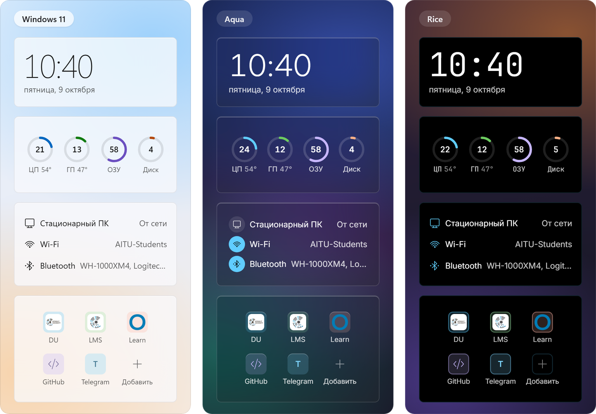
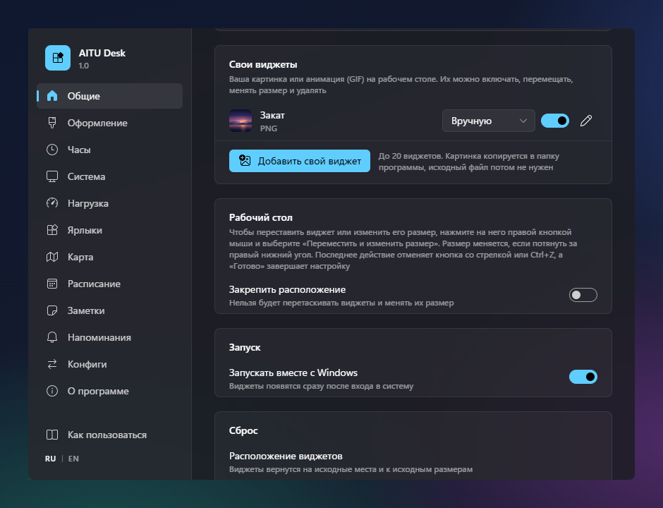
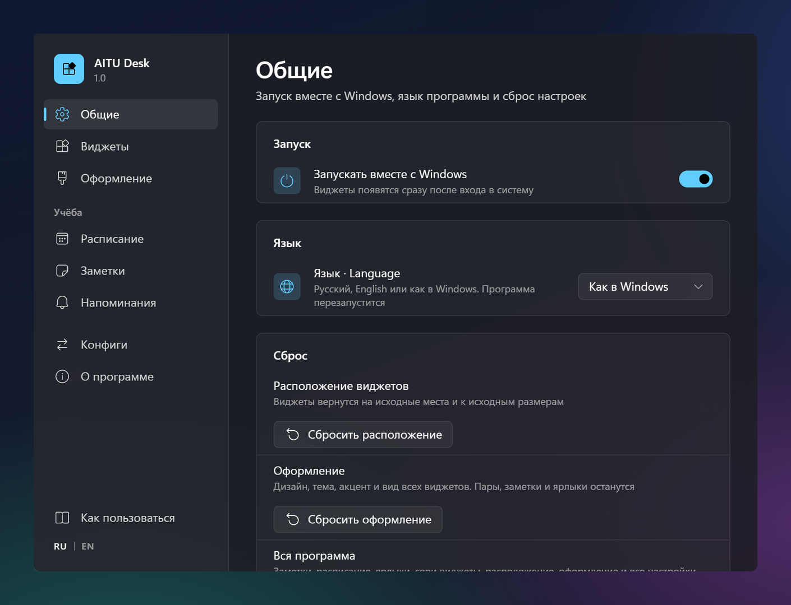
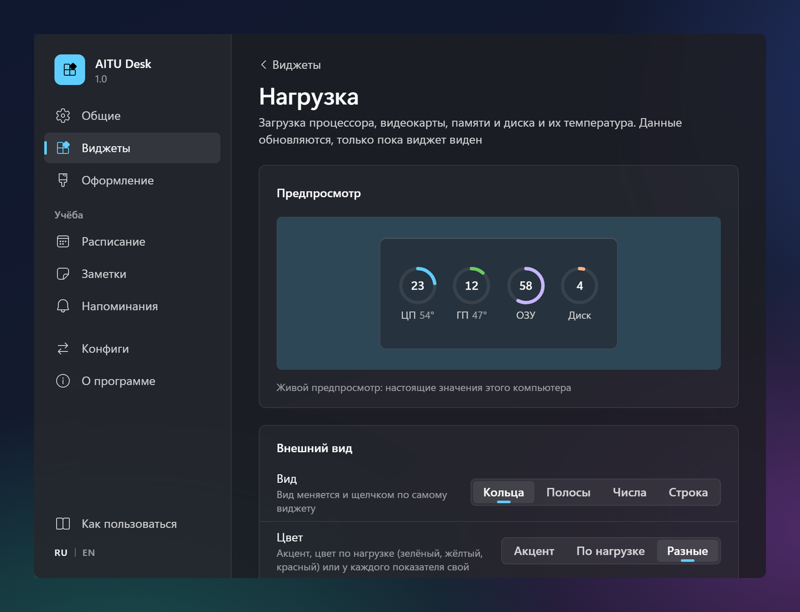
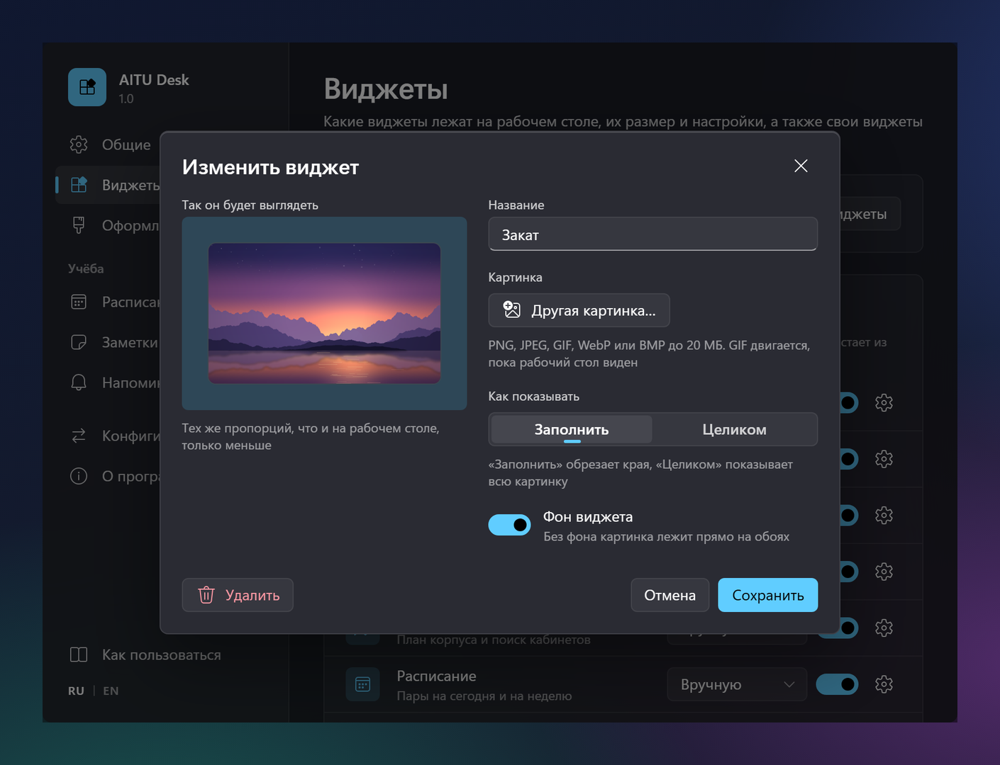

# AITU Desk

[English](README.md) · **Русский**


[](https://github.com/cyberbara01/aitudesk/releases/latest)
[](#установка)
[](README.md)
[](LICENSE)
[](#почему-ему-можно-доверять)
[](#установка)

**Виджеты на рабочий стол Windows 11 для студентов Astana IT University.** Часы, заряд и сеть, нагрузка компьютера,
ярлыки, заметки с дедлайнами, расписание пар, карта AITU и ваши картинки лежат прямо на обоях.

Всё настраивается в одном окне, на русском или английском. Приложение ничего никуда не отправляет и в покое почти не
нагружает процессор.

<br clear="left">

<p align="center">
  <a href="https://github.com/cyberbara01/aitudesk/releases/latest"></a>
</p>

<p align="center">
  
</p>

## Что внутри

<table>
<tr>
<td width="50%" valign="top"><br><b>Часы</b><br>Готовые стили и тонкая настройка: шрифт, размер, секунды, формат даты, фон</td>
<td width="50%" valign="top"><br><b>Система</b><br>Заряд батареи, Wi-Fi и Bluetooth. Имена сети и устройств можно скрыть</td>
</tr>
<tr>
<td width="50%" valign="top"><br><b>Нагрузка</b><br>Процессор, видеокарта, память и диск, их температура; четыре вида и свои цвета</td>
<td width="50%" valign="top"><br><b>Ярлыки</b><br>Сайты AITU с их настоящими иконками и свои: иконка сайта, из набора или буква, свой цвет</td>
</tr>
<tr>
<td width="50%" valign="top"><br><b>Заметки</b><br>Задачи с дедлайном и обратным отсчётом; добавляются и правятся прямо на виджете, порядок расставляется мышью</td>
<td width="50%" valign="top"><br><b>Расписание</b><br>Пары по дням недели, текущая и следующая подсвечены; пару можно добавить и изменить прямо на виджете</td>
</tr>
<tr>
<td width="50%" valign="top"><br><b>Напоминания</b><br>Уведомления Windows перед парой и дедлайном, тихие часы</td>
<td width="50%" valign="top"><br><b>Карта AITU</b><br>Этажи университета, поиск кабинета, шесть цветовых схем или свой цвет, цвет и толщина номеров, прозрачность с проявлением под курсором, метки, приближение колесом или двумя пальцами</td>
</tr>
<tr>
<td width="50%" valign="top"><br><b>Свои виджеты</b><br>Ваша картинка или GIF на рабочем столе, до 20 штук</td>
<td width="50%" valign="top"><br><b>Оформление</b><br>Три дизайна и тонкая настройка: шрифт, формы, рамки, прозрачность. Темы, свой акцент, масштаб</td>
</tr>
<tr>
<td width="50%" valign="top"><br><b>Приватность</b><br>Текст на рабочем столе можно скрыть точками, как пароль</td>
<td width="50%" valign="top"><br><b>Конфиги</b><br>Все настройки в одном файле: на другой компьютер или другу</td>
</tr>
</table>

Не учитесь в AITU? Всё, кроме карты, пригодится и вам, а карту и ярлыки университета можно выключить.

## Как это работает

<table>
<tr>
<td width="33%" valign="top" align="center"><br><b>Прямо на обоях</b><br><sub>Карта слева вверху, часы и нагрузка посередине, остальное справа. Двигайте и меняйте размер как удобно</sub></td>
<td width="33%" valign="top" align="center"><br><b>Правая кнопка мыши</b><br><sub>Переместить, изменить размер (всё внутри растёт вместе с виджетом), свернуть в значок, открыть настройки</sub></td>
<td width="33%" valign="top" align="center"><br><b>Значок, который вырастает</b><br><sub>Маленький и средний виджет лежат значком, по щелчку он вырастает в карточку посередине экрана</sub></td>
</tr>
<tr>
<td width="33%" valign="top" align="center"><br><b>Добавить и поправить на месте</b><br><sub>«+» в конце расписания и заметок, карандаш у пары или заметки под курсором</sub></td>
<td width="33%" valign="top" align="center"><br><b>Карта AITU</b><br><sub>Поиск кабинета (223 или C1.2.223), этажи, свои цветные метки; может быть полупрозрачной, пока на неё не навели</sub></td>
<td width="33%" valign="top" align="center"><br><b>Три дизайна</b><br><sub>Windows 11, Aqua и Rice, пять тем, свой акцентный цвет и тонкая настройка каждой части</sub></td>
</tr>
</table>

## Скриншоты

Тот же ноутбук на английском: карта целиком, часы с секундами, нагрузка кольцами, заметки скрыты точками, в
расписании пары на субботу.

<p align="center">
  
</p>

Три дизайна, одни и те же виджеты: Windows 11 (светлая тема), Aqua (стекло) и Rice (чёрная). Любой дизайн сочетается
с любой темой и акцентным цветом.

<p align="center">
  
</p>

Виджет, свёрнутый в значок, вырастает в карточку посередине экрана, а остальной стол остаётся как был.

<p align="center">
  
</p>

Окно настроек:

<p align="center">
  
  
</p>
<p align="center">
  
  
</p>
<p align="center">
  
  
</p>
<p align="center">
  
  
</p>

## Установка

1. Скачайте `AITU-Desk_<версия>_x64-setup.exe` из [последнего релиза](https://github.com/cyberbara01/aitudesk/releases/latest) и запустите.
2. Если Windows покажет «Система Windows защитила ваш компьютер», нажмите «Подробнее», затем «Выполнить в любом
   случае». Предупреждение появляется, потому что установщик пока не подписан: проект подал заявку на бесплатную
   подпись от SignPath Foundation, подробнее в разделе [«Подпись кода»](#подпись-кода).
3. Откроется окно настроек с короткой инструкцией, а виджеты появятся на рабочем столе. Дальше они запускаются вместе
   с Windows, это выключается в «Общих».

Нужна Windows 11, 64 бита. Интерфейс на русском или английском, как в Windows; язык меняется в «Общих» или кнопкой
«RU | EN» внизу окна настроек.

<details>
<summary><b>Как проверить, что установщик настоящий</b></summary>
<br>

Рядом с установщиком в релизе лежит `SHA256SUMS.txt`. Сравните его с хешем скачанного файла в PowerShell:

```powershell
Get-FileHash ".\AITU-Desk_1.0.0_x64-setup.exe" -Algorithm SHA256
```

Сборку делает [`.github/workflows/release.yml`](.github/workflows/release.yml) из исходников этого репозитория.
</details>

<details>
<summary><b>Что делает установщик и где хранятся данные</b></summary>
<br>

| Что | Где |
| --- | --- |
| Программа `aitudesk.exe` и деинсталлятор `uninstall.exe` | `%LOCALAPPDATA%\AITU Desk\` |
| Ярлык в меню «Пуск» и, если оставить галочку, на рабочем столе | меню «Пуск», рабочий стол |
| Запись для удаления в «Установленных приложениях» | `HKCU\Software\Microsoft\Windows\CurrentVersion\Uninstall\AITU Desk` |
| Настройки, пары, заметки, ярлыки, расположение виджетов (обычный JSON) | `%APPDATA%\kz.edu.astanait.aitudesk\settings.json` |
| Копии картинок ваших виджетов | `%APPDATA%\kz.edu.astanait.aitudesk\widgets\` |
| Служебный кеш WebView2 | `%LOCALAPPDATA%\kz.edu.astanait.aitudesk\EBWebView\` |
| Автозапуск (включён с первого запуска, переключатель в «Общих») | значение `AITU Desk` в `HKCU\Software\Microsoft\Windows\CurrentVersion\Run` |

Больше установщик ничего не делает: никаких служб, драйверов, заданий планировщика, расширений браузера и
программ в нагрузку. WebView2 уже есть в Windows 11; только если его нет, установщик скачает его у Microsoft.

Файл настроек открывается в Блокноте. Если после правки он перестанет читаться, приложение его не сотрёт, а
переименует в `settings.broken-<время>.json`.
</details>

<details>
<summary><b>Сеть и приватность</b></summary>
<br>

- Сеть нужна, только когда вы сами что-то делаете: открываете ярлык в браузере или добавляете и меняете ярлык (один
  раз скачивается иконка сайта: запрос к самому сайту и, если иконки нет, к сервису иконок Google, которого никогда
  не спрашивают про локальные имена). Иконки DU, LMS и Learn встроены. Сайт не может перенаправить эти запросы на
  устройства вашей домашней сети.
- Расписание, заметки, имя сети Wi-Fi и названия Bluetooth-устройств на рабочем столе можно скрыть точками.
- Температуру процессора даёт Windows там, где может (в основном на ноутбуках). На большинстве настольных ПК Windows
  её не даёт, а драйвер для этого приложение не ставит: оно читает температуру у программы мониторинга, которую вы и
  так запускаете (LibreHardwareMonitor, HWiNFO, Core Temp, MSI Afterburner или AIDA64), и только на этом компьютере.
- В конфиг попадают только выбранные вами части, а заметки и свои виджеты по умолчанию не попадают. Ярлыки из чужого
  конфига принимаются только с адресами `http://` и `https://`, а картинки только если это действительно картинки.
</details>

<details>
<summary><b>Удаление</b></summary>
<br>

Параметры → Приложения → Установленные приложения → AITU Desk → Удалить. Галочка «Удалить данные приложения» стирает
и настройки; без неё они остаются на случай повторной установки. Перед удалением всё можно сохранить в конфиг в
разделе «Конфиги». Чтобы начать заново без удаления, кнопка «Сбросить всё» внизу «Общих» вернёт приложение в
состояние сразу после установки.
</details>

## Почему ему можно доверять

- **Открытый код** под лицензией MIT: всё, что делает приложение, есть в этом репозитории.
- **Ничего не отправляет**: ни телеметрии, ни рекламы, ни аккаунтов, ни автообновлений.
- **Не нужны права администратора**, ставится только для вашей учётной записи.
- **Собирается на GitHub**: установщик каждого релиза собирает GitHub Actions из исходников, рядом лежат контрольные
  суммы.
- **Лёгкое**: установщик около 3 МБ, а в покое приложение почти не нагружает процессор.

**Приватность.** Программа ничего не передаёт по сети, если об этом не попросил сам пользователь или тот, кто её
устанавливает и запускает. Что и когда она запрашивает из сети, описано в «Сеть и приватность» в разделе
[«Установка»](#установка).

## Ссылки

| Что | Где |
| --- | --- |
| Скачать | [Последний релиз](https://github.com/cyberbara01/aitudesk/releases/latest) |
| Ошибка или идея | [Issues](https://github.com/cyberbara01/aitudesk/issues) или Telegram [@capybara205](https://t.me/capybara205) |
| Оценить приложение | [Анонимная форма](https://forms.gle/LV7BYCqeveRyRm9YA): хватит одной оценки от 0 до 10 |
| Автор | [@cyberbara01](https://github.com/cyberbara01) |
| Карта AITU | проект [aitumap](https://github.com/Yuujiso/aitumap) от [Yuujiso](https://github.com/Yuujiso) |
| Сторонние компоненты | [THIRD-PARTY-NOTICES.md](THIRD-PARTY-NOTICES.md) |

<details>
<summary><b>Сборка из исходников</b></summary>
<br>

Нужны Node.js 22+, Rust (stable) и, по [инструкции Tauri](https://tauri.app/start/prerequisites/), Microsoft C++
Build Tools (или mingw-w64 для цели `x86_64-pc-windows-gnu`).

```bash
npm install
npm run tauri dev      # запуск в режиме разработки
npm run tauri build    # установщик в src-tauri/target/release/bundle/nsis/
```

Для проверки без ноутбука есть переменные окружения: `AITUDESK_MOCK_POWER` (`none` | `78` | `15,charging` | `40,saver`),
`AITUDESK_MOCK_WIFI` (`off` | `SSID,bars` | `hidden,bars`), `AITUDESK_MOCK_BT` (`off` | `none` | `A;B;C`).

Внутри: Tauri 2, Rust, React 18, TypeScript и Vite. Все виджеты работают в одном процессе WebView2, часы
просыпаются раз в минуту, если секунды не показаны, а скрытые и свёрнутые в значок виджеты не держат таймеров.
Пока окно программы закрывает весь экран, нагрузка не считывается, а GIF замирают. В режиме экономии заряда Windows
часы прячут секунды, заряд, сеть и нагрузка проверяются реже, а GIF замирают. Без прозрачности виджеты обходятся
без акрила, и видеокарте легче.

[](https://tauri.app)
[](https://www.rust-lang.org)
[](https://react.dev)
</details>

## Лицензия

[MIT](LICENSE): пользуйтесь, меняйте и делитесь, сохраняя имя автора. Сторонние компоненты (карта, иконки, шрифты)
перечислены в [THIRD-PARTY-NOTICES.md](THIRD-PARTY-NOTICES.md).
